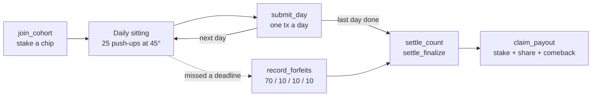
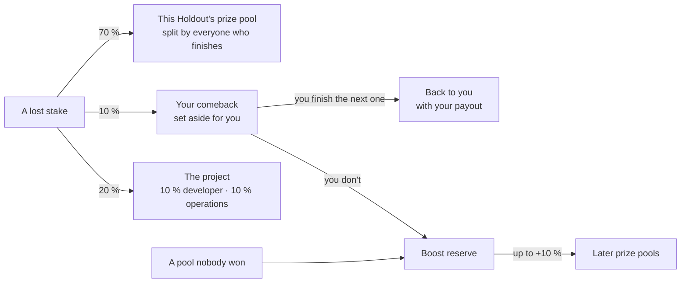

<p align="center">
  
</p>

<p align="center">
  <b>Be the holdout. Stake on yourself.</b><br>
  25 push-ups a day, counted by your phone. Stake SKR with everyone who starts on Monday.<br>
  Finish, and take your stake back plus a share of what the others lost.
</p>

<p align="center">
  
  
  
  
  
  
  
</p>

Holdout is a Solana Mobile app where you stake on yourself. Anyone can do the free **Daily 25**:
25 push-ups, counted on the phone, that build a streak. On top of it sit **Holdouts**, 7-day and
21-day runs with a stake in SKR. Miss a day and your stake goes to the people still standing.
Finish, and you get your stake back plus a share of the pool.

Built for the Solana Mobile **CLOCK IN** hackathon.

| | |
|---|---|
| **Now** | **Devnet.** Test SKR, the whole cycle working end to end: the contract, the crank, the app and short *Hackathon* rounds anyone with a Seeker can run in half an hour. |
| **Next** | **Mainnet, real SKR, real stakes.** The Seeker Genesis Token check moves into the contract, the faucet goes, the upgrade authority is revoked and the operator keys are split. See [Known weaknesses](#known-weaknesses): each one is written down with its real fix. |

## Contents

[What makes it different](#what-makes-holdout-different) ·
[How it works](#how-it-works) ·
[Where a lost stake goes](#where-a-lost-stake-goes) ·
[Privacy](#privacy-what-we-never-collect) ·
[Rep counting](#how-push-ups-are-counted) ·
[On chain](#on-chain-and-off-chain) ·
[Install](#install-and-run) ·
[Quality](#quality-and-verification) ·
[Known weaknesses](#known-weaknesses) ·
[Docs](#documentation)

<!-- screenshots: uncomment once the files in docs/images/ exist (see docs/images/README.md)
<p align="center">
  
  
  
  
  
</p>
-->

## What makes Holdout different

- **Your phone counts every rep.** An on-device AI model watches the push-up and a written rule
  decides what counts. Nobody reports their own reps.
- **Rules tuned on real recordings.** A separate tester app, Holdout Lab, records labelled sets
  (knees, toes, cobras). Every rule change is replayed against all of them before it ships.
- **Money moves only when someone misses a day.** Nobody pays to take part. If everyone finishes,
  everyone gets exactly their stake back.
- **A fall is not the end.** 10 % of a lost stake is set aside for that member. They finish the next
  Holdout of the same kind and get it back, in full.
- **80 % of every lost stake stays with members.** 70 % goes to this Holdout's prize pool and 10 %
  to the member's own comeback. 20 % runs the project. The contract enforces it.
- **Discipline ranks you, money never does.** Leaderboards rank by the share of Holdouts you
  finished.
- **Private by design.** No microphone. No video or body data ever leaves the phone. The build
  fails if a microphone permission appears.
- **Native on Seeker.** Mobile Wallet Adapter with Seed Vault, the Seeker Genesis Token as the key
  to Holdouts, and Seeker ID (`.skr`) names in the roster.
- **No oracle, and no one can hold the money.** The contract never reads a price. The admin sets
  up the levels and the operator prices the chips. Every step that moves a Holdout forward
  (opening it, recording missed days, settling, releasing a comeback) follows the contract's rules
  and can be sent by any wallet. Our crank does it on a schedule, how often depends on the
  environment, but if it stopped, anyone could finish the job.

## How it works

| | The Daily 25 | Spark · 7-day | Habit · 21-day | Hackathon · 3-day |
|---|---|---|---|---|
| | *All at once, or 10 at a time* | *Light it up · knees allowed* | *Make it stick · toes only* | *A quick taste* (devnet only) |
| Stake | Free | SKR | SKR | Test SKR |
| Days × reps | Every day × 25 | 7 × 25 | 21 × 25 | 3 × 5, 10-minute days |
| Knee push-ups | Count | Count | Don't count | As its level |
| Starts | Any time | Mondays 05:00 UTC | Mondays 05:00 UTC | Every 30 minutes |
| Needs | A Solana wallet | A Seeker | A Seeker | A Seeker |

- **Join** by picking one of four chips (≈ $10 / $25 / $50 / $100 in SKR). Joining and leaving
  close one hour before the start. Until then, leaving is a full refund.
- **Do 25 push-ups a day**, all at once or in blocks of 10. Every 10 are banked for good. When the
  day is done, your wallet signs one transaction.
- **Miss a day** and your stake is lost. The crank records it, by chain time, not your phone's clock.
- **Finish**, and once the Holdout settles, claim your stake plus your share.



More in [How it works](docs/how-it-works.md): the calendar, the Hackathon rounds, scripted members,
Seeker gating, the four tabs and the faucet.

## Where a lost stake goes



**80 % comes back to members. The rest runs Holdout.**

- **The prize pool** is shared by finishers in proportion to their stake:
  `share = floor(pool × chip / total stake of finishers)`.
- **The comeback** is exact, never "up to": `min(10 % of the lost stake, your new stake)`. It comes
  back when you finish the next Holdout of the same kind. Lost on the last day? Join the next one
  on its first day, or the one after.
- **The boost reserve** is filled only by comebacks nobody made good and by pools nobody won. It
  adds up to 10 % to a later pool that has a finisher.
- **If nobody drops out**, nobody pays anything: everyone gets exactly their stake back.

**Example.** Ten members stake 100 SKR each and three miss a day. The pool is 210 SKR, 30 SKR is
set aside as three comebacks, and 60 SKR goes to the project. Each of the seven finishers claims
**130 SKR**: their 100 back plus a 30 share. With 50 SKR in the boost reserve, the pool grows by 21
and each claims **133 SKR**.

The full rules, the rounding, and why a group can't farm the boost are in
[Economics](docs/economics.md).

## Privacy: what we never collect

| | |
|---|---|
| 🎥 **Video** | Never stored, never uploaded. Each frame goes to the on-device model and is dropped. |
| 🎙️ **Sound** | Never recorded. There is no microphone permission, and `checkNoAudioPermission` fails the build if one appears. |
| 🧍 **Body data** | Landmarks live in memory during the sitting only. No trace is sent anywhere. |
| ⛓️ **On chain** | One `submit_day(day_index, proof_hash)` per completed day: no image, no landmark. |
| ☁️ **Backup** | Cloud backup and device transfer are off. |

The member app asks for four permissions: camera, internet, network state and notifications. There
is no Holdout server, no analytics SDK and no ad SDK. The counter's thresholds were tuned on a
separate, never-distributed tester app, **Holdout Lab**. It has no network access, its recordings
come only from people who agreed to be filmed, and none of its code is in the member app. Details in
[Privacy](docs/privacy.md).

## How push-ups are counted

The front camera feeds **MediaPipe Pose Landmarker** on the phone's GPU. A plain-Kotlin rule engine,
[`kotlin/repcounter`](kotlin/repcounter/), applies the rule to its 33 body landmarks:

1. **Top**: elbow above 160°, body straight within ±10°.
2. **Bottom**: elbow below 90°, body line held.
3. **Back to the top**, in 0.8–6 seconds.
4. **Habit only**: legs straight, on the toes. Knees on the floor don't count.

The phone stands on the floor at **45°** ahead of the shoulder. That is the one angle where the
camera can tell a push-up from the knees from one on the toes, so every sitting uses it.
Pre-flight checks (light, whole body, knees visible, angle), a held plank and a 3 · 2 · 1 countdown
come before the first rep. Refused reps get a coaching cue, never an error.

**Holdout Lab: where the rules are trained.** The rules come from a separate app, **Holdout Lab**
(`holdout.app.lab`). It runs exactly the same counting code. Testers who agreed to be filmed do
sets in it: honest push-ups, push-ups from the knees, cobras, half reps, different angles. Each rep
is then labelled, for example "from the knees" or "from the toes". The labelled recordings become
the fixtures in [`fixtures/rep-traces/`](fixtures/rep-traces/). Every rule change, such as where
"knees down" starts, is replayed against all of them before it ships. That way a fix that catches
knee push-ups can't quietly start refusing honest ones. Lab has no wallet and no network. It is
never given to members, and the member build fails if any Lab code reaches it.

More in [Rep counting](docs/rep-counting.md).

## On chain and off chain

| On chain: the [Holdout program](docs/contract.md) | Off chain |
|---|---|
| Every stake, pool and reserve, in program-owned vaults | Rep counting, on the phone |
| Schedule and deadlines, from chain time | The banked reps of a day in progress, on the phone |
| Each completed day (`submit_day`) | The Daily 25 and its streak, on the phone |
| The 70 / 10 / 10 / 10 split, the comeback, the boost | Reminders, scheduled on the phone |
| Settlement and claims | The crank: a loop calling the permissionless instructions |
| Leaderboard progress and Holdout streaks | Chip prices: operator input from the Jupiter Price API |
| The faucet's daily budget | Scripted members' wallets (Hackathon rounds only, labelled) |

**Program ID (devnet):**
[`Ho1d924DTXrCgVfbW1U2NkAc3rGk1F723weN8rduyoy4`](https://explorer.solana.com/address/Ho1d924DTXrCgVfbW1U2NkAc3rGk1F723weN8rduyoy4?cluster=devnet).
There are 15 instructions, and the accounts and the trust model are listed in
[Contract](docs/contract.md).

## Install and run

**Option A: the release APK.** _The signed APK will be attached to the repository's Releases._
Download it on the phone, allow the install, open it.

**Option B: build it yourself** (JDK 21 and the Android SDK; no keys needed):

```bash
git clone https://github.com/illia-loshchinin/holdout.git
cd holdout/kotlin
./gradlew :app:assembleMemberDebug
adb install -r app/build/outputs/apk/member/debug/app-member-debug.apk
```

Then connect a Mobile Wallet Adapter wallet **on devnet** and tap **Get test tokens** on **Me** for
test SKR and fee SOL. Holdouts need a Seeker holding a Seeker Genesis Token. To try one on another
phone, build with `-Pholdout.seekerGate=off` (debug only).

The signed release, the build options and troubleshooting are in
[Build and install](docs/build-android.md). The Solana side is in
[Development](docs/development.md).

## Quality and verification

| | |
|---|---|
| **≈ 1,780 Kotlin tests** | `:app` 1,265 (incl. Robolectric and Roborazzi screen tests), `:core` 229, `:repcounter` 150, `:crank` 143 |
| **≈ 300 contract tests** | TypeScript, `@solana/kit` + LiteSVM: 15 scenario suites and a randomised invariant checker |
| **65 Rust unit tests** | Settlement maths checked against golden vectors |
| **278 labelled reps** | From 27 recorded sets, replayed by a regression ratchet that fails on any change |

Every pull request has to pass four CI jobs: `program`, `anchor`, `contract-tests` and `kotlin`.
They include:

- rustfmt and clippy;
- a no-oracle guard;
- the committed IDL and Codama client must equal the build;
- ktlint and every JVM test;
- both debug APKs;
- the no-microphone and no-Lab-code guards;
- a wording guard against gambling language;
- this README's weaknesses table must equal `docs/weaknesses.json`.

GitHub Actions is off for this repository for now, so the same jobs run through
`bash scripts/ci-local.sh --report`. It sets a **CI (local)** commit status, which is the merge
gate. Every change is specified first (`specs/`), checked against a written
[constitution](.specify/memory/constitution.md), and reviewed before merge.

## Known weaknesses

Named on purpose: a judge, a tester or a future member should know where the build is weaker than
it looks. Each has its real fix beside it.

| What | Why it is like this | Real fix |
|---|---|---|
| Devnet with a mock SKR mint | Hackathon build; no real value at stake | Mainnet with real SKR |
| Seeker ID names and the Seeker Genesis Token are read from Solana mainnet | Seeker IDs (.skr names) and Seeker Genesis Tokens exist only on mainnet. The app reads both from the public mainnet RPC: Seeker ID names for display only, and the wallet's Seeker Genesis Token before a join. Everything else runs on devnet. Members without a Seeker ID, scripted members included, are shown by shortened address | Nothing to fix for the names: on mainnet the same lookup reads the same network. At mainnet launch the contract checks the Seeker Genesis Token itself (see the Seeker-exclusive row). A dedicated RPC provider would make first-time lookups of large lists faster |
| "Stake back" is true in SKR, not in dollars | Everything is SKR-denominated with no oracle in the contract | A known property of SKR-native staking, stated in the app |
| Staking is Seeker-exclusive, but on devnet the app enforces it, not the contract (`genesis_gate_enabled = false`) | Seeker Genesis Tokens exist only on mainnet, so the app checks the wallet's token on mainnet before it offers a join; a wallet that signs a join without the app is not stopped, and a wallet confirmed once is remembered on that phone | Two steps at mainnet launch: turn the flag on, and have the app send the member's Seeker Genesis Token account and its mint as `join_cohort`'s remaining accounts. The contract then checks the token on every join; that check is already written and tested |
| Non-default `day_seconds` for test cohorts — a **short test lobby kept running on devnet**, labelled and open to every Seeker owner, from which the demo video is recorded | Lets a single person run a whole cycle alone: three 10-minute days, a new cohort every 30 minutes (FR-044a, H36). Only one test league runs at a time, since streaks are written when a cohort is counted and two test leagues of different lengths could count a member's outcomes out of order on the combined test board | Admin-guarded; real cohorts always use 24 hours |
| A completed day's proof is client-signed | No backend in the build | Server-side attestation signer with pinned traces |
| Reps banked during the day (in blocks of 10), and a completed day waiting for network, live only on the phone | No wallet prompt mid-workout; a lost phone loses that day's partial progress, and a rooted phone could edit it. A day finished offline counts only if it reaches the network before the deadline | Covered by the attestation fix; cross-device progress later |
| Knee push-ups count in the Daily 25 and in Spark Holdouts, by design | The Daily 25 and Spark Holdouts **count push-ups from the knees on purpose** — a free habit, and a 7-day Holdout, for building strength; only Habit Holdouts refuse them. Every sitting is counted at 45° since 8 Oct, and the Daily 25 is held to the Spark set-up: until then it also accepted the phone head-on, where the legs and hips point into the lens and knee angle, knee and ankle height, hip height, torso angle and body line all read the same for knee push-ups as for honest ones (`fixtures/rep-traces/front-knees-01`), so it counted there what a Holdout refuses | Nothing to fix for the knees: the Daily 25 shows how many of the day's reps came from the toes, so a member can see how far they are from a Habit |
| At 45° the body line is checked only coarsely, and the knee rule is 'off the floor' | Recorded on the phone, honest planks read 152–167° at 45°, so the ±10° body-line rule cannot be measured there; a rep is refused only when its median body line folds below 140°. In staked sittings, knees are judged on the push back up, mainly by how high the knee and ankle stand above the hands (honest 0.44–0.65 arm-lengths, knees down 0.32–0.39, line at 0.41), with the knee angle (below 90°: a deep kneel, or the feet raised behind) as a second signal — a leg bent in the air is allowed. The lines were set on one person's recordings, with the phone at floor level; the margins are 0.03–0.05. A second person's knee push-ups read the legs over the 0.41 line (0.42–0.44; his honest reps 0.51–0.79), so the legs on the push are also judged against the member's own plank held through the countdown: under 0.66 of it is knees down (honest reps on every recording 0.70 or more, his knee reps 0.60–0.63). Knee push-ups filmed at a flatter angle, nearer head-on, read like honest reps. Knees are judged only while the elbow is above 100°, on the way down and on the push back up: at the bottom the landmarks read honest reps lower than push-ups from the knees (legs 0.27–0.43 against 0.42–0.65), so a rep pushed from the knees through the bottom and back on the toes by 100° is not caught | More recorded sets, especially 45° knee push-ups recorded on the phone; a lower-body classifier if the angle proves too loose |
| Loose trousers hide the knees from the pose model | In loose trousers the model cannot find the knee and puts it on the ankle, so nothing about the knee can be judged: a staked sitting does not start, and says so ("Can't see knees"). Measured on one person in loose white trousers — the knee unreadable in 60–67 % of frames, against 0–1 % for fitted clothing | Wear something fitted or roll the trousers up; the knee-on-the-floor image classifier would not depend on the knee landmark |
| A cobra is refused at 45°, but not in every case | Lying flat and pressing only the chest up, hips on the floor, counted at 45° until the body line was judged on the push back up (honest 157–174°, cobra 120–134°). A cobra done with the body nearly straight, and a rep pushed up from lying on the floor, passed that check; they are refused by how far the hips have risen half-way up the push against the shoulders (honest 0.92–1.06, those 0.63–0.87, line 0.90) — with a margin of 0.02–0.03, measured on two people; in a staked sitting a rep whose rise cannot be read is not credited. From further in front than about 35° that check does not hold, so no sitting starts there; the Daily 25 and Spark, which accept a body line straight to the ankle **or to the knee** (so knee push-ups with the feet raised count), stop at about 40°. Until 8 Oct the Daily 25 started further in front, and cobras got through there: 4 of 5 on one recording (`angled-mixed-03`). Not caught: a rep let down until the hips rest on the floor and pushed up straight in one piece — no landmark reading tells a hip on the floor from a deep honest bottom (four counted on 4 Oct) — and, on a second person whose head covered the near hand at the bottom, two cobras, because the near wrist was misplaced and every arm reading with it | The knee-on-the-floor image classifier, extended to hips on the floor; a wrist reading that holds when the head covers the near hand |
| No liveness check and no audio anti-spoofing in rep verification | The palm-liveness check was dropped on 22 September after the first sitting on real hardware: by the time the checks pass the member is face-down on the floor, and it asked them to lift a hand off it. Holding the top of a push-up starts the sitting instead — a readiness check, not a liveness one. So nothing here tells a live person from a video played to the lens, or one member from another. Microphone permission, which would, adds first-run friction and protects no real value on devnet | Reinstate the audio check and the audio rep condition together — one move restores liveness and anti-spoofing both |
| Stake chips (≈ $10 / $25 / $50 / $100) are priced in SKR by the Operator from an off-chain rate — **a trusted input**: by hand at launch, then re-priced every week, in the 4 hours before the week's cohorts open, by the Operator's `crank chips publish --auto`, which reads the **Jupiter Price API** (mainnet SKR mint) | The contract must never read a price | On-chain chip governance before real value is at stake |
| Cohorts are filled by real members first; scripted members — real wallets under the same contract rules, whose forfeits fund real prizes and whose completed days are **not camera-verified** — top a cohort up only to a minimum (20 members in a 7-day cohort, 12 in a 21-day one) | A cohort must never be empty when someone installs the app during judging | Disclosed here, in the app, in the demo video and in the pitch deck; their addresses are published in the build and every scripted member is labelled wherever it appears |
| A wallet is required before anything, even the Daily 25 | One identity from the first tap; guest mode was considered and dropped | The connect screen says how to get a wallet; the demo video, sent with the submission, shows the whole product without one |
| The full cycle is shown in the demo video, not inside the app | Nobody can wait 7 days to see a settlement; the submission is the app's final state, so it carries no recording or section for judges | The video is a recording of the real app against the real devnet contract, on a labelled short test Holdout, which any wallet holding a Seeker Genesis Token can also join and run in about half an hour |
| The faucet's fee sponsor key ships inside the app | A wallet with zero SOL cannot pay for its own first transaction, and there is no server to sign for it | Anyone can extract the key, and empty the 0.05 SOL float it holds, so the contract bounds that instead of assuming it will not happen: no wallet is limited (a tester who runs out may claim again), but a single daily budget of 0.72 SOL covering **every** lamport that leaves the faucet — top-ups and reimbursements alike — and a permissionless refill, so a drained sponsor is restored by the next crank pass rather than ending onboarding. Real fix: no faucet on mainnet, or a rate-limited relayer |
| The program keeps its upgrade authority during judging | A defect found while cohort #3 holds real test stakes must be fixable | Used only for defect fixes that change no existing cohort, account layout or fund movement. Real fix: revoke the authority once the contract is final |
| The fee funds a comeback pledge, a developer share and operations by rule, but the developer and operations shares are ordinary wallets | Of every forfeited stake, 10% is set aside as the forfeiting member's own comeback, in the league's reserve vault, which only the program can move (a comeback nobody makes good, and the pool of a Holdout nobody finished, feed that league's boost reserve there), and 10% and 10% go to the developer and operations wallets named in this README (H35; re-split 2026-10-12, H39). What those two wallets then do with it is not enforced by the contract | Publish both wallets' addresses and their spending; later, move operations spending on chain or under a multisig |
| Spark Holdouts count push-ups from the knees on thin evidence | Knees-allowed counting at 45 degrees was measured on about 26 recordings from mostly one person: 87% of honest knee reps counted, 3 of 56 cobras slipped through - 2 of them filmed at about 30 degrees, which the Spark camera check now refuses (H35) | Record at least 3 people, 100 knee reps and cobras at 30-60 degrees, and replay them before any real money rides on Spark |
| A Daily 25 done before the phone has ever read chain time is dated afterwards, from the phone's own uptime clock | The Daily 25 needs no connection, but a day is chain time (05:00 UTC), never the phone's clock. The last chain reading is kept, so this only happens after a reboot with no network since. Several such sittings are dated together, from the latest one's start; reps done offline across a reboot stay undated | Keep one record per offline sitting and date each separately |
| Reminders are on-device only — no push | No server knows anyone's deadlines. The phone schedules a reminder when a Holdout starts, halfway through each day (with sound) and before its deadline (silently), from chain time, and a day you have done that is not on chain yet stays in the notification shade and is re-posted silently every hour until it is submitted (FR-068). A Holdout you finished gets one notice 15 minutes after its end, when settlement usually has come; it does not check the chain, so it says your claim is *probably* ready (FR-068b). Android may deliver them a few minutes late, not at all after a restart until the app is opened, and never if notifications are declined. The deadline is the chain's, never the reminder's | A push service fed by the chain, alongside the on-device reminders |
| One key, `operator.json`, is both the crank's fee payer and the only key that can publish the chip set, and it sits as a hot secret on the Fly machine that runs the crank (and in the GitHub Actions fallback) | Opening a cohort every 30 minutes needs a funded payer. A separate payer key was considered and the product owner decided against it (2026-10-11, L14), so this is an accepted risk of the devnet build, not an oversight. Whoever takes the key can re-price the stakes of every Holdout not yet open and spend its float. Worse, it can publish one chip set with an enormous top tier: the program keeps the highest top tier ever published (`max_top_tier` only rises) and the faucet mints exactly that much per claim, and `Config.operator` has no rotation instruction. The faucet then mints absurd amounts or fails, new wallets lose their way to SKR, and only a program upgrade undoes it. The same machine and the GitHub Actions fallback also hold the keypairs of the 56 scripted members (`HOLDOUT_SCRIPTED_KEYS_TGZ_B64`), so a compromise can stop their submissions (forfeits that move real pools), join or leave, and claim their payouts. What it cannot do is touch a real member's stake or a settled payout, which only the program moves | A payer key of its own holding only the float, an operator key kept off the machine (or a multisig), an operator rotation instruction and a cap on the top tier, and the scripted keys held apart, for the mainnet build |

## Documentation

| Page | What is in it |
|---|---|
| [How it works](docs/how-it-works.md) | The Daily 25, Spark, Habit and Hackathon rounds, the calendar, Seeker gating, scripted members, the app's tabs, the faucet |
| [Economics](docs/economics.md) | The split, shares, rounding, the comeback, the boost, worked examples |
| [Rep counting](docs/rep-counting.md) | The pose pipeline, the rule, 45°, Spark vs Habit, how it is tested |
| [Privacy](docs/privacy.md) | What is processed, stored and sent; permissions; build guards; Holdout Lab |
| [Contract](docs/contract.md) | Program ID, instructions, accounts, lifecycle, off-chain parts, trust model |
| [Build and install](docs/build-android.md) | Debug and signed release APKs, `adb install`, build options, troubleshooting |
| [Development](docs/development.md) | Repository map, the Solana toolchain, CI, guards, how changes are made |
| [`docs/holdout_decisions.md`](docs/holdout_decisions.md) | The decision record: why the build is what it is, and what was rejected |
| [`specs/001-holdout-hackathon/`](specs/001-holdout-hackathon/spec.md) | The product spec, with its plan, tasks, data model, contracts and quickstart |
| [`docs/design/`](docs/design/README.md) | The design book: tokens, components, voice and naming |

When documents disagree: constitution → spec → decision record.

## License

© 2026 Illia Loshchinin. All rights reserved. The source is public for review and judging only.
See [LICENSE](LICENSE).
