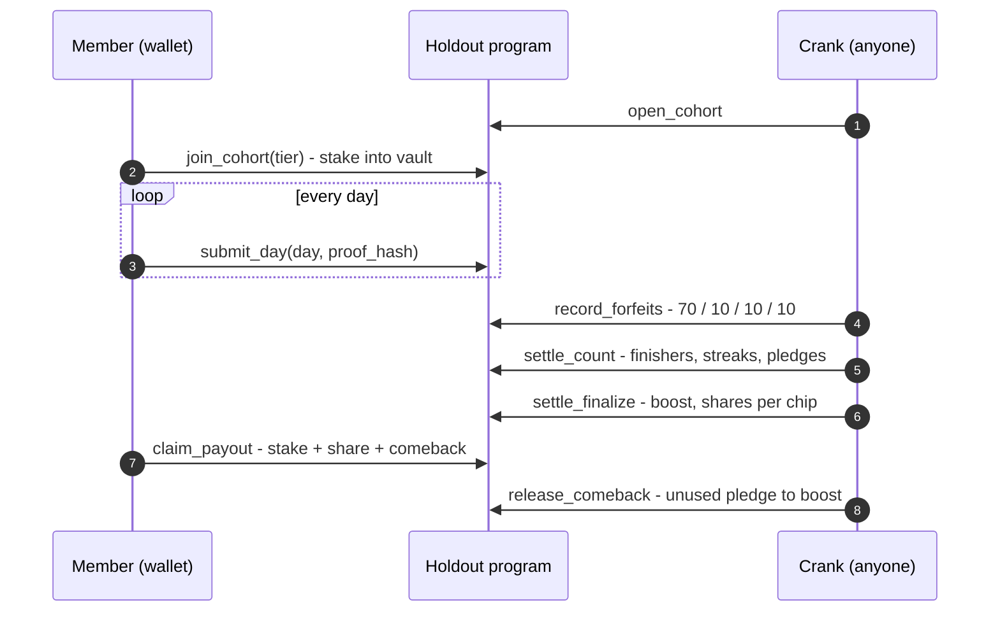

# The Solana program

[← README](../README.md) · [Economics](economics.md) · [Development](development.md)

| | |
|---|---|
| Program ID | [`Ho1d924DTXrCgVfbW1U2NkAc3rGk1F723weN8rduyoy4`](https://explorer.solana.com/address/Ho1d924DTXrCgVfbW1U2NkAc3rGk1F723weN8rduyoy4?cluster=devnet) |
| Cluster | Devnet |
| Framework | Anchor 1.1.2, Solana (Agave) 3.1.10 |
| Source | [`programs/holdout/`](../programs/holdout/src/lib.rs) |
| IDL | [`idl/holdout.json`](../idl/holdout.json). CI checks it matches the build. |
| Client | Codama-generated TypeScript in [`tests/clients/holdout/`](../tests/clients/holdout/), and a hand-written Kotlin client in [`kotlin/core`](../kotlin/core/) |
| Token | SKR, an SPL token. On devnet it is a test mint with no value. |

The program holds every stake, every pool and every reserve in program-owned vaults. No person,
including the operator and the developer, can move a member's stake or a prize pool. Only the
program's rules move them.

## Instructions

| Instruction | Who signs | What it does |
|---|---|---|
| `initialize` | Upgrade authority, once | Sets the operator, fee sponsor, destinations and faucet budget |
| `create_league` | Admin | Creates a league (Spark, Habit, or a test league in a `test-leagues` build). Real leagues must start on a Monday at 05:00 UTC. |
| `publish_chip_set` | Operator | Publishes four SKR stake amounts and the time from which the set is refused. Never a price. |
| `open_cohort` | **Anyone** | Opens the next Holdout of a league. The caller pays only the rent. |
| `join_cohort(tier)` | Member | Stakes the chip of that tier into the Holdout's vault. Checks the Seeker Genesis Token when the gate is on. Allows the late join of a member's comeback round. |
| `leave_cohort` | Member | Full refund, while joining is open |
| `submit_day(day_index, proof_hash)` | Member | Records one completed day before that day's deadline. The proof hash is emitted, not stored. |
| `record_forfeits` | **Anyone** | Finds missed days from chain time and splits each lost stake 70 / 10 / 10 / 10. Paged and repeatable. |
| `settle_count` | **Anyone** | Counts finishers, writes streaks and moves comeback pledges into the league's reserve vault. Paged. |
| `settle_finalize` | **Anyone**, once | Applies the boost, then computes one share per chip in constant time. A Holdout with no finishers sends its pool to the boost reserve. |
| `release_comeback` | **Anyone** | Moves a comeback pledge that can no longer be made good into the boost reserve |
| `claim_payout` | Member | Pays stake + share + comeback. Never expires. |
| `claim_faucet(recipient)` | Fee sponsor | A zero-SOL wallet's first transaction: test SKR plus fee SOL, within the daily budget |
| `top_up_sponsor` | **Anyone** | Refills the fee sponsor from the faucet's own funds |
| `set_flags(genesis_gate_enabled)` | Admin | Turns the on-chain Seeker Genesis Token check on or off |

Every instruction marked **Anyone** is permissionless. The Holdout lifecycle doesn't depend on any
one party: if the crank stopped, anyone could run the same passes.

## Accounts

| Account | Holds |
|---|---|
| `Config` | Operator, fee sponsor, developer and operations destinations, the faucet and its daily budget, the current chip set, `genesis_gate_enabled` |
| `LeagueConfig` | One per league: schedule (first start, cadence, day length, join lock), form (knees allowed or toes only), reps per day, `comeback_reserve`, `boost_reserve` and the reserve vault |
| `Cohort` + vault | One Holdout: its copied rules and chip set, counters, pool, settlement shares. Its SKR vault is owned by the program. |
| `Membership` | One member in one Holdout: tier, days submitted, status, any comeback owed |
| `Profile` | One per member: per-league progress (streaks, Holdouts played and finished, an open comeback pledge and its rounds) |

A Holdout copies every rule from its league when it opens, so a running Holdout's rules can never
change under its members.

## Lifecycle

## Off-chain parts

| Part | What it does | Trust |
|---|---|---|
| **Crank** ([`kotlin/crank`](../kotlin/crank/); a loop packaged for Fly.io, with a GitHub Actions fallback; how often it runs depends on the environment) | Opens Holdouts, records forfeits, settles, releases comebacks, tops up the sponsor, runs scripted members | Every pass except chip pricing is permissionless |
| **Chip pricing** (`crank chips publish --auto`) | Reads the SKR price from the Jupiter Price API once a week and publishes four SKR amounts | Trusted operator input. The contract never reads a price. |
| **The app** | Counts reps, signs through Mobile Wallet Adapter, reads chain state | A completed day's proof is client-signed |
| **Reminders** | Scheduled on the phone from chain time | No server |

## Trust model, plainly

- **A completed day is client-signed.** The program trusts the member's wallet that the day was
  done. A server-side attestation signer is the real fix.
- **The program keeps its upgrade authority during judging**, so a defect can be fixed. It is to
  be revoked once the contract is final.
- **One operator key** publishes chip sets and pays crank fees. It can't touch a member's stake or
  a settled payout.

The full list, each with its real fix, is in the README's
[Known weaknesses](../README.md#known-weaknesses).

## Tests

- **66 Rust unit tests** in the program. The settlement maths is checked against golden vectors
  in [`fixtures/settlement-vectors.json`](../fixtures/settlement-vectors.json).
- **About 300 contract tests** in [`tests/`](../tests/) (TypeScript, `@solana/kit` + LiteSVM):
  15 scenario suites (join and leave, forfeits, settlement, reserves, comeback joins, faucet,
  sponsor float, leaderboard, no-oracle and more), plus a randomised invariant checker.
- The exact instruction contract is in
  [`specs/001-holdout-hackathon/contracts/program-instructions.md`](../specs/001-holdout-hackathon/contracts/program-instructions.md).
