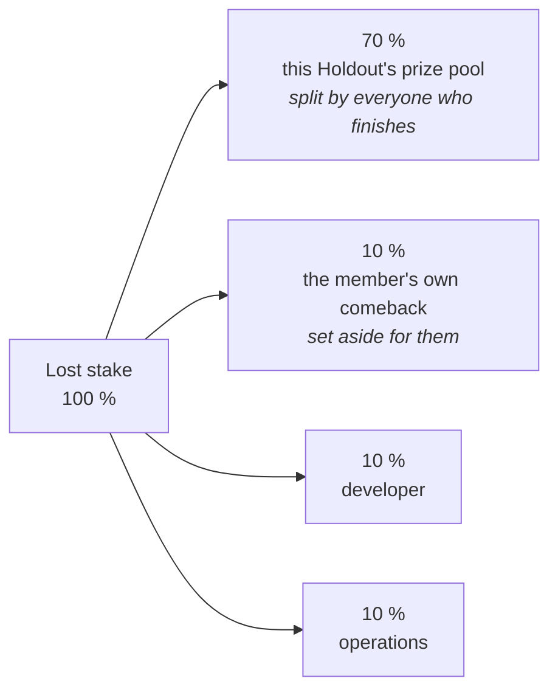
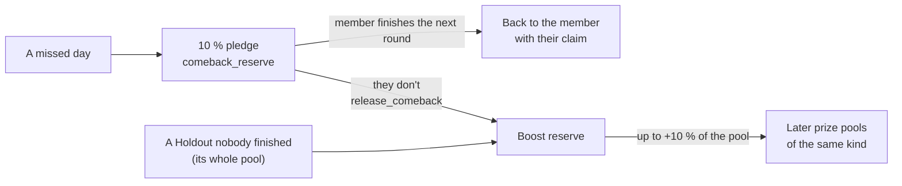

# Economics: where every SKR goes

[← README](../README.md) · [How it works](how-it-works.md) · [Contract](contract.md)

Holdout moves money for one reason only: someone missed a day. Nobody pays to take part.
If everyone in a Holdout finishes, everyone gets exactly their stake back, to the last base unit.

All of this is enforced by the Solana program. The numbers below are the program's constants in
[`programs/holdout/src/math/settlement.rs`](../programs/holdout/src/math/settlement.rs). The same
file is tested against the golden vectors in
[`fixtures/settlement-vectors.json`](../fixtures/settlement-vectors.json).

## The split of a lost stake

When a member misses a day, their whole stake leaves them. It is split like this:



| Part | Share | Who can move it | When |
|---|---|---|---|
| Prize pool | 70 % | The program, to finishers' claims | At settlement |
| Comeback pledge | 10 % | The program only, to that same member or to the boost reserve | Counted at settlement, paid on a later claim |
| Developer | 10 % | Developer wallet | At once, when the forfeit is recorded |
| Operations | 10 % (and every rounding remainder) | Operations wallet | At once, when the forfeit is recorded |

**80 % stays with members. 20 % goes to the project.**

In code, the fee is `floor(30 % × stake)` (`FEE_PERCENT = 30`) and the pool takes the rest. Inside
the fee, the comeback (`COMEBACK_PERCENT = 10`) and the developer part (`DEVELOPER_PERCENT = 10`)
are each rounded down. Operations takes what is left, so the parts always add back to the stake.
For a stake of 101: pool 71, comeback 10, developer 10, operations 10.

## Finishing: stake back plus a share

At the end of a Holdout, every finisher can claim:

```
payout = own stake + share of the pool for their chip + comeback (if they have one)
```

The pool is shared **in proportion to stake**. A Holdout has exactly four chip sizes, so the
program computes one share per chip rather than one per member, and settlement takes constant time:

```
share_for_chip = floor(pool × chip / total stake of all finishers)
```

Rounding down leaves a few base units over; they go to operations. Claims never expire, and
nobody can claim for you. Your wallet signs your own claim.

## The comeback: 10 % set aside for you

The comeback is how Holdout treats a member who fell off.

1. You miss a day. 10 % of your stake is **pledged to you**. It is not shared with anyone.
2. When settlement counts your forfeit, the pledge moves into the program's reserve vault for that
   kind of Holdout, booked under `comeback_reserve`. No boost can ever spend it.
3. You join **the next Holdout of the same kind** (Spark after a Spark, Habit after a Habit) and
   finish it. Your claim then includes the pledge, in full:
   `min(10 % of the lost stake, your new stake)`.
4. Missed the **last day**? The next Holdout has already closed for joining. You can still join it
   late, until the end of its first day, or take the one after it. Finishing either brings the
   pledge back.
5. If you don't finish it, anyone (in practice, the crank) can call `release_comeback` once that
   round is settled. The pledge then joins the **boost reserve**.

The amount is exact. The app says "Win back 250 SKR", never "up to".

## The boost: what nobody used

Each kind of Holdout (Spark, Habit, and the Hackathon rounds) has its own **boost reserve**, held
by the program. It is filled from two sources only:

- comeback pledges that nobody made good;
- the whole pool of a Holdout that **nobody** finished.

When a Holdout with at least one finisher settles, its pool gets
`min(10 % of its own pool, boost reserve)` (`BOOST_CAP_PERCENT = 10`) before shares are computed.
A Holdout where nobody dropped out has no pool, so it gets no boost, and "everyone finishes,
exactly your stake back" still holds.



## Two worked examples

**Ten members, 100 SKR each, three miss a day, empty boost reserve.**

| | SKR |
|---|---|
| Lost stakes | 3 × 100 = 300 |
| Prize pool (70 %) | 210 |
| Comeback pledges (10 % each, one per member who missed) | 3 × 10 = 30 |
| Developer + operations (10 % + 10 %) | 60 |
| Finishers' total stake | 7 × 100 = 700 |
| Share per finisher | floor(210 × 100 / 700) = **30** |
| **Each finisher claims** | 100 + 30 = **130** |

If one of the three finishes the next Spark, their claim there includes their 10 SKR.

**Same Holdout, boost reserve holding 50 SKR.**

The boost is `min(10 % × 210, 50) = 21`, so the pool becomes 231.
Share per finisher: `floor(231 × 100 / 700) = 33`. Each finisher claims **133 SKR**.

## Why a group can't farm it

Say a group forfeits on purpose so one of its own finishes. It recovers the 70 % pool part and its
own 10 % comeback: 0.80 per SKR lost. The boost adds at most 10 % of the pool, 0.07 per SKR lost,
taken from other members' unused money. That is **0.87 in all, below 1**. Losing on purpose always
costs more than it brings back.

## Stakes are chips in SKR

You pick one of four chips. You never type an amount. The chips are sized at ≈ $10 / $25 / $50 /
$100 and priced in SKR off-chain by the operator, from the Jupiter Price API, once a week
before the Monday Holdouts open. The contract stores four SKR amounts and **never reads a price**.
A guard script, `scripts/check-no-oracle.sh`, fails CI if any oracle code appears.

Each Holdout locks the chip set it opened with, so its rules can't change while it runs.
"Stake back" is true in SKR, not in dollars.

## Before the start

Joining and leaving close one hour before the start. Until then, leaving is a full refund
(`leave_cohort`). The program decides every deadline from chain time, never the phone's clock.

---

Source of truth: the program code and
[`specs/001-holdout-hackathon/spec.md`](../specs/001-holdout-hackathon/spec.md) (FR-027, FR-032,
FR-037, FR-037c–h, FR-041). The reasons for this design are in
[`docs/holdout_decisions.md`](holdout_decisions.md), H34, H35 and H39.
