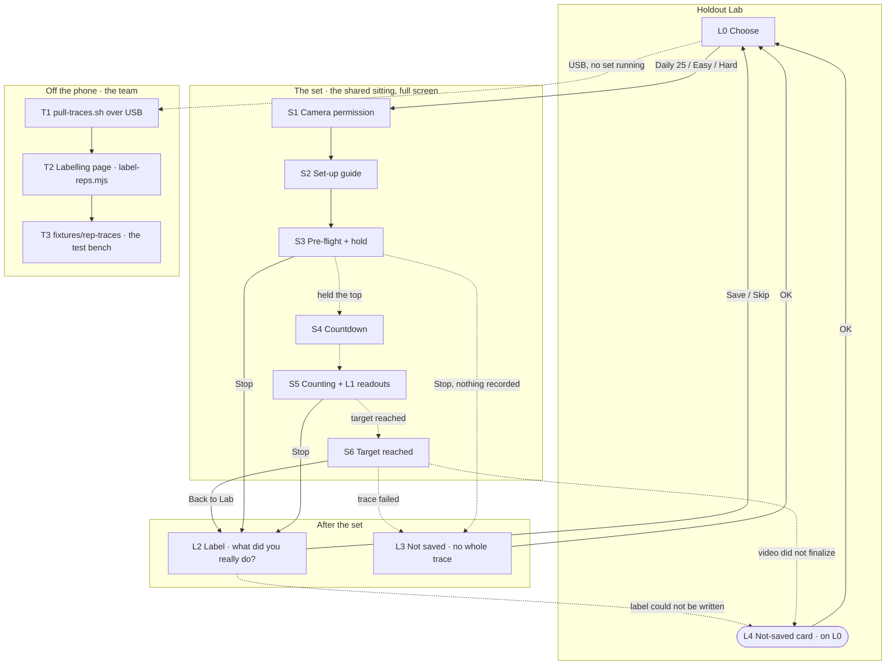

# Holdout Lab — screen map

**Version:** 1.0 · **Date:** 2026-10-10 · **Scope:** the `labDebug` build of Holdout Lab, the tester app of spec 004. The member app has its own map, `holdout_screen_map.md`; the two share the sitting screens (S1–S7), and this file describes only what Lab adds or changes.

**Purpose.** One place that lists every screen a tester meets, what each one shows, where they can go from it, and what the team does with the sets afterwards. It is the brief for the Lab boards on the canvas and for the Lab entries the design book still lacks.

**Visual base (decided 2026-10-10):** the same design system as the member app, the same sitting screen, plus an explicit **LAB marker** so a tester always knows which app is open: the name *Holdout Lab*, its own icon, and a `LAB` chip on the Choose screen. Lab is never shown to members, so nothing here changes what a member sees.

> **Precedence.** This file describes screens; it decides no mechanic. Where it disagrees with spec 004, spec 002 (FR-023, FR-025, FR-026) or constitution X, they are right and this file is a bug. Behaviour is checked against `kotlin/app/src/lab/` and `kotlin/app/src/main/kotlin/holdout/app/sitting/` at commit `e6df566`.

## Contents

1. [How to read this](#1-how-to-read-this)
2. [Who uses Lab](#2-who-uses-lab)
3. [The LAB marker and what Lab reuses](#3-the-lab-marker-and-what-lab-reuses)
4. [The whole map](#4-the-whole-map)
5. [Screen cards](#5-screen-cards)
6. [Inventory at a glance](#6-inventory-at-a-glance)
7. [Use cases](#7-use-cases)
8. [Journeys](#8-journeys)
9. [What the design book needs for Lab](#9-what-the-design-book-needs-for-lab)
10. [Open points](#10-open-points)

---

## 1. How to read this

Tiers, status columns and the card layout are the member map's (`holdout_screen_map.md` §1). IDs:

| Area | Letter | Lives in |
|---|---|---|
| Lab's own screens | **L** | `kotlin/app/src/lab/` |
| The sitting, shared with the member app | **S** | `src/main/.../sitting/`, same IDs as the member map |
| System moments | **N** | OS dialogs, the pull over USB |
| Off the phone, the team's tools | **T** | `scripts/pull-traces.sh`, `scripts/label-reps.mjs` |

**Code status:** everything in this map is ✅ built (spec 004 merged 2026-10-09, PR 27). **Design status:** · nothing is drawn yet; Lab has no board on the canvas and no entry in the design book (§9).

## 2. Who uses Lab

| Who | Gets it how | Does | Never |
|---|---|---|---|
| **A tester** — a team member or a beta tester who agreed **in writing** to be filmed | Direct install of `labDebug` by the team (FR-009) | Records sets in each counting mode, labels what they really did, optionally with video | Connects a wallet, stakes, submits a day, goes online. Lab's manifest removes `INTERNET` (FR-002) |
| **The team** | The same phone over USB | Pulls the sets, labels reps against the video, promotes good sets to tests, fixes counting once for both apps (FR-008, FR-011) | Publishes Lab, links it from the member app or the README |
| **A member** | — | — | Sees Lab at all. Both apps on one phone share no data (edge case, SC-005) |

## 3. The LAB marker and what Lab reuses

**Reused unchanged from the design book:** canvas, surfaces, hairlines, type, spacing, `PrimaryButton`, `SecondaryButton`, `HoldoutCard`, `SectionLabel`, `Body`, and the whole camera sitting (S1–S7) with its pills, hold ring, countdown, counter and chime.

**The LAB marker — rules to add to the book (§9):**

| Where | What | Why |
|---|---|---|
| Launcher | Its own icon, told apart from Holdout's at a glance (FR-001). Today: the status-bar 3×3 crowd in `accent` on black (004 research R8). To be brought under icon v2 (§10) | The two apps sit side by side on a tester's phone |
| App name | **Holdout Lab** | Android shows it under the icon and in the recents |
| L0 header | Wordmark *Holdout* + a `LAB` chip (`surface-3`, `accent` text, `label` style) on the same line | The first thing a tester reads |
| Switches | Every tester switch label starts `TEST ·`, in `accent` when on and `text-tertiary` when off (`TestSwitch`) | A switch is never mistaken for a member setting |
| During a set | The readouts under the count, `label` style, `text-tertiary` (`warning` when something is wrong) | The one thing a member never sees (FR-010); it is also the marker |
| Copy | Tester voice: plain, technical, in the second person; "set" not "sitting", "trace" and "video" named as such; the consent sentence word for word | Nothing is sold here |

## 4. The whole map

Solid arrows are taps; dotted arrows happen on their own. S-screens are the member map's; only what Lab changes on them is listed in §5.

Stop on S1 or S2, before any frame reached the recorder, returns to L0 with no dialog: there is no trace to label and nothing was lost.

## 5. Screen cards

### L0 · Choose

**MUST · ✅ Built · · Not drawn** · `lab/LabApp.kt` (`LabChooser`) · 004 FR-003, FR-005, FR-007, contracts §5

**Job:** the whole of Lab outside a set. Pick how the set is counted, set the switches, start. Reachable in under 60 seconds from install with no wallet app on the phone (SC-001).

**Entered from:** app launch · L2 Save or Skip · L3 OK · Stop on S1/S2

**On screen (as built, top → bottom)**
1. **Holdout Lab** (headline) — *to draw:* the wordmark with the `LAB` chip (§3)
2. Body: *Record and label sets to tune rep counting. No wallet and no network: nothing here is staked or sent.*
3. **L4 Not-saved cards**, one per loss since the chooser was last clear (§5 L4), above everything else so they cannot be missed
4. `COUNT AS` section label, then three cards, each a full-width secondary button with a detail line under it:
   | Row | Button | Detail line (as built) | Counts as |
   |---|---|---|---|
   | 1 | **Daily 25** | `45° · knees allowed · counts toes separately` | `Stakes.DAILY` |
   | 2 | **Easy Holdout** | `45° · knees allowed · staked rules` | `Stakes.EASY` |
   | 3 | **Hard Holdout** | `45° · from the toes` | `Stakes.STAKED` |
5. `SET` section label, then:
   - **Record video** switch — off: *TEST · video recording off — only people who agreed in writing may be filmed*; on: *TEST · recording sittings as video — only people who agreed in writing to be filmed* (constitution X, 002 FR-026). Off on every fresh install, remembered on the phone (FR-005)
   - **Clean screen** switch — on: *TEST · clean screen: no dots or text, for training recordings*; off: *TEST · clean screen off*. Remembered
   - `TARGET` with a **−** / **+** stepper around the number (`amount` style, accent signs; 1–100, default 25; touch targets ≥ 48 dp, accessible names *Fewer reps* / *More reps*). Remembered
6. Footer, `label` style, tertiary: *N sets on this phone · pull them over USB with scripts/pull-traces.sh* (count of `*.trace.csv` in `files/traces/`)

**Variants to draw**
- **Fresh install:** video off, clean screen off, target 25, *0 sets on this phone*
- **After a lost label or video:** one or more L4 cards at the top
- **Many sets:** *12 sets on this phone*; the footer is the only hint that the phone needs pulling — *NICE:* turn it `warning` above a threshold

**Exits:** a mode row → S1 (or S2/S3 if the camera is already allowed) · nothing else; there is no settings, about or wallet screen (contracts §5)

### S1–S7 · The set, as Lab runs it

**MUST · ✅ Built · 🎨 Drawn for the member app** (boards 15–20); Lab needs the readout and clean-screen variants drawn (§9)

The shared `SittingScreen` with `LabSittingTools` passed in. Everything the member map says about S1–S7 holds; the differences:

| Where | Member app | Lab |
|---|---|---|
| Mode | From the Holdout or the Daily 25 | From the L0 row: Daily 25, Easy or Hard rules (FR-003, FR-011) |
| Target | 25, or the day's reps left | L0's target; a set banks under its own scope, so a new set never inherits reps (004 research R3) |
| Deadline banner (S3–S5, top) | Time left to today's deadline | None: there is no day and no chain (`chainSecondsNow = null`) |
| S5 under the count | *10 banked · 15 to go* | The same, then **L1 readouts** (below) |
| Clean screen on (S5 only) | — | Nothing drawn over the camera except the count in the top-right corner (`label`, secondary) and the Stop button. The skeleton, pills, hint, bars and readouts are all hidden, so a training recording shows the raw camera (FR-007) |
| S6 button | **Done** / **Submit day N** | **Back to Lab** |
| After S6 or Stop | Back to Today | → L2, or L3 when the trace failed |
| Video | Never | With the switch on, `VideoCapture` runs beside the preview and the analysis; no audio; if the camera cannot carry all three, the set runs without video and the readout says so (002 FR-026) |

#### L1 · Readouts (on S5, under the count)

**MUST · ✅ Built · · Not drawn** · `sitting/LabReadouts.kt` · 004 FR-007; never in a member build (FR-010, the build check greps for `LabReadouts` and `"rec · `)

Three `label`-style lines, `text-tertiary`:
1. `rec · <trace name>` — or **`rec · not saved`** in `warning` when the trace could not be written
2. `analysis 27 fps · video on` — `· video could not start` when the camera refused a third use case; the whole line turns `warning` below 15 fps (002 FR-026, research R4)
3. `side · easy · elbow 152° · line 161° · knee 118°` — the detected view, the rules in force, and the three angles the counter reads; `knee —` when unseen

**Variants to draw:** healthy · fps low · video could not start · trace not saved

### L2 · Label — "What did you just do?"

**MUST · ✅ Built · · Not drawn** · `sitting/TraceLabelDialog.kt` · 002 FR-025, 004 FR-006

**Job:** the person's count is the only ground truth. Asked once, before leaving, so a pulled trace is already a test.

**Entered from:** S6 Back to Lab · Stop on S3/S5, whenever a trace was written

**On screen (a dialog on `surface-1`, radius 24, full width inside the gutter)**
1. **What did you just do?** (title)
2. *The app counted 17. Log what you really did — it goes into this set's trace.*
3. Five counters, each a label with **−** / **+** and the number: **Full push-ups** · **Half push-ups** · **From the knees** · **Cobra** · **Other movement** (`Trace.MOVEMENTS`)
4. **Where was the phone?** — choice chips: `front` · `30°` · `35°` · `40°` · `45°` · `50°` · `55°` · `60°` · `side` (`Trace.PLACEMENTS`), then `on my left` · `on my right` (`Trace.SIDES`). Both remembered from the last set, because a calibration session records many sets from one spot
5. **Note (optional) — e.g. phone on a book** (text field)
6. **Skip** (quiet, left) · **Save** (primary, right)

**Behaviour:** Save writes the label into the trace through a temporary file and an atomic rename; if that fails the trace stays whole and unlabelled and the loss shows as an L4 card. Skip leaves the trace unlabelled. Tapping outside counts as Skip.

**Exits:** Save / Skip → L0

### L3 · Not saved — "This set was not saved"

**SHOULD · ✅ Built · · Not drawn** · `sitting/TraceLabelDialog.kt` (`TraceNotSavedDialog`) · 004 edge case "the phone runs out of space"

Shown **instead of L2** when no whole trace exists: none was written (storage full, a write refused) or no frame ever reached it (the camera never started, or Stop came before the first frame).

**On screen:** **This set was not saved** (title, `warning`) · *No whole trace of it is on the phone — none was written, or it was cut short — so it will not reach the team. Check that the camera starts and the phone has space, then record it again.* · **OK**

**Exits:** OK → L0

### L4 · Not-saved card (on L0)

**SHOULD · ✅ Built · · Not drawn** · `lab/LabApp.kt` · contracts §3 "losses after the set"

A loss that happens **after** the set screen has gone cannot be shown there: the video finalizes later, and a label write can fail on Save. Each such loss becomes a card at the top of L0 until dismissed.

**On screen:** a `HoldoutCard` with **Not saved** (`titleMedium`, `warning`), the sentence `onSetProblem` reported — which set, and whether it was the label or the video — and **OK** (quiet, accent).

**Copy, as built:** *The label of <set> was not saved, so its trace is unlabelled.* · *The video of <set> was not saved whole (recorder error N); the phone may be out of space.* · *The video of <set> is empty, so it was not saved.* · *The video of <set> could not be named after its trace; it is on the phone as <file>.*

**Variants:** label lost · video lost · several at once

### N · System moments

| ID | Moment | From → to |
|---|---|---|
| **N4** | Camera permission, the OS dialog behind S1; denied twice → the app's settings page (as the member app) | S1 → S2/S3 |
| **N6** | Storage full during a set: the set is still counted on screen; the trace or video is reported lost (L1 line 1, then L3 or L4) | S5 → L3 / L4 |
| **N7** | The pull over USB (`adb run-as`): every trace and video is copied, size-checked and **deleted from the phone**; done with no set running | L0 → T1 |

## 6. Inventory at a glance

| ID | Screen | Tier | Code | Design | Reached from | Goes to |
|---|---|---|---|---|---|---|
| L0 | Choose | MUST | ✅ | · | launch, L2, L3 | S1 |
| S1–S4 | Camera permission, set-up guide, pre-flight, countdown | MUST | ✅ | 🎨 (member boards) | L0 | S5, L2/L3 on Stop |
| S5 + L1 | Counting with readouts; clean-screen variant | MUST | ✅ | · variants | S4 | S6, L2 |
| S6 | Target reached · **Back to Lab** | MUST | ✅ | 🎨 (member board, new label) | S5 | L2, L3 |
| L2 | Label dialog | MUST | ✅ | · | S6, Stop | L0 |
| L3 | Not saved dialog | SHOULD | ✅ | · | S6, Stop | L0 |
| L4 | Not-saved card | SHOULD | ✅ | · | after L2 or the video | L0 |
| N4, N6, N7 | Permission, storage, the pull | MUST / SHOULD | ✅ | — | — | — |
| T1–T3 | Pull, labelling page, fixtures | MUST | ✅ | — | the team's machine | — |

**Count:** 4 Lab screens and 1 overlay, none drawn; 6 shared sitting screens, drawn for the member app and needing 2 variants.

## 7. Use cases

| ID | Actor | Goal | Enters at | Leaves at | Screens | Covers |
|---|---|---|---|---|---|---|
| UC-L1 | Tester | Record a set in a given counting mode and say what was really done | L0, a mode row | L0 after Save | L0 → S1…S6 → L2 → L0 | 004 US1 (1–3), FR-003, FR-006, SC-001 |
| UC-L2 | Tester (consented) | Record a set with video for the knee classifier | L0, Record video on | L0 | L0 → S1…S6 → L2 → L0 | US1-4, FR-005, 002 FR-026, constitution X |
| UC-L3 | Tester | Make a clean training recording, nothing drawn over the body | L0, Clean screen on | L0 | L0 → S1…S4 → S5 (clean) → S6 → L2 | FR-007 |
| UC-L4 | Tester | Stop a set early and still label what was done | S3 or S5, Stop | L0 | S3/S5 → L2 → L0 | 002 FR-023 (a trace is complete however the set ends) |
| UC-L5 | Tester | Record a set with a lower or higher target (5 for a quick check, 50 for endurance) | L0, the stepper | L0 | L0 → set → L2 | data-model §2 (`target` 1–100) |
| UC-L6 | Tester | Learn that a set was lost, not silently dropped | S6 / Save / after the set | L0 | → L3, or L4 on L0 | edge case: storage full; SC-006 |
| UC-L7 | Tester | Open Lab with no wallet app on the phone | launch | L0 | L0 | US1-1, FR-002 |
| UC-L8 | Team | Get every set off a tester's phone and open it in the labelling page | T1 | T2 | N7 → T1 → T2 | FR-008, US1-5, SC-006 |
| UC-L9 | Team | Turn a labelled set into a test both apps must pass | T2 | T3 | T2 → T3 (`--promote`) | FR-011, US4, SC-003 |
| UC-L10 | Member with both apps | Do Lab sets without touching the member app's streak, banked reps or settings | L0 | L0 | — | edge case: both apps on one phone; SC-005 |

## 8. Journeys

- **JL1 — A set in each mode, under ten minutes:** `L0` **Easy Holdout** → `S1` (first time) → `S2` → `S3` → `S4` → `S5` + `L1` → `S6` **Back to Lab** → `L2` Save → `L0` → **Daily 25** → … → **Hard Holdout** → … → *3 sets on this phone*
- **JL2 — A filmed set:** `L0` Record video on (reads the consent line) → **Hard Holdout** → `S5` with `analysis 24 fps · video on` → `S6` → `L2` Save → `L0`; the `.mp4` and `.video.json` sit beside the trace until T1
- **JL3 — A clean recording:** `L0` Clean screen on → a mode → `S3` with pills (still shown) → `S5` with only the count in the corner → `S6` → `L2`
- **JL4 — Something went wrong:** `S5` shows `rec · not saved` → `S6` → `L3` OK → `L0`; or `L2` Save fails → `L0` with an L4 card *label not saved*; or the video did not finalize → `L0` with an L4 card *video not saved*
- **JL5 — The team's loop:** the tester plugs in with no set running → `T1 pull-traces.sh` (copies, checks, deletes) → `T2 label-reps.mjs` (labels reps from the video, flags doubtful ones) → `T3 --promote` into `fixtures/rep-traces/` → `:repcounter:test` replays every labelled set through the one shared counter → a counting fix reaches both apps in their next build (FR-011)

## 9. What the design book needs for Lab

The book (`docs/design/`) has no word on Lab. To draw the boards above it needs, in the design-system artifact and then synced:

| Add | For | Notes |
|---|---|---|
| **Naming: Holdout Lab** | §3 | The name, the `LAB` chip, "set" and "trace" as words, the tester voice, the consent sentence word for word |
| **Lab icon** under icon v2 | launcher | Same 5×5 crowd language as Holdout's icon, clearly a different mark (§10) |
| **Switch** component | L0 | `TestSwitch`: Material switch with an `accent` track when on; the label changes with the state and starts `TEST ·` |
| **Stepper** component | L0 target | `−` number `+`, `amount` style, 48 dp targets |
| **Dialog** component | L2, L3 | `surface-1`, radius 24, full width inside the gutter, title + body + actions; today the book allows only sheets, for the faucet and the stake |
| **Choice chips** (single select, remembered) | L2 placement and side | Like `TierChips` but free text and smaller |
| **Readouts** pattern | L1 | Three `label` lines under the counter; `warning` rules |
| **Notice card** (warning) | L3, L4 | `HoldoutCard` with a `warning` title and a quiet OK; the member app will want the same for *not saved* and offline notices |
| **Sitting variants** | S5 | Clean screen; readouts under the count |

## 10. Open points

Decided by the product owner on 2026-10-10 (to be built as code tasks on spec 004, and drawn):

1. **The Lab icon under v2 — decided:** the same 5×5 crowd as Holdout's icon, with the H of seven drawn in **`warning`** (coral, `#FF623A`) instead of `accent`. One language, one shape; the colour says "test". The book's rule *"never draw the H in anything but `accent`"* is written for Holdout's own icon and gets one stated exception: Holdout Lab's launcher, themed and status-bar icons. Replaces today's 3×3 crowd in `src/lab/res/drawable/`.
2. **Mode detail lines on L0 — decided: three different descriptions.** *Daily 25:* `45° · knees allowed · counts toes separately`. *Easy Holdout:* `45° · knees allowed · staked rules`. *Hard Holdout:* `45° · from the toes`. The three rows stay, because a trace carries its mode. Source: spec 002 FR-007 and `LabMode` in `lab/LabSettings.kt`.
3. **Set count threshold — open:** whether the footer warns when many sets wait on the phone, and at what number. Low impact; decide when the Lab boards are drawn.
