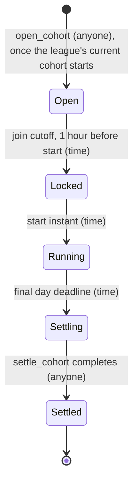

# Holdout — demo scope cut and state machines

**Version:** 1.8 · **Date:** 2026-09-18 · **Status:** D-A … D-I decided; §1, §3 and §4 synced to `specs/001-holdout-hackathon/spec.md`

**Revision note, 2026-10-05 (decision H34):** the forfeit split is now **70/30** and a no-finisher pool goes **wholly to the fee destination**, with no carry-over and no held state. Where this document still describes 20 % fees, 50/50 splits or carry-over states, the spec (FR-027, FR-037) governs.

**Changed in 1.8 (18 Sept):** pointers follow constitution v1.3.1 and decisions H1–H30 · the **exercise is now a cohort parameter** with negative and decline push-ups reserved for later (H30), so F1's rep counter is push-ups only by validation, not by assumption.

**Changed in 1.7 (17 Sept):** members' names adopted — **the Daily 25** and **a Holdout** (H28, spec §1a), with on-chain names unchanged · **first-run tour** added as F12 (FR-067) and the full-cycle walkthrough becomes judge-facing (H29) · guest mode proposed and dropped, so F10 wallet-first stands.

> **Precedence.** The constitution (`.specify/memory/constitution.md`, v1.3.1) and the spec override this file; `holdout_decisions.md` (H1–H30) records why. Where this file and the spec disagree, the spec is right and this file is a bug. Decision IDs D1–D16 and O1–O12 cited below refer to the archived record at `docs/archive/holdout_decisions_pre-hackathon-spec_2026-09-15.md`.

**Changed in 1.6 (phasing, 15 Sept — spec §3a, H23):** four items are **Phase 2** — league leaderboards (F9), weekly chip re-pricing (S10), delivery of a held carry-over (§3.1), automatic offline submission (§3.3) — built only after the Phase 1 core works end to end and only before the 28 September freeze. Each has a Phase 1 stand-in, and the data Phase 2 needs is still recorded in Phase 1.

**Changed in 1.5 (third clarify session of 15 Sept):** **wallet required before anything else**, daily challenge included (F10) · **in-app faucet** for test SKR and fee SOL, once per wallet per day, no server (F11, E21) · **scripted members are real wallets under the same rules**, published in the build (S8, D-E) · **offline sittings allowed**, completed days wait for network and count only if they land before the deadline (§3.3, E20) · **palm liveness times out after 30 seconds** back to pre-flight (§3.3; E11 resolved).

**Changed in 1.4 (second clarify session of 15 Sept):** the session machine (§3.3) is replaced by **sittings with reps banked in blocks of 10** for the whole day — no pause limit, no refusal to start late, pre-flight and palm liveness on every sitting · **opening, forfeiting and settling are permissionless** — the keeper is the usual caller, not a privileged one (D-F, §3.1, §3.2) · settlement **rounds shares down and sends the remainder to the fee destination** · survivor counter and projected pool count a breach at the deadline, before the forfeit is recorded · cohorts expected **up to 1,000 members**, no cap (D-G rewritten, E9 updated, E17–E19 added).

**Changed in 1.3 (clarify session of 15 Sept):** state machines, invariants and the edge table rewritten to match spec §8 — no free cohorts, no `Finished`, `Refunded` or `Cancelled`; `Locked` kept with a **1-hour** join cutoff (was 24 hours); unconditional lobby place alongside a running cohort; invariants replaced by the spec's INV-1…INV-8 · scope tables updated: staked 7-day league (not free), daily streak and on-chain leaderboards in, share cards and badges out, audio dropped entirely · D-C chip note superseded by USD-tier chips priced in SKR (H8).

**Changed in 1.2:** day boundaries are cohort-anchored 24h windows at a 05:00 UTC reference instant — **no timezone exists anywhere in the system** (D-B, rewritten); evaluating deadlines in a backend considered and rejected, with the bounded-oracle pattern recorded for later.

**Changed in 1.1 (decisions of 15 Sept):** SKR-only staking, no USDC anywhere (D-C) · two leagues, free 7-day and staked 21-day (D-I) · audit dropped for the hackathon. **These override `holdout_v1_prd.md` §6.4 (USDC pool), §5.1 (three leagues, staked qualifier) and the `JupiterSwapRouter` contract in §9.1 — the PRD has not yet been patched.**

**Purpose.** This is the layer between the product documents (spec and PRD) and the first line of Rust. It answers three questions the PRD deliberately leaves open: *what actually ships by the hackathon*, *what states the system has and who moves them*, and *which decisions block code today*.

| Companion file | Holds |
|---|---|
| `specs/001-holdout-hackathon/spec.md` | What the hackathon build does. Authoritative over this file. |
| `holdout_decisions.md` | Why the build is what it is (H1–H30). Read before changing anything here. |
| `holdout_v1_prd.md` | Product requirements for the hackathon build (v2.7): screens, copy, verification rules, settlement vectors. |
| `archive/holdout_v1_prd_full-vision_2026-09-15.md` | The original full-vision PRD. **Bare §-references below (§5.3, §8.6, §9.3 Op6 …) point into this archive**, not into the current PRD. |
| This file | Demo scope, state machines, blocking decisions, edge transitions the PRD does not cover. |

---

## 0. The real deadline is 28 September, not 8 October

The hackathon submission is due **9 Oct 08:59 CEST**, so 8 Oct is the last working day. But the demo plan commits to **cohort #3 running in-app on devnet from Monday 28 Sept to Sunday 4 Oct**, and cohort #4 starting 5 Oct so it is visibly thinning during filming.

That means the app must be good enough for **real strangers to complete a 7-day cohort in it starting Monday 28 September**. From today that is **13 days**, not 23. The last week is video, deck and repo — not features.

| Window | Days | What must be true at the end |
|---|---|---|
| 15–21 Sept | 7 | Spikes done, contract deployed to devnet, rep counter works on real bodies |
| 22–27 Sept | 6 | Vertical slice end-to-end on devnet; cohort #2 running half in-app as the rehearsal |
| **28 Sept** | — | **Cohort #3 starts in-app (its lobby opened 21 Sept). Feature freeze.** |
| 28 Sept – 4 Oct | 7 | Cohort #3 runs. Only bug fixes. Capture footage daily. |
| 5–8 Oct | 4 | Cohort #4 live on camera, video, deck, README |

Everything below is sized against the 13-day number.

---

## 1. Scope cut

The rule: **a feature earns its place only if it appears in the video or is load-bearing for something that does.** Half the rubric is UX and presentation; the pool economics score approximately zero.

### 1.1 Built for real

| # | Feature | Why it survives the cut |
|---|---|---|
| F1 | Pose rep counter (push-ups, MediaPipe, on-device) | The product's magic. Nothing else is differentiated. |
| F2 | Sitting flow: pre-flight (4 visual checks, no audio) → palm liveness → countdown → counting, reps banked every 10 across the day → day complete | The 40 seconds of video that sell the anti-cheat story |
| F3 | Home / cohort screen: survivor counter + live prize | The X-factor asset (§10.1a). `189 / 312 still standing` |
| F4 | Lobby: countdown to the join cutoff and the start, live roster count, leave button; locked-hour view with the final roster | Makes the cohort feel populated before it starts |
| F5 | League ladder screen | One screen, establishes the progression story |
| F6 | `join_cohort` / `leave_cohort` / `submit_session` / `tick_cohort` / `settle_cohort` / `claim_payout` on devnet, **SKR end to end** | The full money loop, honestly on-chain, with no swap and no oracle in it |
| F7 | Seed Vault signing + MWA | The $10K Solana Mobile Stack prize depends on this being real |
| F8 | The Daily 25 + daily streak (off-chain, cosmetic, survives a forfeit) | The free habit loop anyone can run on day one (D-I, H2, H4) |
| F9 | **Phase 1:** cohort roster, and per-league progress recorded on-chain. **[Phase 2]** League leaderboards ranked by survival rate (min. 3 cohorts played), with cohorts played and league streak | Shows who is disciplined, from on-chain progress only (H17, H23) |
| F10 | Wallet-first onboarding: connect a wallet before anything else, with a no-wallet explanation screen | Every surface keyed to a wallet from the first tap (H21). Guest mode was proposed and dropped, 2026-09-17 (H29) |
| F12 | First-run tour: three cards after the wallet connects — the Daily 25, what a Holdout is, how reps are counted — skippable and re-openable; a short explainer video joins it once cohort #3 is filmed | A first-timer learns the rules in seconds; the 3-minute walkthrough becomes judge-facing (H28, H29, spec FR-067) |
| F11 | In-app faucet: test SKR for the top chip plus fee SOL for a 21-day cycle, once per wallet per day, pre-funded, no server | A judge with an empty wallet can stake in one tap; no public faucet on the critical path (H22) |

### 1.2 Faked, seeded, or stubbed

| # | Feature | How it is faked | Risk if a judge notices |
|---|---|---|---|
| S2 | — | *(was: SKR→USDC swap. Deleted entirely by D-C — there is no swap.)* | — |
| S3 | — | *(was: badges. Cut — H17.)* | — |
| S4 | — | *(was: leaderboard seeded from cohort #1 and #2 data. Now live from on-chain progress — F9.)* | — |
| S5 | Notifications | Manual Telegram push to cohort members | None — invisible in video |
| S6 | Genesis Token gate | *(Superseded 2026-10-10, H38: staking is Seeker-exclusive. The flag stays off on devnet, but the app checks the wallet's Seeker Genesis Token on mainnet before a join; the contract checks it once the flag is turned on at mainnet launch.)* ~~Feature flag `genesis_gate_enabled`, **off on devnet**~~ | ~~**Must be off**, or no tester without a Seeker can join~~ Testers and judges need a wallet holding a Seeker Genesis Token, or a debug build with the gate off |
| S7 | ~~League gate~~ | **Removed 2026-10-10 (H37):** no gate, no flag, no unlock record — both leagues open to every member | — |
| S8 | Judging-period cohorts | Real members first — beta testers and anyone who installs the app — with scripted members **topping a cohort up to a floor only** (20 for a 7-day cohort, 12 for a 21-day one). Scripted members are **ordinary wallets run by automation under the same contract rules**: real test-SKR stakes, completed days, planned forfeits and finishes. Their forfeits fund real prizes. Their days are not camera-verified. Addresses published in the build; disclosed in the app, README, demo video and pitch deck, and labelled wherever they appear (H14, constitution XII) | None if labelled; deception if not |
| S9 | Full-cycle demo | Recorded walkthrough inside the app, captured from cohort #3 on the real devnet program — the whole flow from launching the app to the claim, playable before a wallet is connected (H14, `holdout_demo_video.md`) | None — it is a recording of the real thing |
| S10 | Stake chip prices | **Phase 1:** Operator publishes one SKR chip set at launch from an off-chain rate. **[Phase 2]** re-prices weekly when drift exceeds 20% (H8, H23) | None — named in the README as a trusted input |

### 1.3 Cut entirely

Geo-blocking · TOS · audit · calibration flow · audio in verification — both the pre-flight check and the rep condition (E12, H13) · Swelfie · share cards · badges · daily-streak or server-fed leaderboards · **free cohorts of any league** (H3) · conditional pre-joining (§5.6a — the unconditional lobby place is in, H10) · cohort cancellation and min-size auto-enrolment (§7.4) · cold-start bonus match (§6.5) · insurance fund · demotion logic (there is none) · Firebase · **`JupiterSwapRouter`, USDC in every form, slippage handling, and any on-chain price oracle** (D-C, H8) · **geo-IP** (D-B makes it pointless).

*Solo sessions and the daily streak were on this list in v1.1 and came back as the daily challenge (D-I).*

Each of these is one paragraph in the PRD and three days of work. None of them appear in a three-minute video.

**Cutting Firebase is the least obvious call and the most valuable.** Its jobs were session resume and the Merkle trace behind `proof_hash`. Session resume works from device-local storage. The Merkle trace is decorative on devnet anyway, because nothing verifies it server-side — see D-E. Removing Firebase removes an auth integration, a security-rules surface and a second source of truth, 13 days before a deadline.

---

## 2. Blocking decisions

Eight decisions that must be made before the first `lib.rs`. Each blocks code, each has a recommendation.

### D-A. Compressed time — `day_seconds` on the Cohort

**The problem.** A 7-day cohort cannot be tested, and a settlement cannot be rehearsed, at one day per day. There are two cohorts left to rehearse with and no time to wait out either.

**Recommendation.** Put `day_seconds: u32` on `Cohort`, default `86_400`. Every deadline in the contract derives from `start_unix + day_index * day_seconds`. A test cohort with `day_seconds = 60` plays a full 7-day cycle in seven minutes — including forfeitures, settlement and claim.

**Why it is the highest-leverage line in the document.** It makes the settlement test vectors in Appendix A executable against a live devnet deployment rather than only in unit tests, it lets the video show a complete cohort arc if the real ones underdeliver, and it turns "did settlement work?" from a seven-day question into a seven-minute one. Ship it behind an admin-only guard so mainnet cohorts can never be created with a non-default value.

### D-B. Day boundaries — **decided: cohort-anchored windows, no timezones at all**

**The rule.** Day N of a cohort runs from `cohort_start + N × day_length` to `cohort_start + (N+1) × day_length`, identically for every member. The contract derives every deadline from block time. **There is no timezone field anywhere in the system** — not on the membership, not on the cohort, nowhere.

**What this deletes** relative to the per-member rule it replaces: the stored offset and its pending counterpart, the client reporting an offset at all, the 12-hour clamp against a long flight producing a one-hour day, the 15-minute keeper cadence needed for :30 and :45 offsets, geo-IP, DST handling, and the ~26-hour window in which a cohort had no single end (E13). It also removes the only reason anyone reached for a backend — see below.

**The reference instant: 05:00 UTC.** Cohorts start on that instant and every day boundary falls on it.

| City | Boundary, local (summer) | Reads as |
|---|---|---|
| Los Angeles | 22:00 | evening cutoff |
| New York | 01:00 | dead of night |
| Warsaw | 07:00 | before the morning session |
| Kyiv | 08:00 | before the morning session |

**No instant is good for everyone, so the honest question is who pays.** Kyiv and Los Angeles are ten hours apart. Almost nobody trains between 23:00 and 05:00 local, which puts the "dead" window at 21:00–03:00 UTC for Europe, 03:00–09:00 for US East and 06:00–12:00 for US West. **Europe's dead window and US West's do not overlap at all**, so a boundary that disturbs nobody does not exist — this is arithmetic, not a design failure.

At 05:00 UTC, Europe gets a boundary that sits before the common morning training hour and Los Angeles loses the last two hours of its evening. At 06:00 UTC Los Angeles is whole, but a Kyiv member's 08:00 workout lands on the previous day — a far more common case and a far more confusing one. Hence 05:00.

**Never call it a day.** The app shows a running countdown — "11:42 left" — not a calendar date. Members then never have to reason about which date a session belongs to, which is the actual source of "why did my morning workout count as yesterday". The same framing absorbs DST for free: a fixed UTC instant shifts by an hour in local terms twice a year, and a countdown makes that invisible. It also makes compressed-time demo cohorts (D-A) read naturally rather than absurdly.

**Where 05:00 UTC fails, and it is worth knowing before launch.** It serves the Atlantic — Europe, Africa, Turkey, both Americas — and it fails Asia-Pacific badly: Mumbai 10:30, Bangkok and Jakarta 12:00, Singapore and Manila 13:00, Tokyo and Seoul 14:00. A boundary in the middle of the active day is the worst case there is, far worse than an early or late one.

This matters more than it looks, because the Genesis Token gate makes Seeker owners the entire addressable market, so **the geography of Seeker owners is the geography of this product**. Solana Mobile has published 150,000+ preorders across 57 countries and shipping to 50+, but **no per-country or per-region breakdown exists publicly** (checked their own press release, The Block, CoinMarketCap — all give the country count and nothing finer). So the honest position is: the Atlantic instant is a bet, not a conclusion.

Two cheap ways to replace the bet with data, neither of which blocks anything now: ask Solana Mobile DevRel directly — a fair question from a hackathon entrant and grant applicant — and record a coarse region from the **device locale** at join, off-chain and display-only, so cohorts #1–#3 measure it themselves. Locale-for-analytics does not contradict the no-timezone rule above: it never touches a deadline, a branch or an amount (constitution III's sibling rule).

If Asia-Pacific turns out to be material, the fix is already designed: a second reference instant. **18:00 UTC** gives Mumbai 23:30, Bangkok 01:00, Tokyo 03:00 and Sydney 04:00 — the same quality of fit that 05:00 gives the Atlantic.

**Regional cohorts are the scaling answer, later.** The reference instant lives on the cohort, so `Front Lever · Americas · week of 21 Sep` is a configuration change, not a redesign. Deferred deliberately: more cohorts at low volume fragments the pool, which is the objection §7.1 already settles. Regions open when volume supports them, not before.

**Why not evaluate deadlines in a backend** — asked and answered 2026-09-15:

- **A backend knows nothing the contract does not.** It has the same client-reported clock information and a worse one from a trust standpoint. Relocating the decision buys no information; it only changes who is believed.
- **It creates a path to draining a pool.** A backend that decides outcomes can mark every member forfeited and one account a finisher; that account then claims the entire pool legitimately. A compromised signing key empties cohorts without ever touching a withdrawal function.
- **It enters the hot path of every session.** If the backend owns the deadline it must also accept submissions, or the contract has nothing to check against. It stops being an auxiliary service and becomes the spine — required up every time anyone anywhere works out.
- **Its failure mode is worse.** A dead keeper delays money while the truth stays recoverable from account state. A dead backend at a boundary destroys the only record of who made it.
- **It costs the pitch.** "The contract holds the money and the rules" is the reason this is on-chain rather than on Stripe. If a server decides who won, the Solana Mobile Stack integration story is a payment rail.

If per-member local midnight is ever genuinely required, the safe pattern is a **bounded oracle**: the backend may only assert a miss inside the window between the earliest possible deadline (UTC+14) and the latest (UTC−12), both of which the contract computes itself. Outside that window the contract refuses early claims and forfeits late ones on its own. That caps the backend's discretion at 26 hours and makes a fabricated winner impossible. Recorded here so it is not re-derived later.

**Resolves E4, E5 and E13, and OD-1 in `specs/001-holdout-hackathon/spec.md`.**

### D-C. Network and token — **decided: SKR only, no USDC**

**Recommendation.** Devnet, mock SPL mint `tSKR` with a faucet. **Stakes, the pool, payouts and the 20% fee are all denominated in SKR.** There is no USDC leg, no swap, and no `JupiterSwapRouter`.

**What this deletes.** The swap CPI, slippage tolerance and its revert path, the USDC vault, the fee's USDC→SKR conversion — and, if the stake chips are **fixed SKR amounts** (100 / 250 / 500 / 1000 SKR rather than $25 / $50 / $75 / $100), **every price oracle in the system.** Nothing in the contract needs to know what SKR is worth. For a 13-day build that is the single largest subtraction available.

**What it costs, stated honestly.** §6.4 chose USDC so that "finish and you get exactly your stake back" is true in dollars. In SKR it is true in SKR only: a 21-day cohort during a 40% drawdown returns the same number of tokens and less money. Two consequences that are not optional:

1. **Every figure a member stakes or receives is quoted in SKR** — prize, stake, payout. A dollar number presented as what the member gets is a promise the contract cannot keep.
2. The risk belongs in the README and the deck as a known property, not a discovered one.

> **Superseded in part (2026-09-15, H8).** The fixed SKR chips above were replaced by four **USD-tier chips ($10 / $25 / $50 / $100) priced in SKR**: the Operator re-prices them off-chain once a week when drift exceeds 20%, each cohort locks the chip set current at its creation, and the contract validates SKR only and never reads a price (constitution III, V). USD tier labels are now shown, always marked approximate; the "never a dollar figure" rule applies to amounts staked or received, not to tier labels. Spec FR-054…FR-059.

On devnet with a mock mint none of this bites. It becomes a real product decision the day a mainnet cohort holds real SKR.

Say the devnet framing plainly in the README. A judge who reads "devnet, mock SKR mint, SKR-native by design" reads competence; one who discovers it reads deception.

### D-D. Genesis Token gate

*(Superseded 2026-10-10, H38: staking is Seeker-exclusive. The contract's check is written behind the flag, which is turned on at mainnet launch; on devnet the flag stays off and the app checks the wallet's Seeker Genesis Token on Solana mainnet before every join, so testers without a Seeker can no longer stake. Research R17.)* **Recommendation.** `genesis_gate_enabled: bool` in program config, off on devnet, with the client-side check written but bypassable. Cohort #3 testers will be ordinary Android users without a Seeker, and the whole demo plan dies if they cannot join. The deck still gets the "remove the Seeker and the product breaks" slide — the design claim is true whether the flag is on or off this month.

### D-E. Who signs the session attestation

**The gap.** §8.7 specifies a `proof_hash` that is a Merkle root of the session trace. It does not say who holds the signing key. If the client signs, a rooted phone forges sessions. If a backend signs, there is a backend — a service, a key, rotation, and a deploy target that does not exist in the stack today.

**Recommendation for the demo.** Client-signed, `proof_hash` written to the `AttestationRegistry` exactly as specified, **and one honest paragraph in the README** naming this as the known trust gap with the v2 fix (server-side attestation signer, IPFS-pinned traces). Do not build a backend in 13 days.

This is the one place where cutting a corner has real consequences, so it gets documented rather than quietly skipped. Judges reward a builder who names their own threat model.

**Two more things sit inside the same trust gap (decided 2026-09-15):** scripted members' completed days are submitted by automation with no camera behind them (spec FR-043a), and banked reps plus any completed day waiting for network live on the device until submission (FR-024a, FR-024b). The README names all three together.

### D-F. Keeper

**Recommendation.** Node script, idempotent by design (already true in §9.3 Op3), run by cron on Fly.io with a manual `npm run tick -- --cohort <pubkey>` escape hatch. Single replica. Add a `--dry-run` that prints which memberships *would* be forfeited — during cohort #3 that is the difference between a bug and a forfeited stranger.

**Decided 2026-09-15 (spec FR-030a):** `open_cohort`, `tick_cohort` and `settle_cohort` are **permissionless**. The keeper holds no special key; any wallet can run a step once it is due, and none of them takes an argument that could change a parameter, outcome, recipient or amount. So the escape hatch is not only `npm run tick` on our box — anyone with the repo can crank a stuck cohort, which is what keeps the judging month alive if the Fly.io box dies. Pages must work for **1,000-member cohorts** (FR-011a).

### D-G. Day progress persistence

**Recommendation.** Device-local (MMKV or AsyncStorage). No Firebase. See §1.3.

**Decided 2026-09-15 (spec FR-024, FR-024a):** there is no single session and no pause bound. Verified reps are **banked in blocks of 10** on the device, kept until the day's deadline, and a day may take any number of sittings — `10 + 10 + 5`. Reps short of the next block when a sitting ends are discarded. Every sitting re-runs pre-flight and palm liveness. Nothing goes on-chain until the day is complete; a lost phone loses that day's banked reps (ES-3a). The app never refuses a late start and warns in the last 10 minutes (FR-047).

### D-H. Minimum cohort size

**Recommendation.** `min_cohort_size = 1` on devnet so a solo test cohort still runs; the 8-member floor and the cancel/refund/auto-enrol path (§7.4) are cut entirely for the demo. That path needs a cohort that does not exist yet to enrol people into, and a rent payer for the new membership accounts — both open questions, neither on the critical path.

### D-I. The ladder — **decided: two staked leagues over a free daily habit**

**Revised 2026-09-15, replacing "free 7-day → staked 21-day".**

| Layer | What it is |
|---|---|
| **The Daily 25** | 25 reps, every day, free, for everyone. No cohort, no stake, no prize. Builds a streak. |
| **7-day league** | Staked. Never closes. *(Its "entry rung" role and the 21-day unlock were removed 2026-10-10, H37.)* |
| **21-day league** | Staked. Where the money is. |

**This inverts the product's shape, in a good direction.** Holdout is now a free daily habit app with a staking layer on top, rather than a staking app with a free trial. For a rubric that puts 25% on Stickiness & PMF, a free loop anyone can run on day one, forever, is a far stronger story than a cohort you must pay to enter.

**Three consequences that follow necessarily:**

1. **The 7-day league must never close.** Previously the free week was the comeback path after a forfeit (D14) and the permanent low-commitment home. With no free cohort, that role has nowhere else to go: if the 7-day closed on a clear, a member who forfeits a 21-day cohort would face a 21-day, top-chip re-entry as their only way back — the single largest churn risk in the design (O3). So the 7-day stays open to everyone, always, including after a clear and after a forfeit. This reverses D3.
2. **The streak must stay cosmetic.** It unlocks nothing and nothing is ever paid against it. The moment a streak gates or pays anything, free sessions need economic anti-cheat — and free sessions are exactly where there is no stake to make cheating expensive. Cosmetic keeps it off-chain, unsigned, and free to build.
3. **A forfeit must not break the streak.** Losing a stake and losing a habit are different failures. Conflating them punishes a member twice for one bad day and pushes exactly the people the free tier is meant to retain.

*(Superseded 2026-10-10, H37: the gate is deleted, not off — the two leagues are separate products.)* **Gating is off for the hackathon.** Both leagues are joinable from first launch. The unlock logic is still written and still records a clear — only the check is skipped, behind `ladder_gate_enabled`, exactly as the Genesis Token gate is handled in D-D. Two reasons to do it with a flag rather than by deleting the code: a judge reading the repo sees the designed ladder rather than a missing feature, and nobody has to spend a week clearing the 7-day league before reaching the one worth filming. The README names the flag alongside the others (constitution XI).

**Solo sessions come back into scope**, having been cut in §1.3 — they are now the entire free product. The cost is small because the session flow already exists: an entry point, an off-chain streak store, and a home screen that shows the challenge when no cohort is running.

**It also fixes E14.** A staked 7-day cohort can start Monday 28 September 05:00 UTC and end Monday 5 October 05:00 UTC — inside the submission window. The full money loop, including the claim, can be filmed happening for real, which is what compressed time (D-A) was going to have to fake. D-A stays for testing and as a fallback, not as the demo's centrepiece.

**What was given up:** the free qualifying route. Previously a free week earned the unlock (D2); now every route into the ladder is paid. Two notes on that. The "does this even work for my body, my camera, my room" objection is still answered for free by the Daily 25, which is the same session — so the conversion cliff is narrower than it looks. But the free-entry lane was also what made the product legal in jurisdictions where paid entry is not, and that argument is now gone; a launch-time concern, not a hackathon one.

---

## 3. State machines

Three machines. The contract owns two of them; the device owns the third.

### 3.1 Cohort

Matches spec §8.1. The PRD's enum is `{ Open, Running, Settled, Cancelled }`: `Locked` and `Settling` are added, and `Cancelled` is cut with minimum cohort size (D-H).

| Transition | Trigger | Guard | Effects |
|---|---|---|---|
| `[*] → Open` | anyone, `open_cohort` (keeper usually) | previous cohort of this league has started (weekly, Monday 05:00 UTC) | creates pool PDA; start, join cutoff (start − 1 h), `reps_per_day`, `duration_days`, `day_seconds`, boundary instant and the current chip set fixed permanently; receives any held carry-over for its league (FR-037a) **[Phase 2]** |
| `Open → Locked` | time | `now ≥ join_cutoff` | joins and leaves both refused from this instant; roster final |
| `Locked → Running` | time | `now ≥ start_unix` | all `Pending` memberships become `Active` |
| `Running → Settling` | time | final day deadline passed | no further completed day (`submit_session`) accepted |
| `Settling → Settled` | anyone, `settle_cohort` (keeper usually; pageable) | all no-shows already forfeited by `tick_cohort` | writes `finisher_count` and `total_finisher_stake` **once**; rounds each share down and sends the rounding remainder to the fee destination, recorded on the cohort (FR-032a); with zero finishers, sends 50% of the pool to the fee destination and 50% as carry-over to the open cohort of the same league, or holds and records it on this cohort if none is open (FR-037, FR-037a — holding is Phase 1, later delivery Phase 2) |

After `Settled` the only changes anywhere in the cohort are claims and the single delivery of a held carry-over (INV-6).

**Why `Locked` exists.** It makes "joining closed, cohort not started" a legal, visible state rather than a bug: the roster and member count are final for the last hour, and no join or leave can land in the same instant the obligation begins. It originally also hosted the minimum-size check, which is cut — which is why the cutoff shrank from 24 hours to 1 (H9).

**Why `Settling` must exist.** Settlement over a large cohort — up to 1,000 members — is paginated. A caller that dies halfway through must be resumable by anyone without double-crediting anyone, and no `submit_session` may land in the gap. A cohort that is `Running` during its own settlement can accept a session for a day that has already been scored.

Every time-triggered transition is derived from chain time and holds whether or not the keeper has run (constitution II). **Displays follow the same rule:** the survivor counter, projected pool, projected shares and roster count a member as out from the instant of breach, before `tick_cohort` records it; recording it later changes no displayed figure (FR-038a). League leaderboards count the forfeit once recorded.

### 3.2 Membership

Matches spec §8.2.

```mermaid
stateDiagram-v2
    [*] --> Pending : join_cohort (user)
    Pending --> Withdrawn : leave_cohort (user), before join cutoff
    Pending --> Active : cohort starts (time)
    Active --> Forfeited : missed day (derived; tick_cohort materialises)
    Active --> ReadyToClaim : settle_cohort, every day completed (anyone)
    ReadyToClaim --> Claimed : claim_payout (user)
    Withdrawn --> [*]
    Forfeited --> [*]
    Claimed --> [*]
```

| Transition | Trigger | Guard | Effects |
|---|---|---|---|
| `[*] → Pending` | user, `join_cohort` | cohort `Open`; stake equals one of the cohort's four chip amounts; member holds no other `Pending`; cohort starts no earlier than the final deadline of the member's running membership (FR-006a, FR-006b) | stake held **segregated**, never in the pool; `member_count++` |
| `Pending → Withdrawn` | user, `leave_cohort` | cohort still `Open` (before the join cutoff) | full refund, no fee, `member_count--` |
| `Pending → Active` | time | cohort reaches `Running` | `days_completed = 0`; unaffected by anything happening to the member's other membership |
| `Active → Forfeited` | anyone, `tick_cohort` (keeper usually; materialises a breach that already exists; pageable) | `now > deadline_of(days_completed)` | 20% fee, 80% to pool; `progress[league].forfeited++`; the current league streak is set to 0 when this cohort is **counted at settlement**, not here, so a forfeit recorded before an earlier cohort settles still breaks the streak (FR-061a); daily streak untouched |
| `Active → ReadyToClaim` | anyone, `settle_cohort` (keeper usually) | `days_completed == duration_days`; the league's previous cohort has settled | `progress[league].cleared++`; current league streak++, longest = max |
| `ReadyToClaim → Claimed` | user, `claim_payout` | — | transfers `stake + pool × stake / total_finisher_stake` |

`progress[league]` (cleared, forfeited, current and longest league streak) is the only source for the leaderboards (H17).

**Two corrections to §9.3 fall out of this table.**

1. **`leave_cohort` (Op6 step 2) validates `Membership.status == Active`.** In the lobby a membership is `Pending` — `Active` is set when the cohort starts. Coded literally, leaving the lobby always fails and leaving a *running* cohort would be the thing that succeeds, which is a stake-refund bug in the worst possible place. The guard is `Pending`, and only while the cohort is `Open`.
2. **The join guard "no other `Active` membership" is replaced by the lobby-place rule.** A member may join while running another cohort, holding at most one `Pending`, provided the new cohort does not start before the running one ends. The place is unconditional — nothing is resolved or refunded when the running cohort settles or forfeits (H10), so PRD §5.6a's refund-at-tick path (E8) does not exist.

**Removed from the PRD and v1.2 of this file:** `Refunded` (cancellation is cut, D-H) and `Finished` (no free cohorts, H3).

### 3.3 Sitting and day progress (device-local, off-chain until the day completes)

Matches spec §8.3. A **sitting** is one run of checks, liveness and counting; a day may take any number of them. **Day progress** — banked reps in whole blocks of 10 — lives on the device and outlasts sittings until the day's deadline.

```mermaid
stateDiagram-v2
    [*] --> Idle
    Idle --> Preflight : start a sitting (shows reps to go and time left; warns in last 10 min)
    Preflight --> Idle : environment check fails
    Preflight --> Liveness : all 4 checks green
    Liveness --> Countdown : palm held 3 continuous seconds
    Liveness --> Preflight : no palm within 30 s → tip shown (retries unlimited)
    Liveness --> Idle : user cancels
    Countdown --> Counting : 3 seconds elapse
    Counting --> Counting : 10th verified rep of a block → block banked on device
    Counting --> Idle : sitting ends (stop, app closed, crash) → reps short of a block discarded
    Counting --> Completed : banked + current reps reach reps_per_day
    Completed --> Submitted : completed cohort day confirmed on chain before the deadline (challenge day: recorded on device)
    Completed --> WaitingForNetwork : cohort day completed with no connection
    WaitingForNetwork --> Submitted : online again → member taps submit (Phase 1) / submitted automatically [Phase 2]; lands before the deadline
    WaitingForNetwork --> Expired : lands after the deadline, or never lands → breach
    Idle --> Expired : day deadline passes without Completed → banked reps stop counting
```

| Rule | Source | Note for the implementation |
|---|---|---|
| Four visual environment checks and palm liveness at the start of **every** sitting | spec FR-019, FR-020 | Re-verification on return is what stops one person banking 10 and another finishing; no audio anywhere (E12) |
| Reps bank in blocks of 10; the final block may be smaller | spec FR-024 | Persist each block **before** showing "banked" — a crash between counting and saving must never display a block that isn't stored |
| Reps short of the next block are discarded when a sitting ends | spec FR-024, ES-1, ES-2 | Tell the member how many weren't kept |
| No pause limit; unlimited sittings until the deadline | spec FR-015, FR-024 | Banked progress is keyed to the day index, so it expires by construction at the boundary |
| Never refuse a late start; warn in the last 10 minutes | spec FR-047, ES-3 | Warning on the start card and during `Counting` |
| Palm liveness times out after 30 seconds | spec FR-020 | Tip, back to `Preflight`; unlimited retries; cancel anytime; banked reps untouched |
| Sittings work offline; a completed cohort day waits for network | spec FR-024b, ES-3b | Warn before an offline cohort sitting and on offline completion; persist the pending day; once online, submit it on one tap (Phase 1) or automatically **[Phase 2]**. Chain time decides — nothing on the device extends a deadline. A challenge day needs no network |
| A wallet is connected before any sitting | spec FR-001a | Banked progress and the daily streak are keyed to the connected wallet on this device |
| Banked progress on the device only; nothing on-chain before `Completed` | spec FR-024a, ES-3a | A lost or wiped phone loses the day's banked reps |
| One completed day per `day_index` | spec FR-025 | Contract-side idempotency; the client must also disable the CTA |
| Reps come from `Cohort.reps_per_day` | spec FR-014 | **Never a constant.** A running cohort's bar cannot move. The Daily 25 is always 25. |

### 3.4 Invariants

**Authoritative list: spec §8.4.** Reproduced here with the old I-numbers for traceability. These hold at every instant and belong in the test suite before any business logic (constitution VII).

| Spec | Invariant | Was |
|---|---|---|
| **INV-1** | Held stakes + prize pool + any held carry-over == balance under custody. Finisher principal is never in the pool. | I1 |
| **INV-2** | Only forfeited stakes, and carry-over from a no-finisher cohort of the same league, ever enter a prize pool. | I8 (bonus match removed) |
| **INV-3** | `days_completed ≤ max_days_completed(now)` at all times — the day in progress counts, so day 0 may be completed in the cohort's first second. | I3 |
| **INV-4** | Per member: at most one membership in a `Running` cohort, at most one `Pending`, and no `Pending` whose cohort starts before the running one's final deadline. | I4, revised for the lobby place |
| **INV-5** | `finisher_count` and `total_finisher_stake` are written exactly once, in `settle_cohort`. | I5 |
| **INV-6** | After `Settled`, the only changes anywhere in the cohort are `ReadyToClaim → Claimed` and the single delivery of a held carry-over. | I6, revised for carry-over |
| **INV-7** | `tick_cohort` and `settle_cohort` are idempotent, chunkable and permissionless — two keepers, or a keeper and a stranger, running at once is safe. | I7 |
| **INV-8** | A member in breach (`now > deadline_of(days_completed)`) cannot submit, whether or not the keeper has ticked. | I9 |
| **INV-9** | A league streak depends only on the order of the member's own cohorts: streaks are written when a cohort is counted, and a cohort is counted only after the previous one of its league has settled. | new 2026-09-19 |

Old **I2** (`Forfeited` is reachable only from `Active`; a lobby member can never forfeit) is a property of the membership machine in §3.2 and is tested there, not listed separately.

---

## 4. Edge transitions the PRD does not cover

Found by drawing the machines. Each needed a decision before the code that touches it; the status of each is now given. Only **E11** is still open.

| # | Gap | Where | Resolution |
|---|---|---|---|
| E1 | `leave_cohort` guards on `Active`, lobby members are `Pending` | §9.3 Op6.2 | **Resolved:** guard on `Pending`, cohort `Open` (§3.2). |
| E2 | No `Locked` / `Settling` states | §9.2 | **Resolved:** both in spec §8.1; `Locked` is the 1-hour window before start (H9). |
| E3 | No terminal state for a free-cohort finisher | §9.2, §7.4 | **Dissolved by H3:** there are no free cohorts, so no `Finished`. |
| E4 | Cohort status is global; day boundaries are per-member local | §5.3 vs §9.2 | **Resolved by D-B:** single cohort offset for the hackathon, per-day snapshot thereafter |
| E5 | `tz_offset_minutes` locked at join (§9.3) vs at cohort start (§5.3) | contradiction | **Resolved by D-B:** neither — re-snapshotted at every day boundary |
| E6 | "Nobody finishes → pool rolls forward as seed" appears in §7.4 but in none of `settle_cohort`'s steps | §7.4 vs §9.3 Op4 | **Resolved by H12 / spec FR-037…FR-037b:** 50% to the fee destination, 50% carried over to the open cohort of the same league, held on the settled cohort if none is open and delivered exactly once. |
| E7 | `bonus_match()` is called inside `tick_cohort` | §9.3 Op3 | If the treasury is underfunded the tick reverts and **nobody gets forfeited** — keeper liveness would depend on a treasury balance. **Cut for the demo** (bonus matching out of scope); if it returns, credit the match at settlement. |
| E8 | Pre-join refunds happen inside `tick_cohort` | §9.3 Op4.7 | **Dissolved by H10:** the lobby place is unconditional, so nothing is refunded at forfeiture or settlement. |
| E9 | A day completes one second before the day boundary and confirms one second after | §5.3, §9.3 Op2.3 | **Resolved by spec FR-017, FR-047, ES-3:** the deadline is judged against chain time at submission, so that day is not complete. The app never refuses a late sitting but warns in the last 10 minutes that a late completion may not land in time. |
| E10 | Cancelled cohort auto-enrols members into "next week's cohort" | §7.4 | **Cut for the demo (D-H)**; needs a design before mainnet. |
| E11 | Palm liveness has no failure path | §8.3 | **Resolved by spec FR-020:** after 30 seconds without a palm, a tip and back to pre-flight; unlimited retries, cancel anytime, banked reps untouched. |
| E12 | **Cutting audio anti-cheat silently changes the rep rules** | §8.2 pill 5, §8.4 rule 4 | **Resolved by H13 / spec OD-3: both cut.** Four visual checks, visual rep rules only, no microphone. The weaker rule — no anti-static-frame audio filter — is named in the README. |
| E13 | A cohort with per-member offsets would end at up to 27 different instants spanning ~26 hours, while `total_finisher_stake` is written once | §9.3 Op4 | **Dissolved by D-B.** With cohort-anchored windows a cohort has exactly one end instant and settlement has nothing to wait for. |
| E14 | A staked 21-day cohort cannot settle before the submission deadline | D-I | **Dissolved by the revised D-I.** The staked 7-day cohort runs 28 Sep 05:00 – 5 Oct 05:00 UTC, inside the window, so the claim is filmed for real. |
| E15 | A join or leave signed before the join cutoff lands after it | spec §8.2 | **Resolved by spec ES-12:** chain time decides; the late transaction is rejected, the app says which happened and warns in the final minutes before the cutoff. |
| E16 | A 21-day member takes a lobby place in a cohort that starts while theirs still runs — two daily obligations | spec FR-006b | **Resolved:** the join guard refuses it; INV-4. |
| E17 | The keeper's key or box is lost during the judging month | D-F | **Resolved by spec FR-030a:** opening, forfeiting and settling are permissionless, so anyone can crank; no caller can influence the result. |
| E18 | Shares don't divide exactly, leaving dust in the pool forever | §9.3 Op5 | **Resolved by spec FR-032a:** each share rounds down; the remainder goes to the fee destination at settlement and is recorded. |
| E19 | A member closes the app at 17 reps, or their phone dies | §8.6 | **Resolved by spec FR-024, ES-1:** 10 banked reps survive, 7 are discarded; the member returns any time before the deadline and re-verifies. |
| E20 | A member completes a cohort day offline and reconnects around the deadline | spec §8.3 | **Resolved by spec FR-024b, ES-3b:** warned before and on completion; the day waits on the device and is submitted automatically on reconnect; it counts only if it lands before the deadline by chain time. |
| E21 | A judge connects a fresh wallet with no SOL and no test SKR | spec US-9 | **Resolved by spec FR-042a, ES-0a, ES-0b:** one-tap in-app faucet, once per wallet per day, pre-funded, no server; a clear message if it can't pay out. |
| E22 | A judge has no Solana wallet at all | spec US-1, US-9 | **Resolved by spec FR-001a, ES-0 (revised 2026-09-17):** the app requires a wallet first and explains how to get one, and the connect screen offers the recorded walkthrough, which plays without a wallet — so a judge who cannot connect one still sees the whole product, plus the README. |

---

## 5. What to do after this document

1. **Sign off or amend §1 and §2.** Everything downstream assumes them.
2. **Spikes, 2–3 days, in parallel with nothing else.** Seed Vault signing on the real Seeker · MediaPipe rep counting against ten real videos, including deliberate cheating · Anchor localnet with manipulated clock and a `day_seconds = 60` cohort surviving a full cycle.
3. **IDL-level contract spec.** PDA seeds, account layouts, instruction signatures, signer per instruction, error codes. Two to three pages, derived directly from §3 above. This is the artefact that becomes `lib.rs`.
4. **Appendix A test vectors → Anchor test suite.** They are already written as vectors; convert them before the business logic exists, together with spec INV-1…INV-8 (§3.4).
5. **Mocks for twelve screens, not thirty** — connect wallet (with no-wallet variant), faucet, home/cohort (with waiting-for-network variant), Daily 25, ladder, stake confirm, lobby (open and locked), sitting (pre-flight, palm timeout, offline warning, counting with banked blocks, stopped part-way, complete), claim, leaderboard and cohort roster, recorded walkthrough. Every state in §3.1, §3.2 and §3.3 must have a screen or be provably unreachable (constitution IX).
6. **NFR one-pager** — only budgets that change the architecture: inference FPS and battery over a three-minute sitting, cold start, RPC rate limits for reading 1,000-member rosters and leaderboards, the keeper's retry policy and page size, the settlement window, camera-frame privacy.

---

7. **Done 2026-09-15 — the PRD was rewritten, not patched.** `holdout_v1_prd.md` v2.0 covers only the hackathon build and cites the spec for every behaviour; the original full-vision PRD is archived verbatim. Every divergence between the two — USDC pool, Jupiter swap, three leagues, free cohorts, local-time deadlines, conditional pre-join, audio, Firebase — is listed in `holdout_decisions.md` §3. **Write the IDL spec from spec §8 and §3 above, never from the archived PRD §9.**

---

## 6. Housekeeping

`cohort_01_launch_kit.md` and `cohort_tracker.csv` are referenced as living in this project folder but are not present in it. Cohort #1 started yesterday, so if the tracker exists somewhere else it should be moved here before cohort #2 starts on 21 September.
