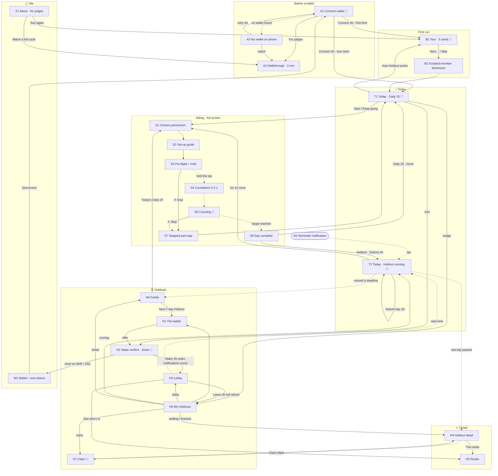

# Holdout — screen map (hackathon build)

**Version:** 1.1 · **Date:** 2026-10-05 · **Scope:** the devnet hackathon build only. Post-hackathon screens are parked in §9.

**Purpose.** One place that lists every screen the app needs, what each one shows, and where a member can go from it. It is the brief for visual design: each card in §5 is one frame (or one set of frames) to draw.

**Visual base:** the draft canvas *"Holdout — hero screens"* (claude.ai design canvas, 7 phone boards at 390 × 844, dark, tokens from PRD §11). Cards marked 🎨 describe that board. Every other card is written so it can be drawn in the same look (§2).

> **Precedence.** This file describes screens; it decides no mechanic. Where it disagrees with the spec or `holdout_v1_prd.md` §10, they are right and this file is a bug. Behaviour is checked against `kotlin/app/src/main/kotlin/holdout/app/` at commit `31bcdb8`. Where the draft disagrees with the spec, §7 lists it.

## Contents

1. [How to read this](#1-how-to-read-this)
2. [The visual base — from the draft](#2-the-visual-base--from-the-draft)
3. [Navigation — the draft's bottom bar](#3-navigation--the-drafts-bottom-bar)
4. [The whole map](#4-the-whole-map)
5. [Screen cards](#5-screen-cards)
6. [Inventory at a glance](#6-inventory-at-a-glance)
7. [Draft vs spec — fix before final](#7-draft-vs-spec--fix-before-final)
8. [What to draw next, and what to build](#8-what-to-draw-next-and-what-to-build)
9. [Parked — after the hackathon](#9-parked--after-the-hackathon)
10. [Journeys through the map](#10-journeys-through-the-map)

---

## 1. How to read this

### Tiers

| Tier | Means | Test |
|---|---|---|
| **MUST** | The core loop, or a judge's run-through, breaks without it | Remove it and someone gets stuck, loses money they could have kept, or can't see the product |
| **SHOULD** | Specified in the PRD, or a real member reaches it. The build works without it but feels broken or confusing there | Remove it and the member is confused, or the app quietly hides a fact the PRD says it must state |
| **NICE** | Polish, delight, conversion. Nobody is stuck without it | Remove it and only the feel of the product suffers |

### Status — two columns, kept apart

| | In the app (code) | In the design (draft canvas) |
|---|---|---|
| Done | ✅ Built | 🎨 Drawn |
| Partly | 🟡 Partial — a PRD variant is missing | ✏️ Drawn, but needs changes (§7) |
| Not yet | ⬜ Not built | · Not drawn |

### IDs

Each screen has an ID: a letter for its area and a number. Arrows on the map and in the cards use those IDs.

| Area | Letter | Lives in |
|---|---|---|
| Before a wallet | **A** | outside the app shell |
| First run | **B** | outside the app shell |
| Today | **T** | tab ⌂ |
| Sitting (camera) | **S** | full screen, no bar |
| Holdouts | **H** | tab ☰ (H4, H5 also under tab ∿) |
| Wallet and tokens | **W** | tab ◯ |
| About | **X** | tab ◯ |
| System moments | **N** | overlays, OS dialogs, the wallet app |

---

## 2. The visual base — from the draft

Every new board reuses these. The values are the draft's tokens note (PRD §11).

| | |
|---|---|
| **Frame** | 390 × 844, black canvas `#000000`, 20 px side gutter, ~40 px top padding, no app bar |
| **Surfaces** | surface/1 `#0B1214` (cards) · surface/2 `#121B1D` (nav bar, sheets) · surface/3 `#1A2426` (chips, pills) · hairline white 10 %. No shadows: a surface level and a hairline do the separating |
| **Text** | white · 70 % · 48 % |
| **Colour roles** | accent `#80ECFF` (time, the Daily 25, links) · success `#14F195` (standing, gains, settled) · warning `#FF623A` (streak flame, forfeits, last minutes) · celebration `#9945FF` |
| **Gradient** | `#9945FF → #14F195`, **only** on day complete and claim |
| **Type** | Roboto 300 for big numbers (56–96 px, tabular figures), 500 for titles · JetBrains Mono for every amount and countdown · labels 11–12 px, uppercase, +0.08 em tracking, 48 % white |
| **Shape** | cards radius 24 · sheets 28 · buttons, chips, nav pill fully round |
| **Components seen in the draft** | **primary button** (white pill, 56 px, black label) · **secondary button** (transparent, 24 % white outline, 44 px) · **card** (surface/1 + hairline, 20 px padding) · **key–value row** (label 70 % left, mono value right, hairline between) · **section label** (uppercase, with a mono hint on the right) · **status chip** (`devnet`, `free`, `settled`, streak 🔥 12) · **bank ring** (3 segments of 10) · **block bars** (3 bars during counting) · **hint pill** (sitting) · **bottom sheet** (grab handle, scrim 65 %) · **bottom bar** (76 px, surface/2, active item = white pill) |

---

## 3. Navigation — the draft's bottom bar

**Today the code is hub-and-spoke:** every screen comes back to Home through "← Home", and Home's lower half carries everything else. The draft draws a four-icon bar on Today and Home. This section gives each icon a job.

```
  ┌──────────┬──────────┬──────────┬──────────┐
  │   ⌂      │    ∿     │    ☰     │    ◯     │   ← draft icons: house · pulse · list · person
  │  Today   │  Crowd   │ Holdouts │    Me    │   ← proposed labels (the draft has none)
  └──────────┴──────────┴──────────┴──────────┘
```

| Tab | Root | Holds | Badge |
|---|---|---|---|
| **⌂ Today** | T1 or T2: whichever applies today | The one thing to do today. Open Holdouts stay on T1, as the draft draws them | Dot while today's reps are not done |
| **∿ Crowd** | H4 for the Holdout you're running (or last ran) | The live crowd: still standing, how it thinned, H5 roster. Empty state → the running Holdouts you could watch, then *"Join one to have a crowd"* → ☰ | Dot when people dropped since you last looked |
| **☰ Holdouts** | H0 My Holdouts + the ladder | H1 ladder, H2 stake (sheet), H3 lobby, H6 forfeit, H7 claim, finished Holdouts | Dot when a claim is waiting |
| **◯ Me** | W1 | Wallet address, SKR + SOL, the faucet, streak, disconnect, and X1 About · for judges (walkthrough, tour, weaknesses, scripted wallets) | Dot when SKR or SOL is too low to stake or submit |

> **Assumption to confirm:** the draft's icons are unlabelled. The pulse is read as *Crowd* (PRD §10.1a: "the crowd is the product") and the list as *Holdouts*. If pulse was meant for activity or stats, Crowd folds into ☰ and pulse waits for post-hackathon stats (§9). Either way the icons need text labels for accessibility.

**Rules**

1. **The bar shows on tab roots only** (T1/T2, H4-as-Crowd, H0, W1). Pushed screens carry a back arrow to their tab root.
2. **Sitting (S) and first run (A, B) are full screen, with no bar.** The phone is on the floor; nothing should be tappable by accident.
3. **Stake confirm (H2) is a bottom sheet**, as drawn. It opens over whatever offered the Holdout (T1, H1, A1 cards after connect).
4. **Today never becomes a list.** It shows today's action, the open Holdouts (T1), and at most one nudge line per Holdout needing a tap (claim ready, lobby closing).
5. **A screen that sends a transaction never just fails when funds are short.** It opens the faucet (W1) as a sheet and comes back (ES-0a).
6. **App open lands on Today**, including from a reminder (N2).

**What moves where, from today's Home (`HoldoutApp.kt`, `below = {…}`):**

| On Home today | Moves to |
|---|---|
| "Holdouts open to join" | stays on ⌂ T1 (draft) and also on ☰ H1 |
| Your lobby / forfeit / settling / claim cards | ☰ H0 "Yours"; one-line nudge stays on ⌂ |
| "Past Holdouts" | ☰ H0 "Finished" |
| "The ladder" | ☰ H1 |
| "Who's still standing", "Holdout details" (T2) | ∿ Crowd |
| "Get test tokens · N SKR held", "Disconnect …" | ◯ Me |
| "About · for judges", "About · wallet" | ◯ Me → X1 |
| "How Holdout works" (draft T1 row) | stays on T1 → B1 |

---

## 4. The whole map

Solid arrows are taps; dotted arrows happen on their own (chain state, time, a notification). **✍ = the wallet app opens to sign** (N1); the arrow shows where the member lands once it returns, and on failure they stay put with a notice. Tab roots are always one tap apart through the bar, so those arrows are not drawn.



---

## 5. Screen cards

Each card gives **tier · code status · design status**, why the screen exists, how you get in, what's on it from top to bottom, its variants, and every way out.

### A — Before a wallet

#### A1 · Connect wallet — "First open"
**MUST · ✅ Built · 🎨 Drawn** (board *1 · First open*) · `wallet/ConnectScreen.kt` · PRD #2, FR-001a

**Job:** the front door. A wallet is required before anything, even the free Daily 25, so this screen has to sell the product while it asks.

**Entered from:** app launch with no wallet connected · ◯ Me → Disconnect

**On screen (as drawn, top → bottom)**
1. Wordmark `HOLDOUT` (tracked caps) · `devnet` chip, right
2. Headline, 38 px light: **Stake on yourself.** / *Prove it every day.* (second line 48 %)
3. Two bullets, accent dot and green dot:
   - **The Daily 25** — free, every day, on your own. 25 push-ups, counted by the camera, and a streak.
   - **A Holdout** — stake SKR and run 7 or 21 days with everyone else. Miss a day and your stake goes to the people still standing.
4. Section label `LIVE RIGHT NOW` · mono hint `devnet · test SKR`
5. Two live cards, read from devnet with no wallet:
   - running: `21-DAY · DAY 12` · `running` (green) · **189 / 312** still standing · prize pool `48,200 SKR`
   - open: `7-DAY · STARTS MONDAY` · `open` (accent) · **14** joined so far · at stake `12,500 SKR`
6. Spacer → **Connect wallet** (primary)
7. Links: *No wallet yet?* (accent) · *For judges: full cycle, 3 min* (48 %)

**Variants to draw:** connecting (*"Waiting for the wallet…"*) · wallet error notice · chain not read yet (live cards as skeletons) · `TEST COHORT` badge on a short test cohort · **no wallet** → A3

**Exits:** Connect → N1 → B1 (first time) or T1 · *No wallet yet?* → A3 · judges link → A2

#### A2 · Walkthrough — a full cycle
**MUST · 🟡 Partial** (shows *"Recording in progress"* until the video is bundled) **· · Not drawn** · `WalkthroughScreen` · PRD #13, FR-044

**Job:** a judge can't wait seven days. A 3-minute recording of the real app on the devnet test cohort covers launch, connect, faucet, ladder, stake, lobby, sitting, a completed day, the crowd thinning, a forfeit, settlement and the claim.

**Entered from:** A1 / A3 link (the only screen reachable without a wallet) · ◯ Me → X1

**On screen:** back · `A FULL CYCLE` · video (play/pause, scrubber, chapter ticks for each step above) · caption: *recorded on devnet, on a disclosed short test cohort with compressed days*

**Variants:** not yet bundled · playing · finished (→ **Connect wallet** with no wallet, **Back** otherwise)

**Exits:** back → A1 or X1

#### A3 · No wallet on this phone
**MUST · ✅ Built** (a variant of A1) **· · Not drawn** · ES-0

**On screen:** A1's header and live cards, then a card: **You need a Solana wallet** — a wallet holds your keys and signs for you; Holdout never holds them. On a Seeker, Seed Vault Wallet is built in. On other phones, install a Solana wallet that supports Mobile Wallet Adapter, set it to devnet, then come back. · **Connect wallet** (retry) · *Watch a full cycle (3 min)*

**Exits:** retry → N1 · watch → A2

---

### B — First run

#### B1 · Tour — how it works
**MUST · ✅ Built · 🎨 Drawn** (board *2 · card 2 of 3*; cards 1 and 3 still to draw) · `tour/TourScreen.kt` · PRD #2a, FR-067

**Job:** three cards so a member knows the two products and how reps are counted before the first rep.

**Entered from:** first connect for this wallet · T1 *"How Holdout works"* · ◯ Me → X1 *"Tour again"*

**On screen (as drawn):** `HOW IT WORKS · 2 OF 3` · *Skip* (right) → illustration → title (30 px light) → body (70 %) → small print (48 %) → progress dots (active = long pill) → **Next** / **Start**

| Card | Title | Illustration | Says |
|---|---|---|---|
| 1 | The Daily 25 | *to draw:* 25 dots filling in blocks of 10 | 25 push-ups, free, every day, counted by the camera. All at once or 10 at a time. Builds a streak, stakes nothing |
| 2 🎨 | A Holdout | 12 dots on DAY 1 → 5 green, 7 faded on DAY 7: *5 still standing · 7 lost their stake* | Stake SKR and everyone starts together on Monday. Miss a day → stake to those still standing. Finish → stake back + share. *If nobody drops out, everybody gets exactly their stake back* |
| 3 | How reps are counted | *to draw:* phone at 45° and head-on | Daily 25: in front or at 45°, knees welcome. Staked: 45° only, from the toes. The camera never leaves the phone |

**Exits:** Start / Skip → B2 → T1 · from T1 or X1 → back there

#### B2 · Scripted-member disclosure
**SHOULD · 🟡 Partial** (text exists on H5 and X1, but there's no first-run moment) **· · Not drawn** · PRD #3, FR-043a

**Job:** before anyone joins, say plainly that Holdouts during judging include scripted members: real wallets under the same rules, whose days are not camera-verified, filling a Holdout only up to its minimum (20 in a 7-day, 12 in a 21-day).

**Proposal:** a fourth tour card in the same layout. Illustration: the DAY 1 dot row with a few dots outlined and marked `SCRIPTED`.

**Exits:** Got it → T1 · *See the wallets* → X1

---

### T — ⌂ Today

#### T1 · Today — the Daily 25 and Holdouts to join
**MUST · ✅ Built · 🎨 Drawn** (board *3 · Today*) · `home/HomeScreen.kt` · PRD #4, §10.1a, FR-053

**Job:** with no Holdout running, the free challenge is the hero and the open Holdouts sit right under it. Never empty, never "come back later".

**Entered from:** app open · tab ⌂ · S6 / S7 · H1 Daily 25 rung

**On screen (as drawn, top → bottom)**
1. `TODAY` label · streak chip (flame, mono `12`) right
2. **Daily 25 card:** `THE DAILY 25` + `FREE` chip · **25** push-ups (60 px) · *all at once, or 10 at a time* · **Start** (primary) · `4h 06m left today` (mono, accent)
3. Section label `HOLDOUTS OPEN TO JOIN` · hint `$10 – $100 in SKR`
4. Offer cards, each with an outlined **Join** button:
   - **7-day** · starts Monday · `12,500 SKR` at stake · 14 joined · `closes in 6h 12m`
   - **21-day** · starts Monday · `9,000 SKR` at stake · 9 joined · `+2,400 SKR carried over` from a Holdout nobody finished
5. Row link: ⓘ **How Holdout works** · *3 cards*
6. Bottom bar, ⌂ active

**Variants to draw**
- **Part-way:** *15* · *to go · 10 banked* · **Keep going** (the bank ring from T2 fits here too)
- **Done:** `TODAY` · *25* in green · *done* · no button · streak chip +1. *NICE:* *"Want money on it? Join a 7-day Holdout"* above the offers (PRD §10.2)
- **Offline / chain unknown:** *"devnet unreachable — the Daily 25 still works"*; countdown `—`; offers replaced by that line
- **Holdouts not live:** *"Holdouts are not live on devnet yet"*
- **Nudges** (from ☰): one-line rows above the offers, e.g. *Claim 1,412 SKR →* · *Lobby · starts in 2d 4h →*
- **None open in a league:** *"The next Holdout opens soon."* (ES-15)
- *SHOULD, not built:* **yesterday missed** → *"Yesterday ended at 20 of 25. Today starts fresh."* (ES-3) · **new phone** → *"No banked reps on this device today. 25 to go."* (ES-3a)

**Exits:** Start / Keep going → S1 · Join → H2 sheet · How Holdout works → B1 · nudge → ☰ H0 / H3 / H7

#### T2 · Today — in a Holdout
**MUST · ✅ Built · ✏️ Drawn** (board *5 · Home — in a Holdout*; see §7) · `home/CohortHome.kt` · PRD §10.1a, FR-038, FR-047, FR-024b

**Job:** *the crowd is the product.* The survivor counter and the prize pool are the biggest things on screen, and they move at the deadline itself.

**Entered from:** app open while standing in a running Holdout · N2 reminder · H3 at start time · ☰ H0 running card

**On screen (as drawn, top → bottom)**
1. `21-DAY HOLDOUT · DAY 12 OF 21`
2. **189** / 312 (68 px; total in 48 %) · `STILL STANDING` · ▲ *3 dropped since yesterday* (green)
3. Card: **Prize pool** `48,200 SKR` · hairline · **Your share now** `255 SKR` / *≈ $6* · *+17 SKR since yesterday* (green)
4. Bank ring (1 of 3 segments) with `10` · **10 banked today** · *one block of 10 · 15 reps to go*
5. **Do 15 more** (primary)
6. Footer row: flame `12` *day streak* · `4h 06m left` (mono, accent)
7. Bottom bar, ⌂ active

**Today's-state variants to draw** (the button and ring area change; the counter and pool stay)
| State | Shows | Action |
|---|---|---|
| To do | ring empty · *25 push-ups still needed today* | **Start today's 25** |
| Part-way (drawn) | ring 1/3 · *10 banked today* | **Do 15 more** |
| Last 10 min | time in warning colour + *"Under 10 minutes left. You can still start — the deadline is the chain's"* | Start (never blocked) |
| Offline, not done | warning card: reps can be done, the day counts only once submitted before the deadline | Start |
| Done, not submitted | ring full · *"Done — tap to submit"* · time left | **Submit day 12** → N1 |
| Short of SOL to submit | notice + **Get test tokens** | → W1 sheet |
| Submitted | ring full in green · *"Today is done and on chain."* · *"Next day opens in …"* | — |

Also on T2: a `TEST COHORT` badge when short; nudges for your other Holdouts (a lobby joined for later, a claim waiting); a quiet *"The Daily 25"* link; and the way into ∿ Crowd (tap the counter, or the tab).

**Exits:** Start / Do N more → S1 · Submit → N1 · counter or ∿ → H4 · deadline missed → H6 · last day passed → H4 (settling)

---

### S — Sitting (full screen, no bar)

One continuous camera screen in steps (`SittingViewModel.Step`: PREFLIGHT → COUNTDOWN → COUNTING → COMPLETE). The same screen serves the Daily 25 (front or 45°, knees allowed) and a Holdout day (45° only, from the toes). **Shared chrome, as drawn on S5:** ✕ stop button (40 px circle, top left) · centre label (`DAY 12 · 25 REPS` or `THE DAILY 25`) · dark gradients top and bottom over the camera · skeleton in accent. Audio carries it, because the member is on the floor.

#### S1 · Camera permission
**MUST · ✅ Built · · Not drawn**

**On screen:** camera-shaped empty state · *"Holdout counts your reps on this phone, so it needs the camera. No video ever leaves the device."* · **Allow camera** → OS dialog (N4) · *denied twice:* how to switch it on in Settings (SHOULD)

**Exits:** allowed → S2 (or S3 if the guide is turned off) · ✕ → back

#### S2 · Set-up guide — "Before you get down"
**MUST · ✅ Built · · Not drawn** · `sitting/PlacementGuide.kt`

**Job:** read while the phone is still in hand, since the countdown can't start behind it. Draw it as a bottom sheet over the camera.

**On screen:** placement drawings with captions — head-on (*head towards the phone, hands ~1.5 m from it*), 45° (*ahead of your shoulder, ~1.5 m away*); staked: *at 45° only* · position checklist (top of a push-up; whole body head to feet; line up with the outline; staked: on your toes, turn a little so the near knee shows; Daily 25: knees welcome) · how it runs (hold the top → ring fills → *three, two, one, go*; a beep per rep; banked every 10; ✕ any time) · ☐ *Don't show this again* · **Got it**

**Variants:** Daily 25 · Staked · detected view highlighted

#### S3 · Pre-flight and hold the start position
**MUST · ✅ Built · · Not drawn** — the next sitting board to draw

**On screen:** camera + floor/outline guide (comes off once aligned) · four pills turning green: **Lighting · Whole body in frame · Camera view · Background still** · one big coach line, also spoken (*Phone to 45°*, *Knees up*, *Move back*, *Can't see knees*) · once all green, a **hold ring** fills while the member holds the top · if it won't fill, the reason · *How to set up* link · deadline (Holdout)

**Variants:** looking… · each pill failing · staked refusal from too far in front (says which way to turn) · loose trousers · *NICE, not built:* after three failures, a **tip sheet** with the common fixes (PRD §10.4)

**Exits:** hold complete → S4 · How to set up → S2 · ✕ → S7 / back

#### S4 · Countdown
**MUST · ✅ Built · · Not drawn** — **3 · 2 · 1** at the S5 counter's size, spoken. **Exits:** → S5

#### S5 · Counting
**MUST · ✅ Built · 🎨 Drawn** (board *6 · Sitting — counting*)

**On screen (as drawn):** camera + skeleton · hint pill mid-screen (*"lower — chest closer to the floor"*) · bottom: **17** *of 25* (96 px) · three block bars (full / 70 % / empty) · *10 banked · 7 this set* · `4h 06m left` (mono, accent)

**Variants to draw:** block just banked (bar fills, *"20 banked"* toast, chime) · last 10 minutes (time in warning colour; never a block) · refused rep hint (*"knees off the floor"*)

**Exits:** target reached → S6 · ✕ → S7

#### S6 · Day complete
**MUST · ✅ Built · · Not drawn** — one of the two places the gradient is allowed

**On screen:** **25** in green · `DONE` · gradient sweep · one button:
- Daily 25 → **Done** → T1 (streak +1, *NICE:* flame flourish *"13-day streak"*)
- Holdout day → **Submit day 12 to the chain** → N1 → T2 *"on chain"*

*NICE, not built:* after a Daily 25 with no Holdout → *"Want money on it? Join a 7-day Holdout."* → H1 (PRD §10.2)

#### S7 · Stopped part-way
**SHOULD · 🟡 Partial** (✕ returns home, which shows the banked count, but there's no summary) **· · Not drawn** · ES-1, ES-2

**On screen:** *"17 done — 10 banked, 7 not kept. Come back any time before 5h 12m runs out."* · the three block bars (the third empty) · **Back to today**

**Crash variant** (ES-1, SHOULD): on reopen, *"Your 10 banked reps are safe. 15 to go."* Recovery itself is built (`BankingController.recover`); the message isn't.

---

### H — ☰ Holdouts and ∿ Crowd

#### H0 · My Holdouts (☰ root)
**SHOULD · ⬜ Not built as a screen** (the pieces are cards on Home today) **· · Not drawn**

**On screen**
1. **Yours** — a card per Holdout with its stage (`Journey.stage`), drawn like T1's offer cards with a status word on the right (as on A1's live cards):
   | Stage | Card | Opens |
   |---|---|---|
   | Lobby / locked | *In the lobby · starts in 2d 4h* | H3 |
   | Active | *Day 12 of 21 · 189 standing · 15 to go today* | T2 |
   | Forfeited | *Out after 6 days* (warning) | H6 |
   | Settling | *You finished · settlement in progress* | H4 |
   | Ready to claim | *You finished · claim 1,412 SKR* (green) | H7 |
2. **Open to join** — T1's offer cards with **Join** → H2
3. **The ladder →** H1
4. **Finished** — *Finished · claimed N SKR* → H4

**Empty:** the offers + *"Leave any time before joining closes, for a full refund."*

#### H1 · The ladder
**MUST · ✅ Built · ✏️ Partly drawn** (the *leagues* list behind the stake sheet; §7) · `ladder/LadderScreen.kt` · PRD #5, US-1

**On screen (top rung first):** back · **The ladder** · `LOCKED` **Human Flag** — *Coming after the 21-day Holdout. Not in this build.* · `21-DAY HOLDOUT` — the rule (*clear a 7-day first*) and that it's off in this build, your unlock still recorded (or *Unlocked*) · its offers · `7-DAY HOLDOUT` — *The entry rung and the comeback lane. A new one starts every Monday 05:00 UTC.* · offers · `SHORT TEST COHORT` (if any) · `THE DAILY 25` — *25 push-ups, free, every day. Builds your streak. Stakes nothing, pays nothing.*

**Variants:** none open in a league → *"None open to join right now."*

**Exits:** offer → H2 sheet · Daily 25 → T1 · back → H0

#### H2 · Stake confirm (bottom sheet)
**MUST · ✅ Built · ✏️ Drawn** (board *4 · Stake confirm*, interactive chips; §7) · `stake/StakeSheet.kt` · PRD #6, US-6, FR-041, FR-021a

**Job:** everything a member must know before money moves, including the counting rule, so it isn't discovered at the first sitting.

**On screen (as drawn, plus what the spec requires — ➕)**
1. Grab handle · **Join the 7-day Holdout** · *25 push-ups a day · starts Monday 05:00 UTC*
2. Four chips: **$10 / $25 / $50 / $100**, each with its SKR amount (mono); the picked one has an accent outline
3. Card: **Your stake** `1,250 SKR` / *≈ $25* · hairline · **At stake now** `4,800 SKR` ➕ *· 14 joined* ➕ *+ carry-over* · **Joining closes in** `6h 12m`
4. *If nobody drops out, you get exactly your stake back. The prize is what the members who quit leave behind.*
5. **How reps are counted here** (drawn: a surface/3 row with a 45° phone icon, under the reassurance line): *At 45° only: phone on the floor ahead of your shoulder. Full push-ups from your toes — push-ups from the knees don't count.* (FR-021a: required before staking)
6. ➕ *Miss a day: your stake goes into the prize pool — 80 % to the pool, 20 % fee.* · *Leave for a full refund until joining closes.*
7. **Stake 1,250 SKR** (primary)
8. `TEST NETWORK · TEST TOKEN`

**Variants to draw**
| Condition | Shows | Button |
|---|---|---|
| Not enough SKR | *"You hold X. This chip needs Y."* + **Get test tokens** | disabled |
| Not enough SOL | *"…too little devnet SOL to pay for joining…"* + **Get test tokens** | disabled |
| Joining closed / already in a lobby / overlaps current run | one-line notice each | disabled |
| Signing | *"Waiting for the wallet…"* | disabled |
| Landed after cutoff | *"Joining closed before your transaction landed. Nothing was taken."* (ES-12) | — |

**Exits:** Stake → N3 (first join only) → N1 → H3 · Get test tokens → W1 sheet → back here · drag down → where it opened from

*NICE, not built:* **H2a "You're in"** between signing and the lobby: *"You're in. 7 days from Monday 05:00 UTC."* + **Do today's Daily 25** / **See the lobby**.

#### H3 · Lobby
**MUST · ✅ Built · · Not drawn** — the first missing MUST board · `lobby/LobbyScreen.kt` · PRD #7, US-2, ES-12a

**On screen:** back · `LOBBY` (or `LOBBY · LOCKED`) · **7-day Holdout** · *starts in* **2d 04h 12m** (large mono, accent) · card: **14 members · 12,500 SKR at stake** · *Your stake: 1,250 SKR — held by the contract, not by us* · *Joining closes in 6h 12m. Until then you can leave with your full stake back.* (locked: *Joining has closed. This is the final roster.*) · *From the start: 25 push-ups before each day's deadline, at 45°, from your toes* · **See who's in** (secondary) · **Leave — full refund** (secondary, warning text)

**Variants:** open · leaving · locked (no Leave) · leave landed after cutoff (*"Leaving closed before your transaction landed. You're in the cohort."*)

**Exits:** See who's in → H5 · Leave → N1 → H0 · start time → T2

#### H4 · Holdout detail (∿ Crowd root)
**MUST · ✅ Built · · Not drawn** · `cohort/CohortDetailScreen.kt` · PRD #11, US-7

**On screen:** `21-DAY · DAY 12 OF 21` · *(end-state card, see variants)* · **Where it stands:** *189 still standing of 312* · prize pool · carry-over · *9 days to go* · **Your record:** *11 of 21 days · stake 1,250 SKR* · *projected share if the crowd held here* · **How the crowd thinned:** today a list (*After day 1: 301 standing …*); draw it as a step chart or the tour's dot rows (*NICE*) · **The roster →**

**Variants:** running · **settling** (*"You finished · settlement in progress. Your claim opens the moment it's done."*) · **claimed** (*"Claimed · 1,412 SKR"* + explorer link) · as a non-member (no *Your record*) · ∿ empty (no Holdout yet)

**Exits:** The roster → H5 · settled → H7

#### H5 · Roster
**MUST · ✅ Built · · Not drawn** · `roster/RosterScreen.kt` · PRD #12, FR-062, FR-043a

**Job:** who is still in. **No amounts anywhere**, so nobody is ranked by money.

**On screen:** back · **7-day Holdout · roster** · scripted-member note (48 %) · `STILL STANDING · 189` · rows: short address (`· you` on yours) · `standing` (green) / `out after 3 days` (warning), with a `SCRIPTED` chip where it applies · fallen after, by days lasted

**Variants:** reading devnet… · lobby (everyone standing; final once locked)

**Exits:** back → T2 / H3 / H4

#### H6 · Forfeit
**MUST · ✅ Built · · Not drawn** · `cohort/ForfeitScreen.kt` · PRD #9, US-4

**On screen:** back · `21-DAY HOLDOUT` · **You missed day 7.** (warning) · card: *You lasted 6 of 21 days. The deadline passed before day 7 reached the chain, so your stake of 1,250 SKR went into this Holdout's prize pool — 80 % to the pool, 20 % fee.* (+ *"final from the deadline; the record catches up on the next automation pass"* if not yet recorded) · card with green flame: **Your 9-day streak is still alive.** *A forfeit ends a Holdout, never your streak.* · `TWO WAYS BACK` · **Today's Daily 25** (primary) · **The next 7-day Holdout** (secondary)

**Illustration idea:** the tour's DAY 7 dot row with *your* dot faded. Same language, no blame.

**Variants:** recorded / not yet recorded · tried to submit after the deadline (ES-4)

**Exits:** Daily 25 → S1 · next 7-day → H1

#### H7 · Claim
**MUST · ✅ Built · 🎨 Drawn** (board *7 · Claim*) · `claim/ClaimScreen.kt` · PRD #10, US-8, FR-035

**On screen (as drawn):** `7-DAY HOLDOUT` · `settled` chip (green) · amount card: *You finished all 7 days* · **1,412** SKR (56 px) · *≈ $28 · yours to claim* · gradient bar under it · breakdown card: **Stake returned** `1,250 SKR` · **Share of the prize** `162 SKR` (green) · hairline · *9 of 20 members dropped out. Their stakes, minus the 20 % fee, were split between the 11 who finished.* · settled card: **Settled** `5 Oct 05:00 UTC` · `4Bx9…7Qk2 · view on explorer →` · **Claim 1,412 SKR** · *Your wallet signs one transaction. Unclaimed prizes stay here.*

**Variants to draw:** signing · **claimed** (amount in green, gradient sweeps once, button becomes **Next Holdout →** *NICE*) · short of SOL → W1 sheet · nobody dropped out (*"Nobody dropped out — your stake comes back in full"*)

**Exits:** Claim → N1 → claimed · back → H0

---

### W, X — ◯ Me

#### W1 · Me — wallet and test tokens
**MUST · 🟡 Partial** (the faucet is built as `faucet/FaucetSheet.kt`; address and disconnect live on Home and About today) **· · Not drawn** · PRD #3a, ES-0, ES-0a, ES-0b

**On screen (proposed)**
1. Short address (copy) · `devnet` chip
2. Streak chip, large: flame **12** *day streak*: the Daily 25 identity, lives here as well as on T1
3. Card: **You hold** `N SKR` · hairline · *for fees* `0.012 SOL`
4. Card: *One tap a day gives you X SKR — enough for the largest chip — and devnet SOL for fees if you have none. Test network, test token, nothing here has value.* · **Get test tokens** (primary)
5. Outcome notice
6. Rows: **About · for judges →** X1 · **How Holdout works →** B1 · **Disconnect wallet** + *"Switched your wallet's network? Disconnect and connect again."*

**Faucet variants:** funded (*"Done. The tokens are in your wallet."*) · used today (*"Back in 6h 40m"*, button off) · can't pay out (*"It isn't something you did — it refills automatically"*) · sending…

**As a sheet:** from H2, T2 or H7 when short, it shows only cards 3–5 and returns there.

**Exits:** Get test tokens → N1 · About → X1 · Disconnect → A1

#### X1 · About · for judges
**MUST · ✅ Built · · Not drawn** · `about/AboutScreen.kt` · FR-043a, FR-044, constitution XI

**On screen:** back · **About Holdout** · *Devnet only, with a mock SKR token* · **Watch a full cycle (3 min)** · **The three-card tour again** · `KNOWN WEAKNESSES · N` — a card each (what · why · *Real fix:* in accent), from `assets/weaknesses.json`, the same source as the README · `SCRIPTED MEMBERS · N WALLETS` + explanation + every address (mono, 48 %) · *NICE:* app version, program ID, source link

**Exits:** watch → A2 · tour → B1 · back → W1

---

### N — System moments (not screens, but design must account for them)

| ID | Moment | Tier · Status | From → to |
|---|---|---|---|
| **N1** | **Wallet app signs** (Mobile Wallet Adapter): connect, join, leave, submit day, claim, faucet | MUST · ✅ | A1, H2, H3, T2/S6, H7, W1 → back with the result in a notice line; the calling button reads *"Waiting for the wallet…"* |
| **N2** | **Reminder notification** (on-device): the Holdout starts; before each deadline not yet met; *"submit your day"* when done but not on chain | SHOULD · ✅ | OS → T2 |
| **N3** | **Notification permission**, asked once at the first join with the reason shown on H2; the join goes ahead either way | SHOULD · ✅ | H2 → N1 |
| **N4** | **Camera permission**: the OS dialog behind S1 | MUST · ✅ | S1 → S2/S3 |
| **N5** | **"Dropped since yesterday"**, once per new day | SHOULD · 🎨 drawn on T2, ⬜ not built | T2 line (and ∿ badge); tap → H4 |

---

## 6. Inventory at a glance

| ID | Screen | Tier | Code | Design | Tab | Reached from | Goes to |
|---|---|---|---|---|---|---|---|
| A1 | Connect wallet | MUST | ✅ | 🎨 | — | launch, W1 | N1, A2, A3 |
| A2 | Walkthrough | MUST | 🟡 | · | — | A1, A3, X1 | back |
| A3 | No wallet | MUST | ✅ | · | — | A1 | N1, A2 |
| B1 | Tour | MUST | ✅ | 🎨 1 of 3 | — | first connect, T1, X1 | B2 / T1 |
| B2 | Scripted-member disclosure | SHOULD | 🟡 | · | — | B1 | T1, X1 |
| T1 | Today · Daily 25 + open Holdouts | MUST | ✅ | 🎨 | ⌂ | launch, S6, S7, H1 | S1, H2, B1, ☰ nudges |
| T2 | Today · in a Holdout | MUST | ✅ | ✏️ | ⌂ | launch, N2, H3, H0 | S1, N1, H4, H6 |
| S1 | Camera permission | MUST | ✅ | · | — | T1, T2, H6 | S2, S3 |
| S2 | Set-up guide | MUST | ✅ | · | — | S1, S3 | S3 |
| S3 | Pre-flight + hold | MUST | ✅ | · | — | S2 | S4, S7 |
| S4 | Countdown | MUST | ✅ | · | — | S3 | S5 |
| S5 | Counting | MUST | ✅ | 🎨 | — | S4 | S6, S7 |
| S6 | Day complete | MUST | ✅ | · | — | S5 | T1, N1 |
| S7 | Stopped part-way / crash | SHOULD | 🟡 | · | — | S3, S5, reopen | T1, T2 |
| H0 | My Holdouts | SHOULD | ⬜ | · | ☰ | tab, T1 nudges | H1, H3, T2, H4, H6, H7 |
| H1 | The ladder | MUST | ✅ | ✏️ | ☰ | H0, H6 | H2, T1 |
| H2 | Stake confirm (sheet) | MUST | ✅ | ✏️ | ☰ | T1, H1, H0 | N3→N1→H3, W1 |
| H2a | You're in | NICE | ⬜ | · | ☰ | N1 after join | S1, H3 |
| H3 | Lobby (+ locked) | MUST | ✅ | · | ☰ | N1, H0 | H5, N1, T2 |
| H4 | Holdout detail | MUST | ✅ | · | ∿ | tab, T2, H0 | H5, H7 |
| H5 | Roster | MUST | ✅ | · | ∿ | H4, H3 | back |
| H6 | Forfeit | MUST | ✅ | · | ☰ | T2 (deadline), H0 | S1, H1 |
| H7 | Claim | MUST | ✅ | 🎨 | ☰ | H4, H0, T1 nudge | N1, H0 |
| W1 | Me · wallet + tokens | MUST | 🟡 | · | ◯ | tab, H2/T2/H7 sheet | N1, X1, A1 |
| X1 | About · for judges | MUST | ✅ | · | ◯ | W1 | A2, B1 |
| N1–N5 | System moments | MUST / SHOULD | see §5 N | | — | — | — |

**Count:** 19 MUST screens (17 ✅ in code; 6 drawn, 3 of them needing changes) · 4 SHOULD screens + 2 SHOULD moments · 1 NICE screen + several NICE additions inside cards.

---

## 7. Draft vs spec — fix before final

Where the draft says something the spec, the PRD or its own tokens note say differently. Each is a small edit to an existing board.

| # | Board | In the draft | Should be | Source |
|---|---|---|---|---|
| 1 | 4 · Stake | ~~**Prize pool now** `4,800 SKR` on a Holdout that hasn't started~~ | ✅ **Fixed on the canvas (5 Oct):** **At stake now**; a lobby has no prize pool, only forfeits create one | the draft's own names note, FR-053 |
| 2 | 4 · Stake | ~~No counting rule~~ | ✅ **Fixed on the canvas (5 Oct):** *How reps are counted here: at 45° only … full push-ups from your toes* | FR-021a, `StakeSheet.kt` |
| 3 | 4 · Stake | No fee line, refund line, joined count or carry-over | Add *80 % to the pool, 20 % fee* · *leave for a full refund until joining closes* · *14 joined* · carry-over | US-6, FR-041 |
| 4 | 4 · Stake, 5 · Home, 7 · Claim | ~~*"Join the 7-day **cohort**"*, `COHORT 14`, *"clear a 7-day **cohort** first"*~~ | ✅ **Fixed on the canvas (5 Oct):** "Holdout" in everything a member reads; *cohort* is the contract's word | H28, the draft's names note |
| 5 | 4 · Stake (background) | 21-day: *"clear a 7-day cohort first"* | Also say it's **off in this build** (`ladder_gate_enabled = false`); add the locked **Human Flag** rung and the **Daily 25** rung | US-1, `LadderScreen.kt` |
| 6 | 1 · First open, 2 · Tour | *"your stake goes to the people still standing"* | *"…goes into the prize pool"*: 20 % is a fee, so not all of it reaches the people standing | PRD §13 honest language |
| 7 | 5 · Home | *Your share now* `255 SKR` | Keep the PRD's words, but it is a projection: *"your share if today's standing held"* in the small print | `CohortHome.kt`, PRD §10.1a |
| 8 | 3 · Today, 5 · Home | Bottom bar icons have no labels | Text labels (Today · Crowd · Holdouts · Me) or at least `aria-label`s | accessibility, §3 |
| 9 | 3 · Today | ~~`+2,400 SKR carried over` *from cohort 13*~~ | ✅ **Fixed on the canvas (5 Oct):** *"from a Holdout nobody finished"*; members never see cohort numbers | H28, `LadderScreen.kt` |
| 10 | all | No `TEST COHORT` badge anywhere | Show it wherever the short devnet test cohort appears (10-minute days) | README known weaknesses |

---

## 8. What to draw next, and what to build

### Boards to draw, in order
MUST screens first, then the variants judges are most likely to hit.

1. **H3 Lobby** (and its locked variant): where every staker waits
2. **H6 Forfeit**: the moment the product most needs to get right
3. **S3 Pre-flight + hold** and **S6 Day complete**: the sitting's start and finish
4. **H4 Holdout detail** (∿ Crowd root) and **H5 Roster**
5. **H1 The ladder** (full screen, all rungs) and **W1 Me**
6. **T2 variants**: done-tap-to-submit, submitted, last 10 minutes
7. **T1 variants**: part-way, done
8. **B1 cards 1 and 3**, **B2 disclosure card**
9. **A3 No wallet**, **A2 Walkthrough**, **X1 About**
10. **S1, S2, S4, S7**, **H0**, **H2a**

### Code gaps — specified or needed, not built

| # | Gap | Tier | Where | Why it matters |
|---|---|---|---|---|
| 1 | Walkthrough video bundled into A2 | MUST | A2 | Judges' only way through a full cycle (FR-044) |
| 2 | Scripted-member disclosure in first run | SHOULD | B2 | PRD screen #3; today a member can stake without seeing it |
| 3 | "Dropped since yesterday" line | SHOULD | T2 / N5 | Drawn already; PRD §10.1a calls it the reason to open the app on a quiet day |
| 4 | Stopped part-way and crash-recovery messages | SHOULD | S7 | ES-1, ES-2 |
| 5 | Bottom bar + H0 + ◯ Me | SHOULD | §3 | Drawn in the draft; Home is carrying ten things below the hero |
| 6 | Bank ring on T2; Join buttons on T1; stake as a sheet | SHOULD | T1, T2, H2 | Drawn in the draft, not yet in the code |
| 7 | Daily 25 missed / new phone messages | SHOULD | T1 | ES-3, ES-3a |
| 8 | Upsell after the Daily 25 | NICE | S6 / T1 | PRD §10.2 conversion line |
| 9 | Pre-flight tip sheet after three fails | NICE | S3 | PRD §10.4 |
| 10 | "You're in" after joining | NICE | H2a | A moment of commitment; offers the first sitting at once |
| 11 | Thinning chart | NICE | H4 | Same data, drawn as the crowd shrinking |

---

## 9. Parked — after the hackathon

Out of scope for this build. Listed so the design system leaves room for them. Source: `docs/archive/holdout_v1_prd_full-vision_2026-09-15.md` §10.1 and PRD Phase 2.

- **League leaderboards** (Phase 2, US-10): by discipline, never by money. Would sit under ∿ Crowd.
- **Personal stats / profile**: total reps, longest streak, Holdouts cleared. Would grow ◯ Me.
- **Share cards**: workout, streak, cohort recap. Swelfie capture and compose.
- **Settings**: notifications, help and FAQ, terms, privacy.
- **Seeker Genesis gate, geo check, terms acceptance**: mainnet onboarding.
- **Automatic offline submission** (Phase 2): T2 *"Done — waiting for network"* replaces *"tap to submit"*.
- **Human Flag** rung and other exercises: H1 already shows it locked.

---

## 10. Journeys through the map

The paths design has to make smooth, with the screens they cross. Times are PRD targets.

- **J1 — First reps, under three minutes (PRD §10.2):** `A1` → ✍ → `B1` → `B2` → `T1` **Start** → `S1` → `S2` → `S3` → `S4` → `S5` → `S6` → `T1` (streak 1) → *NICE:* upsell → `H2`
- **J2 — Stake on yourself:** `T1` **Join** (or `☰ H1` offer) → `H2` sheet → *(short → `W1` sheet → back)* → `N3` (first join) → ✍ → `H3 Lobby` → *(Monday 05:00 UTC)* → `T2`
- **J3 — A day inside a Holdout (PRD §10.3):** `N2` or app open → `T2` (*3 dropped since yesterday*) → **Do 15 more** → `S1…S6` → **Submit** ✍ → `T2` *on chain* · optionally `∿ H4 / H5`
- **J4 — Change your mind before the start:** `☰ H0` → `H3` → **Leave — full refund** ✍ → `H0`. After the cutoff `H3` is locked.
- **J5 — Miss a day:** `T2` → *(deadline)* → `H6` → **Today's Daily 25** (`S1…`) or **The next 7-day Holdout** (`H1` → J2)
- **J6 — Finish and get paid:** `T2` (last day) → `∿ H4` *settlement in progress* → *(settled)* → `H7` → **Claim** ✍ → claimed → `☰ H0` *Finished*
- **J7 — Judge with no wallet that can sign:** `A1` → *For judges* → `A2` → `A1`. Connected: `◯ W1` → `X1` (weaknesses, scripted wallets, `A2`)
- **J8 — Offline:** `T1` the Daily 25 works with no network. `T2` warns before starting; afterwards **Done — tap to submit** once online, and only before the deadline.
