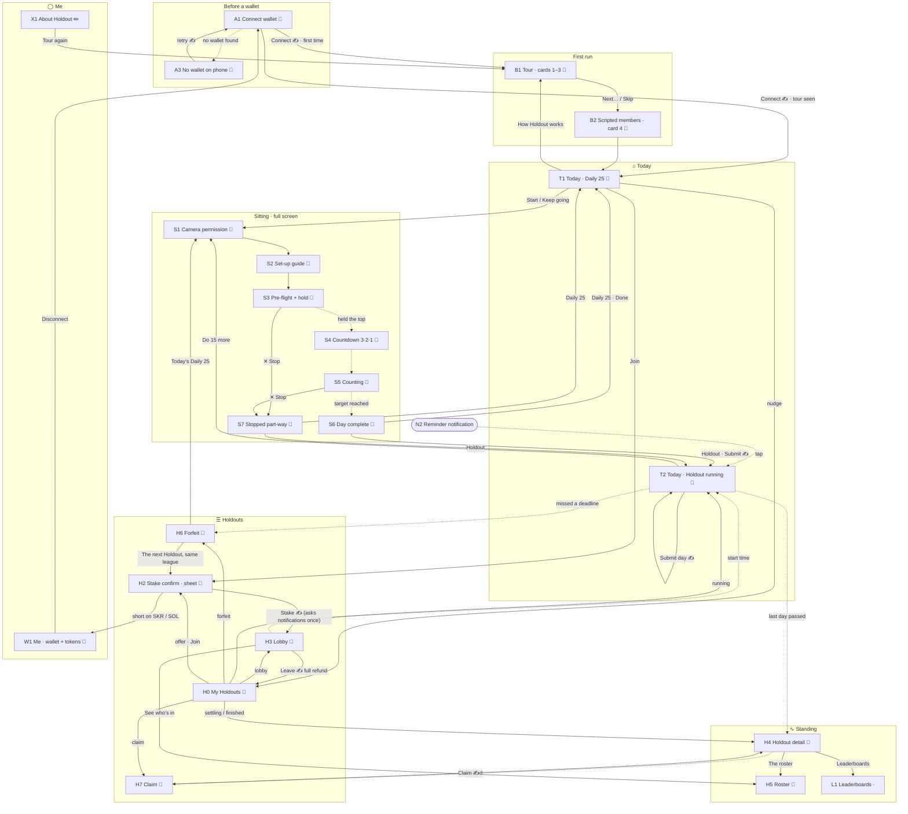

# Holdout — screen map (hackathon build)

**Version:** 2.0 · **Date:** 2026-10-10 (the tab is *Standing*; Easy and Hard; leaderboards L1; the boost, comeback and fee lines; use cases in §11) · **Scope:** the devnet hackathon build only. Post-hackathon screens are parked in §9. Holdout Lab, the tester app, has its own map: `holdout_lab_screen_map.md`.

**Purpose.** One place that lists every screen the app needs, what each one shows, and where a member can go from it. It is the brief for visual design: each card in §5 is one frame (or one set of frames) to draw.

**Visual base:** the draft canvas *"Holdout — hero screens"* (claude.ai design canvas, 7 phone boards at 390 × 844, dark, tokens from PRD §11). Cards marked 🎨 describe that board. Every other card is written so it can be drawn in the same look (§2).

> **Precedence.** This file describes screens; it decides no mechanic. Where it disagrees with the spec or `holdout_v1_prd.md` §10, they are right and this file is a bug. Behaviour is checked against `kotlin/app/src/main/kotlin/holdout/app/` at commit `bb34fd6` (PRs 25 and 28 merged). Where the draft disagrees with the spec, §7 lists it.

> **Two states, one map (decided 2026-10-10).** The boards and the cards describe the **target** navigation: a four-tab bar, *My Holdouts* (H0) and *Me* (W1). The build submitted on **13 October** ships the code as it is, **hub-and-spoke through Home** (`HoldoutApp.kt`): every screen returns to Home with "← Home", and Home carries the offers, the member's own Holdout cards, *Leaderboards*, *Get test tokens* and *About Holdout* below the hero. The bar, H0 and W1 are built after the submission. Each card says which of the two it is drawn for where it matters.

**Decided 2026-10-10 (product owner):** the tab with the crowd is **Standing**; the fee sentence members read is *"80 % stays with members: 70 % to the prize pool, 10 % to this league's boost and comeback reserves. 20 % goes to the project."*; the levels are named **Easy · 7-day** and **Hard · 21-day**.

## Contents

1. [How to read this](#1-how-to-read-this)
2. [The visual base — from the draft](#2-the-visual-base--from-the-draft)
3. [Navigation — the draft's bottom bar](#3-navigation--the-drafts-bottom-bar)
4. [The whole map](#4-the-whole-map)
5. [Screen cards](#5-screen-cards)
6. [Inventory at a glance](#6-inventory-at-a-glance)
7. [Draft vs spec — fix before final](#7-draft-vs-spec--fix-before-final)
8. [What to draw next, and what to build](#8-what-to-draw-next-and-what-to-build)
9. [Parked — after the hackathon](#9-parked--after-the-hackathon)
10. [Journeys through the map](#10-journeys-through-the-map)
11. [Use cases](#11-use-cases)

---

## 1. How to read this

### Tiers

| Tier | Means | Test |
|---|---|---|
| **MUST** | The core loop, or a judge's run-through, breaks without it | Remove it and someone gets stuck, loses money they could have kept, or can't see the product |
| **SHOULD** | Specified in the PRD, or a real member reaches it. The build works without it but feels broken or confusing there | Remove it and the member is confused, or the app quietly hides a fact the PRD says it must state |
| **NICE** | Polish, delight, conversion. Nobody is stuck without it | Remove it and only the feel of the product suffers |

### Status — two columns, kept apart

| | In the app (code) | In the design (draft canvas) |
|---|---|---|
| Done | ✅ Built | 🎨 Drawn |
| Partly | 🟡 Partial — a PRD variant is missing | ✏️ Drawn, but needs changes (§7) |
| Not yet | ⬜ Not built | · Not drawn |

### IDs

Each screen has an ID: a letter for its area and a number. Arrows on the map and in the cards use those IDs.

| Area | Letter | Lives in |
|---|---|---|
| Before a wallet | **A** | outside the app shell |
| First run | **B** | outside the app shell |
| Today | **T** | tab ⌂ |
| Sitting (camera) | **S** | full screen, no bar |
| Holdouts | **H** | tab ☰ (H4, H5 also under tab ∿) |
| Leaderboards | **L** | tab ∿, from H4 |
| Wallet and tokens | **W** | tab ◯ |
| About | **X** | tab ◯ |
| System moments | **N** | overlays, OS dialogs, the wallet app |

---

## 2. The visual base — from the draft

Every new board reuses these. The values are the draft's tokens note (PRD §11).

| | |
|---|---|
| **Frame** | 390 × 844, black canvas `#000000`, 20 px side gutter, ~40 px top padding, no app bar |
| **Surfaces** | surface/1 `#0B1214` (cards) · surface/2 `#121B1D` (nav bar, sheets) · surface/3 `#1A2426` (chips, pills) · hairline white 10 %. No shadows: a surface level and a hairline do the separating |
| **Text** | white · 70 % · 48 % |
| **Colour roles** | accent `#80ECFF` (time, the Daily 25, links) · success `#14F195` (standing, gains, settled) · warning `#FF623A` (streak flame, forfeits, last minutes) · celebration `#9945FF` |
| **Gradient** | `#9945FF → #14F195`, **only** on day complete and claim |
| **Type** | Roboto 300 for big numbers (56–96 px, tabular figures), 500 for titles · JetBrains Mono for every amount and countdown · labels 11–12 px, uppercase, +0.08 em tracking, 48 % white |
| **Shape** | cards radius 24 · sheets 28 · buttons, chips, nav pill fully round |
| **Components seen in the draft** | **primary button** (white pill, 56 px, black label) · **secondary button** (transparent, 24 % white outline, 44 px) · **card** (surface/1 + hairline, 20 px padding) · **key–value row** (label 70 % left, mono value right, hairline between) · **section label** (uppercase, with a mono hint on the right) · **status chip** (`devnet`, `free`, `settled`, streak 🔥 12) · **bank ring** (3 segments of 10) · **block bars** (3 bars during counting) · **hint pill** (sitting) · **bottom sheet** (grab handle, scrim 65 %) · **bottom bar** (76 px, surface/2, active item = white pill) |

### Naming a Holdout (decided 6 Oct)

"Holdout" is the product word (H28), but it's said **once per screen**. A specific Holdout is named by its **length and its dates**, because a new 7-day and a new 21-day start every Monday and the length alone stops being unique after the first week.

| Where | Write | Not |
|---|---|---|
| Cards in a list under a "Holdouts" heading | **21-day** · from 21 Sep | 21-day Holdout |
| A finished one | **7-day** · 28 Sep – 5 Oct | 7-day Holdout |
| Header labels (Lobby, Forfeit, Detail, Claim, Home, Roster, wallet and confirming boards) | `21-DAY · FROM 21 SEP · DAY 12 OF 21` | `21-DAY HOLDOUT` |
| The only mention on a screen (stake sheet, wallet sheet, *You're in*, the Daily 25 upsell) | Join the 7-day Holdout | — |
| Sentences | *your run in this Holdout has ended* | — |

Never *cohort* in anything a member reads, and no names for the lengths: the number of days is the label.

**Levels (H35, decided 2026-10-05; named 2026-10-10).** A Holdout's level is its form, and the level comes first: **Easy · 7-day** (push-ups from the knees count) and **Hard · 21-day** (from the toes only). On a card: **Easy · 7-day** · from 12 Oct. In a header label: `EASY · 7-DAY · FROM 12 OCT · DAY 3 OF 7`. The rule sentence a level carries is read the same everywhere it appears (002 FR-014). *Staked* is not a word members read; it is the code's name for the Hard rules.

**The fee, in one sentence (decided 2026-10-10):** *80 % stays with members: 70 % to the prize pool, 10 % to this league's boost and comeback reserves. 20 % goes to the project.* Used on the stake sheet (H2) and the forfeit screen (H6); nowhere else are percentages shown. The reserves come back as the boost line on offers and the comeback line on Today and the claim.

---

## 3. Navigation — the draft's bottom bar

**Today the code is hub-and-spoke:** every screen comes back to Home through "← Home", and Home's lower half carries everything else. The draft draws a four-icon bar on Today and Home. This section gives each icon a job.

```
  ┌──────────┬──────────┬──────────┬──────────┐
  │   ⌂      │    ∿     │    ☰     │    ◯     │   ← draft icons: house · pulse · list · person
  │  Today   │ Standing │ Holdouts │    Me    │   ← labels, decided 2026-10-10
  └──────────┴──────────┴──────────┴──────────┘
```

| Tab | Root | Holds | Badge |
|---|---|---|---|
| **⌂ Today** | T1 or T2: whichever applies today | The one thing to do today. Open Holdouts stay on T1, as the draft draws them | Dot while today's reps are not done |
| **∿ Standing** | H4 for the Holdout you're running (or last ran) | Who is still standing, how the crowd thinned, the H5 roster, and the **L1 leaderboards**. Empty state → the running Holdouts you could watch, then *"Join one to have a crowd"* → ☰ | Dot when people dropped since you last looked |
| **☰ Holdouts** | H0 My Holdouts | H2 stake (sheet), H3 lobby, H6 forfeit, H7 claim, finished Holdouts | Dot when a claim is waiting |
| **◯ Me** | W1 | Wallet address, SKR + SOL, the faucet, streak, disconnect, and X1 About Holdout (tour, disconnect, test network) | Dot when SKR or SOL is too low to stake or submit |

> **Decided 2026-10-10:** the pulse tab is **Standing** — the state (*still standing*), not a noun for the group, which the design book avoids. *Crowd*, *Live* and *Field* were considered and dropped. The canvas boards still say *Crowd* and are redrawn (§7 #12). The icons carry text labels for accessibility.

**Rules**

1. **The bar shows on tab roots only** (T1/T2, H4-as-Standing, H0, W1). Pushed screens carry a back arrow to their tab root.
2. **Sitting (S) and first run (A, B) are full screen, with no bar.** The phone is on the floor; nothing should be tappable by accident.
3. **Stake confirm (H2) is a bottom sheet**, as drawn. It opens over whatever offered the Holdout (T1, H0, A1 cards after connect).
4. **Today never becomes a list.** It shows today's action, the open Holdouts (T1), and at most one nudge line per Holdout needing a tap (claim ready, lobby closing).
5. **A screen that sends a transaction never just fails when funds are short.** It opens the faucet (W1) as a sheet and comes back (ES-0a).
6. **App open lands on Today**, including from a reminder (N2).

**What moves where, from today's Home (`HoldoutApp.kt`, `below = {…}`):**

| On Home today | Moves to |
|---|---|
| "Holdouts open to join" | stays on ⌂ T1 (draft) and also on ☰ H0 |
| Your lobby / forfeit / settling / claim cards | ☰ H0 "Yours"; one-line nudge stays on ⌂ |
| "Past Holdouts" | ☰ H0 "Finished" |
| "The ladder" | removed (decided 6 Oct): the offers already sit on T1 and H0 |
| "Who's still standing", "Holdout details" (T2) | ∿ Standing |
| "Leaderboards" (Home, built 6 Oct) | ∿ Standing → L1 |
| "Get test tokens · N SKR held", "Disconnect …" | ◯ Me |
| "About · for judges", "About · wallet" (both now "About Holdout") | ◯ Me → X1 |
| "How Holdout works" (draft T1 row) | stays on T1 → B1 |

---

## 4. The whole map

Solid arrows are taps; dotted arrows happen on their own (chain state, time, a notification). **✍ = the wallet app opens to sign** (N1); the arrow shows where the member lands once it returns, and on failure they stay put with a notice. Tab roots are always one tap apart through the bar, so those arrows are not drawn.



---

## 5. Screen cards

Each card gives **tier · code status · design status**, why the screen exists, how you get in, what's on it from top to bottom, its variants, and every way out.

### A — Before a wallet

#### A1 · Connect wallet — "First open"
**MUST · ✅ Built · 🎨 Drawn** (board *1 · First open*) · `wallet/ConnectScreen.kt` · PRD #2, FR-001a

**Job:** the front door. A wallet is required before anything, even the free Daily 25, so this screen has to sell the product while it asks.

**Entered from:** app launch with no wallet connected · ◯ Me → Disconnect

**On screen (as drawn, top → bottom)**
1. Wordmark `HOLDOUT` (tracked caps) · `devnet` chip, right
2. Headline, 38 px light: **Stake on yourself.** / *Prove it every day.* (second line 48 %)
3. Two bullets, accent dot and green dot:
   - **The Daily 25** — free, every day, on your own. 25 push-ups, counted by the camera, and a streak.
   - **A Holdout** — stake SKR and run 7 or 21 days with everyone else. Miss a day and your stake goes into the prize pool.
4. Section label `LIVE RIGHT NOW` · mono hint `devnet · test SKR`
5. Two live cards, read from devnet with no wallet:
   - running: `21-DAY · DAY 12` · `running` (green) · **189 / 312** still standing · prize pool `48,200 SKR`
   - open: `EASY · 7-DAY · STARTS MONDAY` · `open` (accent) · **14** joined so far · at stake `12,500 SKR` · (when the league's reserve holds more than 0) *Prize boost: up to 480 SKR from this league's reserve when it settles* (green, FR-053)
6. Spacer → **Connect wallet** (primary)
7. Link: *No wallet yet?* (accent)

**Variants to draw:** connecting (*"Waiting for the wallet…"*) · wallet error notice · chain not read yet (live cards as skeletons) · `TEST COHORT` badge on a short test cohort · **no wallet** → A3

**Exits:** Connect → N1 → B1 (first time) or T1 · *No wallet yet?* → A3

#### ~~A2 · Walkthrough — a full cycle~~ — removed 9 Oct
The submission is the app's final state, so nothing in it is for judges only (spec 004, constitution v2.1.0). The full cycle is shown in the demo video, sent as a link with the submission, and anyone can run it on a labelled short test Holdout (FR-044a). `WalkthroughScreen` is deleted.

#### A3 · No wallet on this phone
**MUST · ✅ Built** (a variant of A1) **· 🎨 Drawn** (board *21*) · ES-0

**On screen:** A1's header and live cards, then a card: **You need a Solana wallet** — a wallet holds your keys and signs for you; Holdout never holds them. On a Seeker, Seed Vault Wallet is built in. On other phones, install a Solana wallet that supports Mobile Wallet Adapter, set it to devnet, then come back. · **Connect wallet** (retry)

**Exits:** retry → N1

---

### B — First run

#### B1 · Tour — how it works
**MUST · ✅ Built · 🎨 Drawn** (boards *23*, *2*, *24*: cards 1–3 of 4) · `tour/TourScreen.kt` · PRD #2a, FR-067

**Job:** three cards so a member knows the two products and how reps are counted before the first rep.

**Entered from:** first connect for this wallet · T1 *"How Holdout works"* · ◯ Me → X1 *"Tour again"*

**On screen (as drawn):** `HOW IT WORKS · 2 OF 4` (B2 is card 4) · *Skip* (right) → illustration → title (30 px light) → body (70 %) → small print (48 %) → progress dots (active = long pill) → **Next** / **Start**

| Card | Title | Illustration | Says |
|---|---|---|---|
| 1 | The Daily 25 | *to draw:* 25 dots filling in blocks of 10 | 25 push-ups, free, every day, counted by the camera. All at once or 10 at a time. Builds a streak, stakes nothing |
| 2 🎨 | A Holdout | 12 dots on DAY 1 → 5 green, 7 faded on DAY 7: *5 still standing · 7 lost their stake* | Stake SKR and everyone starts together on Monday. Miss a day → stake into the prize pool. Finish → stake back + a share of the pool. *If nobody drops out, everybody gets their stake back, plus a share of anything already added to the prize pool* |
| 3 | How reps are counted | *to draw:* phone at 45° and head-on | Daily 25: in front or at 45°, knees welcome. Staked: 45° only, from the toes. The camera never leaves the phone |

**Copy as built (`tour/TourScreen.kt`, 9 Oct):** card 2 says *Put SKR on yourself with everyone who starts that Monday: Easy, 7 days, push-ups from the knees count; Hard, 21 days, from your toes.* and *Miss a day and your stake goes to the prize pool. Finish, and take back your stake plus a share of what the others left.*; card 3 says *The Daily 25: the phone at 45°, as in a Holdout. Push-ups from the knees are welcome — it tells you how many came from your toes.* · *Easy Holdouts: the phone at 45°, push-ups from the knees count.* · the Hard rule sentence · *The camera never leaves the phone — no video, no landmarks, nothing uploaded.* The boards still carry the pre-Easy/Hard copy (§7 #15).

**Exits:** Start / Skip → B2 → T1 · from T1 or X1 → back there

#### B2 · Scripted-member disclosure
**SHOULD · 🟡 Partial** (text exists on H5 and X1, but there's no first-run moment) **· 🎨 Drawn** (board *25*, the tour's card 4 of 4) · PRD #3, FR-043a

**Job:** before anyone joins, say plainly that Holdouts during judging include scripted members: real wallets under the same rules, whose days are not camera-verified, filling a Holdout only up to its minimum (20 in a 7-day, 12 in a 21-day).

**Proposal:** a fourth tour card in the same layout. Illustration: the DAY 1 dot row with a few dots outlined and marked `SCRIPTED`.

**Exits:** Got it → T1 · *See the wallets* → X1

---

### T — ⌂ Today

#### T1 · Today — the Daily 25 and Holdouts to join
**MUST · ✅ Built · 🎨 Drawn** (board *3 · Today*; the *state* tweak shows Fresh / Part-way / Done / Yesterday missed / Offline, and *nudge* adds the claim nudge row) · `home/HomeScreen.kt` · PRD #4, §10.1a, FR-053

**Job:** with no Holdout running, the free challenge is the hero and the open Holdouts sit right under it. Never empty, never "come back later".

**Entered from:** app open · tab ⌂ · S6 / S7

**On screen (as drawn, top → bottom)**
1. `TODAY` label · streak chip (flame, mono `12`) right
2. **Daily 25 card:** `THE DAILY 25` + `FREE` chip · **25** push-ups (60 px) · *all at once, or 10 at a time* · **Start** (primary) · `4h 06m left today` (mono, accent)
3. Section label `HOLDOUTS OPEN TO JOIN` · hint `$10 – $100 in SKR`
4. Offer cards, each with an outlined **Join** button. The title names the level and the length — **Easy · 7-day** · from 12 Oct, **Hard · 21-day** · from 12 Oct — and, while the league's boost reserve holds more than 0, a green line *Prize boost: up to 480 SKR from this league's reserve when it settles* (FR-053, FR-037d; "up to", never a promised amount; `home/HoldoutOffer.kt`). A short test Holdout is offered the same way with its `TEST COHORT · 10-MIN DAYS` badge and no mention of judges (FR-014 of spec 004):
   - **7-day** · from 12 Oct · `12,500 SKR` at stake · 14 joined · `closes in 6h 12m`
   - **21-day** · from 12 Oct · `9,000 SKR` at stake · 9 joined · **extra line** (green): `+2,400 SKR` *added to the prize pool*
     - **The extra line shows only the amount, never its source.** It covers any money added to a Holdout's prize beyond its members' stakes: today that's only carry-over (`carry_over_received`). Treasury top-ups and sponsorships are parked (§9). The board's *showExtra* tweak hides the line when there's nothing extra. If the source is ever shown, it belongs on the stake sheet (H2) or the detail screen (H4), not on this card.
5. Row link: ⓘ **How Holdout works** · *4 cards*
6. Bottom bar, ⌂ active

**Variants** (🎨 drawn as Tweaks on board 3; holdouts-not-live, none-open and new-phone are text-only and not drawn)
- **Part-way:** *15* · *to go · 10 banked* · **Keep going** (the bank ring from T2 fits here too)
- **Done:** `TODAY` · *25* in green · *done* · no button · streak chip +1. *NICE:* *"Want money on it? Join a 7-day Holdout"* above the offers (PRD §10.2)
- **Offline / chain unknown:** *"devnet unreachable — the Daily 25 still works"*; countdown `—`; offers replaced by that line
- **Holdouts not live:** *"Holdouts are not live on devnet yet"*
- **Nudges** (from ☰): one-line rows above the offers, e.g. *Claim 1,412 SKR →* · *Lobby · starts in 2d 4h →* · **the comeback** (FR-037e, `home/DailyHoldoutLine.kt`), while a lost stake's 14-day window still covers the league's next Holdout: *Finish the Easy · 7-day Holdout starting in 2d 4h and up to 250 SKR of the stake you lost comes back.* ("up to": cut pro rata if the reserve is short)
- **None open in a league:** *"The next Holdout opens soon."* (ES-15)
- *SHOULD, not built:* **yesterday missed** → *"Yesterday ended at 20 of 25. Today starts fresh."* (ES-3) · **new phone** → *"No banked reps on this device today. 25 to go."* (ES-3a)

**Exits:** Start / Keep going → S1 · Join → H2 sheet · How Holdout works → B1 · nudge → ☰ H0 / H3 / H7

#### T2 · Today — in a Holdout
**MUST · ✅ Built · ✏️ Drawn** (board *5 · Home — in a Holdout*; the *today* tweak shows every state in the table below; copy fixes in §7) · `home/CohortHome.kt` · PRD §10.1a, FR-038, FR-047, FR-024b

**Job:** *the crowd is the product.* The survivor counter and the prize pool are the biggest things on screen, and they move at the deadline itself.

**Entered from:** app open while standing in a running Holdout · N2 reminder · H3 at start time · ☰ H0 running card

**On screen (as drawn, top → bottom)**
1. `21-DAY · FROM 21 SEP · DAY 12 OF 21`
2. **189** / 312 (68 px; total in 48 %) · `STILL STANDING` · ▲ *3 dropped since yesterday* (green)
3. Card: **Prize pool** `48,200 SKR` · hairline · **Your share now** `255 SKR` / *≈ $6* · *+17 SKR since yesterday* (green) · *+ about 1,200 SKR boost from this league's reserve if anyone finishes* (green; only while the reserve holds more than 0; FR-037d, `home/CohortHome.kt`)
4. Bank ring (1 of 3 segments) with `10` · **10 banked today** · *one block of 10 · 15 reps to go*
5. **Do 15 more** (primary)
6. Footer row: flame `12` *day streak* · `4h 06m left` (mono, accent)
7. Bottom bar, ⌂ active

**Today's-state variants** (🎨 all seven drawn as the *today* tweak on board 5; the button and ring area change, the counter and pool stay)
| State | Shows | Action |
|---|---|---|
| To do | ring empty · *25 push-ups still needed today* | **Start today's 25** |
| Part-way (drawn) | ring 1/3 · *10 banked today* | **Do 15 more** |
| Last 10 min | time in warning colour + *"Under 10 minutes left. You can still start — the deadline is the chain's"* | Start (never blocked) |
| Offline, not done | warning card: reps can be done, the day counts only once submitted before the deadline | Start |
| Done, not submitted | ring full · *"Done — tap to submit"* · time left | **Submit day 12** → N1 |
| Short of SOL to submit | notice + **Get test tokens** | → W1 sheet |
| Submitted | ring full in green · *"Today is done and on chain."* · *"Next day opens in …"* | — |

Also on T2: a `TEST COHORT` badge when short; nudges for your other Holdouts (a lobby joined for later, a claim waiting); a quiet *"The Daily 25"* link; and the way into ∿ Standing (tap the counter, or the tab).

**Exits:** Start / Do N more → S1 · Submit → N1 · counter or ∿ → H4 · deadline missed → H6 · last day passed → H4 (settling)

---

### S — Sitting (full screen, no bar)

One continuous camera screen in steps (`SittingViewModel.Step`: PREFLIGHT → COUNTDOWN → COUNTING → COMPLETE). The same screen serves the Daily 25 (front or 45°, knees allowed) and a Holdout day (45° only, from the toes). **Shared chrome, as drawn on S5:** ✕ stop button (40 px circle, top left) · centre label (`DAY 12 · 25 REPS` or `THE DAILY 25`) · dark gradients top and bottom over the camera · skeleton in accent. Audio carries it, because the member is on the floor.

#### S1 · Camera permission
**MUST · ✅ Built · 🎨 Drawn** (board *15*; the *denied* tweak shows the Settings variant)

**On screen:** camera-shaped empty state · *"Holdout counts your reps on this phone, so it needs the camera. No video ever leaves the device."* · **Allow camera** → OS dialog (N4) · *denied twice:* how to switch it on in Settings (SHOULD)

**Exits:** allowed → S2 (or S3 if the guide is turned off) · ✕ → back

#### S2 · Set-up guide — "Before you get down"
**MUST · ✅ Built · 🎨 Drawn** (board *16*, a sheet with working Phone / Body / Start tabs; the *staked* tweak switches the rules) · `sitting/PlacementGuide.kt`

**Job:** read while the phone is still in hand, since the countdown can't start behind it. Draw it as a bottom sheet over the camera.

**On screen:** placement drawings with captions — head-on (*head towards the phone, hands ~1.5 m from it*), 45° (*ahead of your shoulder, ~1.5 m away*); staked: *at 45° only* · position checklist (top of a push-up; whole body head to feet; line up with the outline; staked: on your toes, turn a little so the near knee shows; Daily 25: knees welcome) · how it runs (hold the top → ring fills → *three, two, one, go*; a beep per rep; banked every 10; ✕ any time) · ☐ *Don't show this again* · **Got it**

**Variants:** Daily 25 (knees welcome, toes counted separately) · Easy (knees count) · Hard (from the toes only) · detected view highlighted. Every sitting is at 45°; head-on was retired on 7 Oct (002 FR-001)

#### S3 · Pre-flight and hold the start position
**MUST · ✅ Built · 🎨 Drawn** (board *17*; the *step* tweak shows Checks / Holding / Blocked / Tip sheet)

**On screen:** camera + floor/outline guide (comes off once aligned) · five pills turning green: **Lighting · Whole body in frame · Knees visible · Camera view · Background still** (the knees got their own pill on 2026-10-10, 002 FR-024a; red, it says which way to turn or to move the phone back) · one big coach line, also spoken (*Phone to 45°*, *Knees up*, *Move back*, *Can't see knees*) · once all green, a **hold ring** fills while the member holds the top · if it won't fill, the reason · *How to set up* link · deadline (Holdout)

**Variants:** looking… · each pill failing · staked refusal from too far in front (says which way to turn) · loose trousers · *NICE, not built:* after three failures, a **tip sheet** with the common fixes (PRD §10.4)

**Exits:** hold complete → S4 · How to set up → S2 · ✕ → S7 / back

#### S4 · Countdown
**MUST · ✅ Built · 🎨 Drawn** (board *18*; the *number* tweak picks 3, 2 or 1) — **3 · 2 · 1** at the S5 counter's size, spoken. **Exits:** → S5

#### S5 · Counting
**MUST · ✅ Built · 🎨 Drawn** (board *6 · Sitting — counting*)

**On screen (as drawn):** camera + skeleton · hint pill mid-screen (*"lower — chest closer to the floor"*) · bottom: **17** *of 25* (96 px) · three block bars (full / 70 % / empty) · *10 banked · 7 this set* · `4h 06m left` (mono, accent)

**Variants to draw:** block just banked (bar fills, *"20 banked"* toast, chime) · last 10 minutes (time in warning colour; never a block) · refused rep hint (*"knees off the floor"*)

**Exits:** target reached → S6 · ✕ → S7

#### S6 · Day complete
**MUST · ✅ Built · 🎨 Drawn** (board *19*; *mode* switches Daily 25 / Holdout day, *upsell* the NICE upsell) — one of the two places the gradient is allowed

**On screen:** **25** in green · `DONE` · gradient sweep · one button:
- Daily 25 → **Done** → T1 (streak +1, *NICE:* flame flourish *"13-day streak"*)
- Holdout day → **Submit day 12 to the chain** → N1 → T2 *"on chain"*

*NICE, not built:* after a Daily 25 with no Holdout → *"Want money on it? Join a 7-day Holdout."* → H2 (PRD §10.2)

#### S7 · Stopped part-way
**SHOULD · 🟡 Partial** (✕ returns home, which shows the banked count, but there's no summary) **· 🎨 Drawn** (board *20*; the *crash* tweak shows the reopened-after-a-crash variant) · ES-1, ES-2

**On screen:** *"17 done — 10 banked, 7 not kept. Come back any time before 5h 12m runs out."* · the three block bars (the third empty) · **Back to today** (to T1 after a Daily 25 sitting, to T2 after a Holdout one; the *fromHoldout* tweak)

**Crash variant** (ES-1, SHOULD): on reopen, *"Your 10 banked reps are safe. 15 to go."* Recovery itself is built (`BankingController.recover`); the message isn't.

---

### H — ☰ Holdouts and ∿ Standing

#### H0 · My Holdouts (☰ root)
**SHOULD · ⬜ Not built as a screen** (the pieces are cards on Home today) **· 🎨 Drawn** (board *10*, with the ☰ tab active; the *empty* tweak shows no Holdouts yet)

**On screen**
1. **Yours** — a card per Holdout with its stage (`Journey.stage`), drawn like T1's offer cards with a status word on the right (as on A1's live cards):
   | Stage | Card | Opens |
   |---|---|---|
   | Lobby / locked | *In the lobby · starts in 2d 4h* | H3 |
   | Active | *Day 12 of 21 · 189 standing · 15 to go today* | T2 |
   | Forfeited | *Out after 6 days* (warning) | H6 |
   | Settling | *You finished · settlement in progress* | H4 |
   | Ready to claim | *You finished · claim 1,412 SKR* (green) | H7 |
2. **Open to join** — T1's offer cards with **Join** → H2. A Holdout you've already joined is not listed again (it's under *Yours*); one you can't join says why, with Join greyed out (*"Starts before your 21-day ends."*)
3. **Finished** — *Finished · claimed N SKR* → H4

**Empty:** the offers + *"Leave any time before joining closes, for a full refund."*

#### ~~H1 · The ladder~~ — removed 6 Oct
The ladder screen and the **Human Flag** rung are out of the app. The open Holdouts it listed already appear on T1 and H0, and the Daily 25 is T1 itself. Its board (*11*) is gone from the canvas. The app code still has `ladder/LadderScreen.kt`; removing it is in §8.

#### H2 · Stake confirm (bottom sheet)
**MUST · ✅ Built · ✏️ Drawn** (board *4 · Stake confirm*, interactive chips; §7) · `stake/StakeSheet.kt` · PRD #6, US-6, FR-041, FR-021a

**Job:** everything a member must know before money moves, including the counting rule, so it isn't discovered at the first sitting.

**On screen (as drawn, plus what the spec requires — ➕)**
1. Grab handle · **Join the 7-day Holdout** · *25 push-ups a day · from 12 Oct, 05:00 UTC*
2. Four chips: **$10 / $25 / $50 / $100**, each with its SKR amount (mono); the picked one has an accent outline
3. Card: **Your stake** `1,250 SKR` / *≈ $25* · hairline · **At stake now** `12,500 SKR` · *14 joined* · (*extra* tweak) *+2,400 SKR added to the prize pool*, amount only · **Joining closes in** `6h 12m`
4. *If nobody drops out, you get exactly your stake back.* With an extra: *…you get your stake back plus a share of the 2,400 SKR added.* (FR-041)
5. **How reps are counted here** (drawn: a surface/3 row with a 45° phone icon, under the reassurance line): **Hard:** *At 45° only: phone on the floor ahead of your shoulder. Full push-ups from your toes — push-ups from the knees don't count.* **Easy:** *At 45° only. Push-ups from the knees count.* The sentence is the level's, read the same everywhere (FR-021a, 002 FR-012–FR-014); the sheet never shows the Hard rule on an Easy Holdout
6. ➕ *Miss a day: your stake goes into the prize pool. 80 % stays with members: 70 % to the prize pool, 10 % to this league's boost and comeback reserves. 20 % goes to the project.* · *Leave for a full refund until joining closes.* (the fee sentence decided 2026-10-10; the code's *70 % to the pool and a 30 % fee…* and the board's *80 % to the pool, 20 % fee* both change, §7 #11)
7. **Stake 1,250 SKR** (primary)
8. `TEST NETWORK · TEST TOKEN`

**Variants to draw**
| Condition | Shows | Button |
|---|---|---|
| Not enough SKR | *"You hold X. This chip needs Y."* + **Get test tokens** | disabled |
| Not enough SOL | *"…too little devnet SOL to pay for joining…"* + **Get test tokens** | disabled |
| Joining closed / already in a lobby / overlaps current run | one-line notice each | disabled |
| Signing | *"Waiting for the wallet…"* | disabled |
| Landed after cutoff | *"Joining closed before your transaction landed. Nothing was taken."* (ES-12) | — |

**Exits:** Stake → N3 (first join only) → N1 → H3 · Get test tokens → W1 sheet → back here · drag down → where it opened from

*NICE, not built · 🎨 drawn as board 12:* **H2a "You're in"** between signing and the lobby: *"You're in. 7 days from Monday 05:00 UTC."* + **Do today's Daily 25** / **See the lobby**.

#### H3 · Lobby
**MUST · ✅ Built · 🎨 Drawn** (board *8 · Lobby*; the *locked* tweak shows the locked variant) · `lobby/LobbyScreen.kt` · PRD #7, US-2, ES-12a

**As drawn:** a back button and `LOBBY` label · **7-day · 12 Oct – 19 Oct** · *starts in* `2d 04h 12m` (40 px mono, accent) · *Monday 05:00 UTC · everyone starts together* · a row of 14 dots, yours ringed in accent and marked `you`, with *14 members so far* and **See who's in →** · card: **At stake** `12,500 SKR` · **Your stake** `1,250 SKR` / *held by the contract, not by us* · hairline · **Joining closes in** `2d 03h 12m` (one hour before the start) · a surface/3 row *From the start: 25 push-ups before each day's deadline, for 7 days. At 45°, from your toes.* · **Leave — full refund** (coral outline) + *Until joining closes, leaving gives you all 1,250 SKR back.* · **Locked:** the label reads `LOBBY · LOCKED`, a lock line says *Joining has closed. This is the final roster.*, and Leave becomes *Nothing to do until Monday. This phone reminds you when it starts.* There's no bottom bar, because this screen is pushed from ☰.


**On screen:** back · `LOBBY` (or `LOBBY · LOCKED`) · **7-day · 12 Oct – 19 Oct** · *starts in* **2d 04h 12m** (large mono, accent) · card: **14 members · 12,500 SKR at stake** · *Your stake: 1,250 SKR — held by the contract, not by us* · *Joining closes in 2d 03h 12m. Until then you can leave with your full stake back.* (locked: *Joining has closed. This is the final roster.*) · *From the start: 25 push-ups before each day's deadline, at 45°, from your toes* · **See who's in** (secondary) · **Leave — full refund** (secondary, warning text)

**Variants:** open · leaving · locked (no Leave) · leave landed after cutoff (*"Leaving closed before your transaction landed. You're in the cohort."*)

**Exits:** See who's in → H5 · Leave → N1 → H0 · start time → T2

#### H4 · Holdout detail (∿ Standing root)
**MUST · ✅ Built · 🎨 Drawn** (board *13*, the ∿ tab root, with a single-series bar chart of how the crowd thinned; the *state* tweak shows Running / Settling / Claimed) · `cohort/CohortDetailScreen.kt` · PRD #11, US-7

**On screen:** `21-DAY · DAY 12 OF 21` · *(end-state card, see variants)* · **Where it stands:** *189 still standing of 312* · prize pool · *+N SKR added to the prize pool* (amount only) · *9 days to go* · **Your record:** *11 of 21 days · stake 1,250 SKR* · *projected share if the crowd held here* · **How the crowd thinned:** today a list (*After day 1: 301 standing …*); draw it as a step chart or the tour's dot rows (*NICE*) · **The roster →**

**Variants:** running · **settling** (*"You finished · settlement in progress. Your claim opens the moment it's done."*) · **claimed** (*"Claimed · 1,412 SKR"* + explorer link) · as a non-member (no *Your record*) · ∿ empty (no Holdout yet)

**Exits:** The roster → H5 · settled → H7

#### H5 · Roster
**MUST · ✅ Built · 🎨 Drawn** (board *14*) · `roster/RosterScreen.kt` · PRD #12, FR-062, FR-043a

**Job:** who is still in. **No amounts anywhere**, so nobody is ranked by money.

**On screen:** back · `ROSTER` · **21-day · from 21 Sep** · scripted-member note (48 %) · `STILL STANDING · 189` · rows: short address (`· you` on yours) · `standing` (green) / `out after 3 days` (warning), with a `SCRIPTED` chip where it applies · fallen after, by days lasted

**Variants:** reading devnet… · lobby (everyone standing; final once locked)

**Exits:** back → T2 / H3 / H4

#### H6 · Forfeit
**MUST · ✅ Built · 🎨 Drawn** (board *9 · Forfeit*; the *recorded* tweak shows the not-yet-recorded line) · `cohort/ForfeitScreen.kt` · PRD #9, US-4

**On screen:** back · `21-DAY · FROM 21 SEP` · **You missed day 7.** (warning) · card: *You lasted 6 of 21 days. The deadline passed before day 7 reached the chain, so your stake of 1,250 SKR went into this Holdout's prize pool. 80 % stays with members: 70 % to the prize pool, 10 % to this league's boost and comeback reserves. 20 % goes to the project.* (+ *"final from the deadline; the record catches up on the next automation pass"* if not yet recorded) · *NICE, not built:* **the comeback**, one line: *Finish the next Easy · 7-day Holdout within 14 days and up to 250 SKR of this stake comes back.* (FR-037e) · card with green flame: **Your 9-day streak is still alive.** *A forfeit ends a Holdout, never your streak.* · `TWO WAYS BACK` · **Today's Daily 25** (primary) · **The next 21-day Holdout** (secondary — the same league as the one lost, US-4)

**As drawn:** a back button and `21-DAY · FROM 21 SEP` label · the tour's dot row at `DAY 7` (8 green, 5 faded, yours a hollow coral ring marked `you`) · **You missed day 7.** (30 px light, coral) · *The deadline passed before day 7 reached the chain, so your run in this Holdout has ended.* · card: **You lasted** `6 of 21 days` · **Your stake** `1,250 SKR` · hairline · *to this Holdout's prize pool* `1,000 SKR` · *fee, 20 %* `250 SKR` · (not recorded: *Final from the deadline. The on-chain record catches up on the next automation pass.*) · green-outlined card with the flame: **Your 9-day streak is still alive.** *A forfeit ends a Holdout, never your streak.* · `TWO WAYS BACK` · **Today's Daily 25** (white pill) · **The next 7-day** *· from 12 Oct* (outline). The same visual language as the tour, and no blame.

**Variants:** recorded / not yet recorded · tried to submit after the deadline (ES-4)

**Exits:** Daily 25 → S1 · the same league's next Holdout → H2 sheet

#### H7 · Claim
**MUST · ✅ Built · 🎨 Drawn** (board *7 · Claim*) · `claim/ClaimScreen.kt` · PRD #10, US-8, FR-035

**On screen (as drawn):** `7-DAY · 28 SEP – 5 OCT` · `settled` chip (green) · amount card: *You finished all 7 days* · **1,412** SKR (56 px) · *≈ $28 · yours to claim* · gradient bar under it · breakdown card: **Stake returned** `1,250 SKR` · **Share of the prize** `162 SKR` (green) · **Comeback** `250 SKR` *part of your last lost stake, back* (green; only when owed, FR-037e, `claim/ClaimScreen.kt`) · hairline · *9 of 20 members dropped out. Their stakes, minus the 20 % fee, were split between the 11 who finished.* · settled card: **Settled** `5 Oct 05:00 UTC` · `4Bx9…7Qk2 · view on explorer →` · **Claim 1,412 SKR** · *Your wallet signs one transaction. Unclaimed prizes stay here.*

**Variants to draw:** signing · **claimed** (amount in green, gradient sweeps once, button becomes **Next Holdout →** *NICE*) · short of SOL → W1 sheet · nobody dropped out (*"Nobody dropped out — your stake comes back in full"*)

**Exits:** Claim → N1 → claimed · back → H0

---

#### L1 · Leaderboards
**SHOULD · ✅ Built** (6–9 Oct, PR 20, H36; reached from Home's *Leaderboards* button today) **· · Not drawn** · `leaderboard/LeaderboardScreen.kt`, ranking in `kotlin/core/.../Leaderboard.kt` · US-10, FR-060…FR-065, spec 003 FR-002

**Job:** rank by discipline, never by money. One all-time board per league, from on-chain progress only; the short test cohorts share one combined board.

**Entered from:** ∿ H4 *Leaderboards* (target) · Home *Leaderboards* (13 Oct build)

**On screen (as built, top → bottom)**
1. back · **Leaderboards**
2. Board chips, one selected: **Easy · 7-day** · **Hard · 21-day** · **Short test** (the test board carries the `TEST COHORT` label)
3. One line under the chips: *All-time, from the chain. Ranked by the share of Holdouts survived, after 3 finished.* (test board: *Every short test cohort on devnet, counted together. …*)
4. Your standing, one line: *You're ranked #4* · *You're 2 Holdouts away from being ranked* · *Finish 3 of these Holdouts to be ranked*
5. `RANKED · 12` then rows: `1.` **alice.skr** or `ABcd…wxYZ` (`amount` style; Seeker ID when the wallet holds one, shortened address otherwise, spec 003) · `· you` on yours · right: **86% survived** · under: *6 of 7 cleared · streak 4 · best 6*; `◇ SCRIPTED` where it applies. Empty: *Nobody has finished 3 of these Holdouts yet.*
6. `NOT RANKED YET · 31` then rows marked `·` with *… · 2 more to be ranked*
7. **Updating** state, instead of ranks, while one of the league's Holdouts is being counted: *Updating — a Holdout's results are being counted. The board is back once it settles.*

**Rules:** no stake, prize or payout amount anywhere (FR-063, constitution XIII); names never reorder a board (003 FR-008); figures are as of the league's last settled Holdout (FR-060a).

**Variants to draw:** ranked with you in it · not ranked yet · empty board · Updating · the test board

**Exits:** back → H4 (target) / Home (13 Oct build) · a row → nothing (no member profile)

### W, X — ◯ Me

#### W1 · Me — wallet and test tokens
**MUST · 🟡 Partial** (the faucet is built as `faucet/FaucetSheet.kt`; address and disconnect live on Home and About today) **· 🎨 Drawn** (board *26*, the ◯ tab root; the *faucet* tweak shows Ready / Funded / Used today / Can't pay out) · PRD #3a, ES-0, ES-0a, ES-0b

**On screen (proposed)**
1. Short address (copy) · `devnet` chip
2. Streak chip, large: flame **12** *day streak*: the Daily 25 identity, lives here as well as on T1
3. Card: **You hold** `N SKR` · hairline · *for fees* `0.012 SOL`
4. Card: *One tap a day gives you X SKR — enough for the largest chip — and devnet SOL for fees if you have none. Test network, test token, nothing here has value.* · **Get test tokens** (primary)
5. Outcome notice
6. Rows: **About Holdout →** X1 · **How Holdout works →** B1 · **Disconnect wallet** + *"Switched your wallet's network? Disconnect and connect again."*

**Faucet variants:** funded (*"Done. The tokens are in your wallet."*) · used today (*"Back in 6h 40m"*, button off) · can't pay out (*"It isn't something you did — it refills automatically"*) · sending…

**As a sheet:** from H2, T2 or H7 when short, it shows only cards 3–5 and returns there.

**Exits:** Get test tokens → N1 · About → X1 · Disconnect → A1

#### X1 · About Holdout
**MUST · ✅ Built · ✏️ Drawn** (board *27*, to redraw without the judge parts, §7 #13) · `about/AboutScreen.kt` · spec 004 FR-012, FR-013

**On screen:** back · **About Holdout** · *Test network, test token* (devnet, mock SKR) · one line on scripted members (*labelled SCRIPTED wherever they appear*) · **The three-card tour again** · **Disconnect wallet** + *"Switched your wallet's network? Disconnect and connect again."* · *NICE:* app version, program ID, source link

**Not here any more (9 Oct):** the walkthrough, the known weaknesses (README only, from `docs/weaknesses.json`) and the scripted-wallet list (published in the repository).

**Exits:** tour → B1 · disconnect → A1 · back → W1

---

### N — System moments (not screens, but design must account for them)

| ID | Moment | Tier · Status | From → to |
|---|---|---|---|
| **N1** | **Wallet app signs** (Mobile Wallet Adapter): connect, join, leave, submit day, claim, faucet | MUST · ✅ · 🎨 | A1, H2, H3, T2/S6, H7, W1 → back with the result in a notice line; the calling button reads *"Waiting for the wallet…"* |
| **N2** | **Reminder notification** (on-device): the Holdout starts; before each deadline not yet met; *"submit your day"* when done but not on chain | SHOULD · ✅ | OS → T2 |
| **N3** | **Notification permission**, asked once at the first join with the reason shown on H2; the join goes ahead either way | SHOULD · ✅ | H2 → N1 |
| **N4** | **Camera permission**: the OS dialog behind S1 | MUST · ✅ | S1 → S2/S3 |
| **N5** | **"Dropped since yesterday"**, once per new day | SHOULD · 🎨 drawn on T2, ⬜ not built | T2 line (and ∿ badge); tap → H4 |

**N1 as drawn (boards 1a–7b, in row 1 where each signature happens).** The approval sheet belongs to the member's wallet app, so it is drawn **unbranded**: a neutral grey sheet (not a Holdout surface) with *[Your wallet app]*, the identity Holdout sends (**Holdout · holdout.app**), the action, what moves, the fee and *Solana devnet*, then **Reject / Approve**. Each wallet board's *step* tweak switches to Holdout's own **Waiting for your wallet** screen (spinner, one line saying nothing moves until you approve, **Cancel**).

| Signature | Wallet asks (board) | Holdout confirms (board) | Results (tweak *result*) | Lands on |
|---|---|---|---|---|
| Connect | 1a · *Connect to Holdout?* · account, devnet, "can see your address, ask to sign" | — (no transaction) | — | B1 Tour |
| Stake | 4a · *Join 7-day Holdout, from 12 Oct* · **−1,250 SKR** held by the contract · ≈ 0.002 SOL fee + rent | 4b · checklist: approved ✓ · sent ✓ · confirming ◌ · in the lobby | In the lobby · Declined · Failed · **Joining closed** (ES-12) | H3 Lobby |
| Submit day | 6a · *Submit day 12 of 21* · **no SKR moves** · ≈ 0.000005 SOL | 6b · approved · sent · confirming before the deadline | On chain · Declined · Failed · **Deadline passed** (ES-4) → H6 | T2 *submitted* |
| Claim | 7a · *Claim from 7-day Holdout* · **+1,412 SKR** (1,250 stake + 162 share) | 7b · approved · sent · confirming | **Claimed** (green amount, gradient, explorer link) · Declined · Failed | H0 |

Declined always says *nothing was sent and nothing changed*; Failed says devnet didn't confirm it and the stake / day / claim is still there. In Play, Connect, Stake, Claim, Day complete and Home's *Submit day 12* now go through these boards. Leave (H3) and the faucet (W1) sign the same way and reuse this pattern; they have no boards of their own.

---

## 6. Inventory at a glance

| ID | Screen | Tier | Code | Design | Tab | Reached from | Goes to |
|---|---|---|---|---|---|---|---|
| A1 | Connect wallet | MUST | ✅ | 🎨 | — | launch, W1 | N1, A3 |
| ~~A2~~ | ~~Walkthrough~~ — removed 9 Oct (spec 004) | — | — | — | — | — | — |
| A3 | No wallet | MUST | ✅ | 🎨 | — | A1 | N1 |
| B1 | Tour | MUST | ✅ | 🎨 4 of 4 | — | first connect, T1, X1 | B2 / T1 |
| B2 | Scripted-member disclosure | SHOULD | 🟡 | 🎨 | — | B1 | T1, X1 |
| T1 | Today · Daily 25 + open Holdouts | MUST | ✅ | 🎨 | ⌂ | launch, S6, S7 | S1, H2, B1, ☰ nudges |
| T2 | Today · in a Holdout | MUST | ✅ | 🎨 | ⌂ | launch, N2, H3, H0 | S1, N1, H4, H6 |
| S1 | Camera permission | MUST | ✅ | 🎨 | — | T1, T2, H6 | S2, S3 |
| S2 | Set-up guide | MUST | ✅ | 🎨 | — | S1, S3 | S3 |
| S3 | Pre-flight + hold | MUST | ✅ | 🎨 | — | S2 | S4, S7 |
| S4 | Countdown | MUST | ✅ | 🎨 | — | S3 | S5 |
| S5 | Counting | MUST | ✅ | 🎨 | — | S4 | S6, S7 |
| S6 | Day complete | MUST | ✅ | 🎨 | — | S5 | T1, N1 |
| S7 | Stopped part-way / crash | SHOULD | 🟡 | 🎨 | — | S3, S5, reopen | T1, T2 |
| H0 | My Holdouts | SHOULD | ⬜ | 🎨 | ☰ | tab, T1 nudges | H2, H3, T2, H4, H6, H7 |
| ~~H1~~ | ~~The ladder~~ — removed 6 Oct | — | ✅ (to remove) | — | — | — | — |
| H2 | Stake confirm (sheet) | MUST | ✅ | 🎨 | ☰ | T1, H0, H6 | N3→N1→H3, W1 |
| H2a | You're in | NICE | ⬜ | 🎨 | ☰ | N1 after join | S1, H3 |
| H3 | Lobby (+ locked) | MUST | ✅ | 🎨 | ☰ | N1, H0 | H5, N1, T2 |
| H4 | Holdout detail | MUST | ✅ | 🎨 | ∿ | tab, T2, H0 | H5, H7 |
| H5 | Roster | MUST | ✅ | 🎨 | ∿ | H4, H3 | back |
| H6 | Forfeit | MUST | ✅ | 🎨 | ☰ | T2 (deadline), H0 | S1, H2 |
| H7 | Claim | MUST | ✅ | 🎨 | ☰ | H4, H0, T1 nudge | N1, H0 |
| L1 | Leaderboards | SHOULD | ✅ | · | ∿ | H4 (Home today) | back |
| W1 | Me · wallet + tokens | MUST | 🟡 | 🎨 | ◯ | tab, H2/T2/H7 sheet | N1, X1, A1 |
| X1 | About Holdout | MUST | ✅ | ✏️ | ◯ | W1 | B1, A1 |
| N1–N5 | System moments | MUST / SHOULD | see §5 N | | — | — | — |

**Count:** 18 MUST screens (16 ✅ in code; all 18 drawn, with the §7 #11–#17 fixes pending) · 5 SHOULD screens (L1 not drawn) + 2 SHOULD moments · 1 NICE screen + several NICE additions inside cards.

---

## 7. Draft vs spec — fix before final

Where the draft says something the spec, the PRD or its own tokens note say differently. Each is a small edit to an existing board.

| # | Board | In the draft | Should be | Source |
|---|---|---|---|---|
| 1 | 4 · Stake | ~~**Prize pool now** `4,800 SKR` on a Holdout that hasn't started~~ | ✅ **Fixed on the canvas (5 Oct):** **At stake now**; a lobby has no prize pool, only forfeits create one | the draft's own names note, FR-053 |
| 2 | 4 · Stake | ~~No counting rule~~ | ✅ **Fixed on the canvas (5 Oct):** *How reps are counted here: at 45° only … full push-ups from your toes* | FR-021a, `StakeSheet.kt` |
| 3 | 4 · Stake | ~~No fee line, refund line, joined count or carry-over~~ | ✅ **Fixed on the canvas (6 Oct):** *At stake now* `12,500 SKR` · *14 joined* (it said 4,800, out of step with Today) · the fee and refund in one line: *80 % to the pool, 20 % fee … leave for a full refund until joining closes* · an *extra* tweak shows *+2,400 SKR added to the prize pool* | US-6, FR-041 |
| 4 | 4 · Stake, 5 · Home, 7 · Claim | ~~*"Join the 7-day **cohort**"*, `COHORT 14`, *"clear a 7-day **cohort** first"*~~ | ✅ **Fixed on the canvas (5 Oct):** "Holdout" in everything a member reads; *cohort* is the contract's word | H28, the draft's names note |
| 5 | 4 · Stake (background) | ~~A *leagues* list: 21-day *"clear a 7-day Holdout first"*~~ | ✅ **Fixed on the canvas (6 Oct):** the sheet now sits over Today, the screen that opened it, with the 7-day offer highlighted; Today's 21-day offer says *Normally after a 7-day. Open to everyone in this build.* | US-1 |
| 6 | 1 · First open, 2 · Tour | ~~*"your stake goes to the people still standing"*~~ | ✅ **Fixed on the canvas (6 Oct):** First open and Tour card 2 say *…goes into the prize pool*; the tour's *a share of theirs* became *a share of the pool* | PRD §13 honest language |
| 7 | 5 · Home | ~~*Your share now* `255 SKR`~~ | ✅ **Fixed on the canvas (6 Oct):** *Your share now* `255 SKR` · *≈ $6 · if today's standing holds* | `CohortHome.kt`, PRD §10.1a |
| 8 | 3 · Today, 5 · Home | ~~Bottom bar icons have no labels~~ | ✅ **Fixed on the canvas (6 Oct):** every tab screen (Today, Home, My Holdouts, Holdout detail, Me) has a labelled bar: Today · Crowd · Holdouts · Me (*Crowd* becomes *Standing*, #12), working links, the current tab marked | accessibility, §3 |
| 9 | 3 · Today | ~~`+2,400 SKR carried over` *from cohort 13*~~ | ✅ **Fixed on the canvas (5 Oct):** *"from a Holdout nobody finished"*; members never see cohort numbers | H28, `LadderScreen.kt` |
| 10 | all | ~~No `TEST COHORT` badge anywhere~~ | ✅ **Fixed on the canvas (6 Oct):** a coral `TEST COHORT · 10-MIN DAYS` badge, shown by the *testCohort* tweak on Home and Lobby (the walkthrough already carries it) | README known weaknesses |
| 11 | 4 · Stake, 9 · Forfeit | *80 % to the pool, 20 % fee* (and the code's *70 % to the pool and a 30 % fee, a third of which…*) | *80 % stays with members: 70 % to the prize pool, 10 % to this league's boost and comeback reserves. 20 % goes to the project.* — the board **and** `StakeSheet.kt`, `ForfeitScreen.kt` | decided 2026-10-10; FR-027 |
| 12 | every tab screen | The bar's second label reads *Crowd* | **Standing** | decided 2026-10-10 |
| 13 | 27 · About | *Watch a full cycle*, known weaknesses, the scripted-wallet list | Devnet notice · the tour again · Disconnect wallet · one sentence on scripted members; nothing for judges | spec 004 FR-012, FR-015 |
| 14 | Walkthrough board | Still on the canvas | Delete; A2 is gone | spec 004 |
| 15 | 2 · Tour, 3 · Today, 4 · Stake, 8 · Lobby, 13 · Detail, 16 · Set-up | No level anywhere: *7-day*, *21-day*, one counting rule | **Easy · 7-day**, **Hard · 21-day**; the Easy rule sentence on Easy screens, the Hard one on Hard screens; tour cards 2 and 3 as built | H35, 002 FR-013, FR-014 |
| 16 | 3 · Today, 5 · Home, 7 · Claim, 1 · First open | No boost line on offers, no boost estimate on Home, no comeback row on Claim, no comeback nudge | *Prize boost: up to N SKR from this league's reserve when it settles* on every offer with a reserve · *+ about N SKR boost … if anyone finishes* on Home · **Comeback** row on Claim · the comeback nudge on Today | FR-053, FR-037d, FR-037e |
| 17 | — | No leaderboards board | **L1** under ∿ Standing, with its five variants | US-10, PR 20 |

---

## 8. What to draw next, and what to build

### Boards to draw, in order
**Done 5 Oct:** every screen in this map has a board, 27 on the canvas in four rows (hero screens · Holdouts and the crowd · the sitting · before a wallet, first run and Me). Variants are Tweaks on each board, as listed in its card.

Still to draw:
1. ~~**T2 variants** and **T1 variants**~~ 🎨 drawn 6 Oct as Tweaks on boards 5 and 3
2. ~~The §7 copy fixes~~ ✅ all fixed 6 Oct
3. The §7 #11–#16 fixes on the existing boards: the fee sentence, *Standing*, About without the judge parts, delete Walkthrough, Easy/Hard everywhere, the boost and comeback lines
4. **L1 Leaderboards**, five variants (§7 #17)
5. The Holdout Lab boards (`holdout_lab_screen_map.md` §6, §9)

### Code gaps — specified or needed, not built

| # | Gap | Tier | Where | Why it matters |
|---|---|---|---|---|
| 0 | ✅ **Done 9 Oct.** ~~Remove the ladder and Human Flag~~ (decided 6 Oct): `ladder/LadderScreen.kt` and its `Route.Ladder`, the locked Human Flag rung, and the Home and Forfeit buttons that open it (Forfeit's *next 7-day* goes to the stake sheet instead) | MUST | H1 | The screen is out of the design; Forfeit and Home still link to it |
| 1 | ~~Walkthrough video bundled into A2~~ — dropped 9 Oct: the demo video goes as a link (spec 004) | — | — | — |
| 2 | Scripted-member disclosure in first run | SHOULD | B2 | PRD screen #3; today a member can stake without seeing it |
| 3 | "Dropped since yesterday" line | SHOULD | T2 / N5 | Drawn already; PRD §10.1a calls it the reason to open the app on a quiet day |
| 4 | Stopped part-way and crash-recovery messages | SHOULD | S7 | ES-1, ES-2 |
| 5 | Bottom bar + H0 + ◯ Me | SHOULD | §3 | Drawn in the draft; Home is carrying ten things below the hero |
| 6 | Bank ring on T2; Join buttons on T1; stake as a sheet | SHOULD | T1, T2, H2 | Drawn in the draft, not yet in the code |
| 7 | Daily 25 missed / new phone messages | SHOULD | T1 | ES-3, ES-3a |
| 8 | Upsell after the Daily 25 | NICE | S6 / T1 | PRD §10.2 conversion line |
| 9 | Pre-flight tip sheet after three fails | NICE | S3 | PRD §10.4 |
| 10 | "You're in" after joining | NICE | H2a | A moment of commitment; offers the first sitting at once |
| 11 | Thinning chart | NICE | H4 | Same data, drawn as the crowd shrinking |
| 12 | The fee sentence in `stake/StakeSheet.kt` and `cohort/ForfeitScreen.kt` | SHOULD | H2, H6 | Decided 2026-10-10 (§7 #11); a copy change, no rule change |
| 13 | The comeback line on Forfeit | NICE | H6 | The moment the member most needs the way back (FR-037e) |

---

## 9. Parked — after the hackathon

Out of scope for this build. Listed so the design system leaves room for them. Source: `docs/archive/holdout_v1_prd_full-vision_2026-09-15.md` §10.1 and PRD Phase 2.

- ~~**League leaderboards**~~ — built 6–9 Oct (PR 20, H36): **L1** under ∿ Standing. Quarterly and yearly boards stay deferred (FR-060).
- **Personal stats / profile**: total reps, longest streak, Holdouts cleared. Would grow ◯ Me.
- **Share cards**: workout, streak, cohort recap. Swelfie capture and compose.
- **Settings**: notifications, help and FAQ, terms, privacy.
- **Seeker Genesis gate, geo check, terms acceptance**: mainnet onboarding.
- **Automatic offline submission** (Phase 2): T2 *"Done — waiting for network"* replaces *"tap to submit"*.
- **Other exercises** beyond push-ups (the exercise is already a cohort parameter, H30). The Human Flag rung was dropped on 6 Oct.
- **Prize extras beyond carry-over:** a treasury top-up (cold-start bonus matching in the full-vision PRD §6.5) and sponsorships from Solana ecosystem projects. The design already has the slot: T1's extra line shows the amount without the source (§5). The contract needs an instruction that lets an outside wallet add to a cohort's pool, with the source recorded so the app can name it. **Decided 2026-10-05:** extras can be added only **until joining closes**, so members see the whole prize before they commit and nothing changes the pool after the cutoff. Still open: who may pay in, and how the source is recorded. Not in spec-kit yet, because the 5 October freeze and the defect-fixes-only upgrade rule keep it out of the judged build.

---

## 10. Journeys through the map

The paths design has to make smooth, with the screens they cross. Times are PRD targets.

- **J1 — First reps, under three minutes (PRD §10.2):** `A1` → ✍ → `B1` → `B2` → `T1` **Start** → `S1` → `S2` → `S3` → `S4` → `S5` → `S6` → `T1` (streak 1) → *NICE:* upsell → `H2`
- **J2 — Stake on yourself:** `T1` or `☰ H0` **Join** → `H2` sheet → *(short → `W1` sheet → back)* → `N3` (first join) → ✍ → `H3 Lobby` → *(Monday 05:00 UTC)* → `T2`
- **J3 — A day inside a Holdout (PRD §10.3):** `N2` or app open → `T2` (*3 dropped since yesterday*) → **Do 15 more** → `S1…S6` → **Submit** ✍ → `T2` *on chain* · optionally `∿ H4 / H5`
- **J4 — Change your mind before the start:** `☰ H0` → `H3` → **Leave — full refund** ✍ → `H0`. After the cutoff `H3` is locked.
- **J5 — Miss a day, and the way back:** `T2` → *(deadline)* → `H6` → **Today's Daily 25** (`S1…`) or **the same league's next Holdout** (`H2` → J2); for 14 days `T1` carries the comeback nudge, and finishing that Holdout pays the comeback with the claim (`H7`)
- **J6 — Finish and get paid:** `T2` (last day) → `∿ H4` *settlement in progress* → *(settled)* → `H7` → **Claim** ✍ → claimed → `☰ H0` *Finished*
- **J7 — Anyone, a judge included, sees the whole cycle:** the demo video (sent with the submission) · or, connected, `T1` → a short test Holdout → `H2` → its 10-minute days → settlement → `H7` claim, in about half an hour (FR-044a)
- **J8 — Offline:** `T1` the Daily 25 works with no network. `T2` warns before starting; afterwards **Done — tap to submit** once online, and only before the deadline.
- **J9 — Where do I stand:** `∿ H4` → **Leaderboards** → `L1` (Easy · 7-day) → *You're 2 Holdouts away from being ranked* → back. In the 13 Oct build: Home → **Leaderboards** → `L1` → ← Home.

---

## 11. Use cases

The member's goals, each with its entry point, its exit and the screens it crosses. Journeys (§10) are the paths; this is the list design and QA tick off. Every use case holds in both navigation states unless a cell says otherwise.

| ID | Goal | Enters at | Leaves at | Screens | Spec |
|---|---|---|---|---|---|
| UC-1 | Get in with a wallet, understand the two products, do the first free reps | launch → A1 | T1 with a streak of 1 | A1 → N1 → B1 → B2 → T1 → S1…S6 → T1 | FR-001a, FR-067, US-5A, PRD §10.2 |
| UC-2 | Get in with no wallet app on the phone | launch → A1 | A1, wallet installed | A1 → A3 → wallet store → A1 | ES-0 |
| UC-3 | Get test SKR and SOL when short | H2 / T2 / H7 notice | back where it started | → W1 as a sheet → N1 → back | FR-042a, ES-0a, ES-0b |
| UC-4 | Join a Holdout, knowing the rules, the level and the fee before money moves | T1 or H0 offer | H3 lobby | H2 (chips, rule sentence, fee sentence, boost line) → N3 → N1 → H3 | US-6, FR-021a, FR-041, FR-053, 002 FR-012 |
| UC-5 | Change your mind before the start | H0 / T1 nudge | H0, stake back | H3 → **Leave — full refund** → N1 → H0 | FR-009, US-2 |
| UC-6 | Do today's reps in a Holdout and get the day on chain | N2 or launch → T2 | T2 *on chain* | T2 → S1…S6 → **Submit** → N1 → T2 | US-3, FR-038, FR-047 |
| UC-7 | Do today's reps in two or three sittings | T2 / T1 part-way | T2 / T1 done | S5 → ✕ → S7 → later S1… | FR-024b, ES-1, ES-2 |
| UC-8 | See who dropped and what the crowd is worth today | T2 or ∿ | T2 | T2 (counter, *3 dropped since yesterday*, pool, share, boost estimate) → H4 → H5 | PRD §10.1a, FR-038a, FR-062 |
| UC-9 | Miss a day and find the way back | T2 (deadline) | S1 or H2 | H6 (fee sentence, streak alive) → **Today's Daily 25** or **The next 7-day** | US-4, FR-027, FR-037e |
| UC-10 | Come back after a forfeit and earn part of the lost stake back | T1 nudge | H7 claimed | T1 (comeback nudge) → H2 → … → H7 (**Comeback** row) | FR-037e |
| UC-11 | Finish, wait for settlement, claim | T2 last day | H0 *Finished* | T2 → H4 *settling* → H7 → **Claim** → N1 → H4 *claimed* | US-8, FR-034, FR-035 |
| UC-12 | Run the whole cycle alone in about half an hour | T1 short test offer | H7 claimed | H2 (TEST COHORT) → H3 → T2 ×3 → H4 → H7 | FR-044a, spec 004 FR-014 |
| UC-13 | See where you stand against everyone in a league | ∿ H4 (Home today) | back | L1 | US-10, FR-060 |
| UC-14 | Keep the Daily 25 going with no network | T1 | T1 done | S1…S6 offline | US-5A, ES-3 |
| UC-15 | Know what the app runs on and who is scripted | ◯ W1 (Home today) | back | X1 | spec 004 FR-012, FR-013 |
| UC-16 | Switch wallets or networks | W1 / X1 | A1 | **Disconnect wallet** → A1 | FR-001b |
