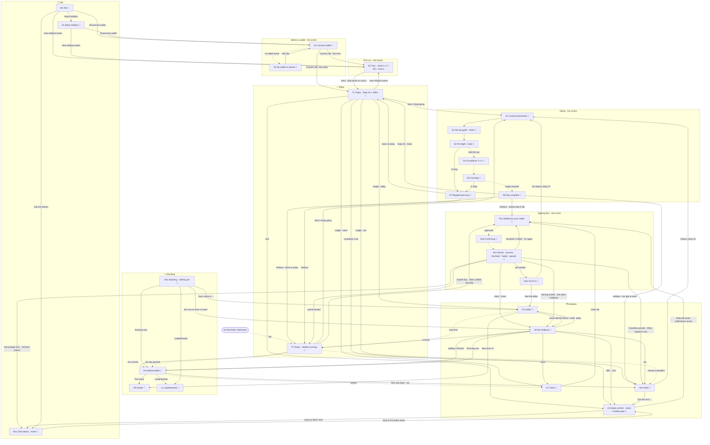

# Holdout — screen map (hackathon build)

**Version:** 3.1 · **Date:** 2026-10-12 (v3.1: the PR #62 review fixes — a left lobby stays on screen, system Back in a sitting, a reminder on a re-created app; v3.0 on 2026-10-11, the app as built at the integration tip `b1ba45f` plus the integration pass `6ec0dc3`: the four-tab bar with *Today · Standing · Holdouts · Me*, *My Holdouts* and *Me* built; the levels are *Spark · 7-day* and *Habit · 21-day*; the four-card tour; Holdout's own signing flow and *You're in*; the stake confirm and faucet as sheets; the shortened fee sentence; no calendar dates; earlier: v2.2 on 2026-10-10 made staking Seeker-exclusive, v2.1 and v2.0 the same day) · **Scope:** the devnet hackathon build only. Post-hackathon screens are parked in §9. Holdout Lab, the tester app, has its own map: `holdout_lab_screen_map.md`.

**Purpose.** One place that lists every screen the app has, what each one shows, and where a member can go from it. It is the brief for visual design: each card in §5 is one frame (or one set of frames) to draw, and it is read from the code as built.

**Visual base:** the canvas *"Holdout — hero screens"* (claude.ai design canvas, phone boards at 390 × 844, dark; version `1791746298-7062`) and the design book `docs/design/`, which is the source for every token, component and sentence of copy. Cards marked 🎨 are drawn on a board. Every card is written so it can be drawn in the same look (§2).

> **Sources and precedence (rewritten 2026-10-11).** This file describes **the app as built**: every "On screen" list and every quoted sentence is read from `kotlin/app/src/main/kotlin/holdout/app/` at commit `b1ba45f` and the integration pass `6ec0dc3` (branch `claude/holdout-hero-screens-dev-5605d4`: the navigation shell, Today, the stake and signing flows, the sitting, Holdouts and Standing, Me and first run, all restyled to the boards). **Rules come from the spec-kit specs and nothing else:** `specs/001-holdout-hackathon` (the product; its session *2026-10-11 (evening)*: FR-069…FR-069d the four tabs, FR-070…FR-070c the signing flow, ES-20–ES-22, AC-24), `002-rep-placement-rules` (counting, with its level sentences), `003-seeker-id-names`, `004-lab-and-member-apps`, `005-refresh-when-unreachable`, with the constitution (2.3.1) in `.specify/memory/constitution.md`; they change only through the `/speckit-*` skills. Where a spec asks for more than the code has, that is a **gap** in §8, never written as if built. Where a board on the canvas differs from the code, §7 lists it. **The hackathon PRD is history**, not an authority: it is archived, unmaintained, as `docs/archive/holdout_v1_prd_hackathon-build_2026-09-18.md`, and the `PRD #n` and `PRD §n` citations on the cards point into it for the screen's origin only; the spec wins wherever the two differ. Mechanics are decided in the specs, never here.

> **One state, one map (decided 2026-10-11, evening; supersedes the 10 Oct hub-and-spoke decision).** The build submitted on **13 October** ships the **four-tab bar** *Today · Standing · Holdouts · Me*, with *My Holdouts* (H0) and *Me* (W1) built (spec FR-069…FR-069d). The earlier plan to ship hub-and-spoke through Home (`HoldoutApp.kt`, "← Home" on every screen) and add the bar after the submission is gone. "Home" in the spec means **Today**, the first tab. The screens that carry no bar are listed in §3.

**Decided 2026-10-11 (product owner):** members read the levels as **Spark · 7-day** and **Habit · 21-day** (never *Easy* or *Hard*; constitution 2.3.1); the tab with the crowd is **Standing** (decided 2026-10-10); the fee sentence is the short one in §2; no payout, pool or total carries a "≈ $" (a dollar label sits only beside a stake chip); and **no calendar date or clock time** appears for a member (constitution VI), so a Holdout is named by its level and length plus its state and a countdown (§2).

## Contents

1. [How to read this](#1-how-to-read-this)
2. [The visual base — from the draft](#2-the-visual-base--from-the-draft)
3. [Navigation — the bottom bar](#3-navigation--the-bottom-bar)
4. [The whole map](#4-the-whole-map)
5. [Screen cards](#5-screen-cards)
6. [Inventory at a glance](#6-inventory-at-a-glance)
7. [Draft vs spec — fix before final](#7-draft-vs-spec--fix-before-final)
8. [What to draw next, and what to build](#8-what-to-draw-next-and-what-to-build)
9. [Parked — after the hackathon](#9-parked--after-the-hackathon)
10. [Journeys through the map](#10-journeys-through-the-map)
11. [Use cases](#11-use-cases)

---

## 1. How to read this

### Tiers

| Tier | Means | Test |
|---|---|---|
| **MUST** | The core loop, or a judge's run-through, breaks without it | Remove it and someone gets stuck, loses money they could have kept, or can't see the product |
| **SHOULD** | Specified, or a real member reaches it. The build works without it but feels broken or confusing there | Remove it and the member is confused, or the app quietly hides a fact the spec says it must state |
| **NICE** | Polish, delight, conversion. Nobody is stuck without it | Remove it and only the feel of the product suffers |

### Status — two columns, kept apart

| | In the app (code) | In the design (canvas) |
|---|---|---|
| Done | ✅ Built | 🎨 Drawn |
| Partly | 🟡 Partial — a spec variant is missing or not wired | ✏️ Drawn, but needs changes (§7) |
| Not yet | ⬜ Not built | · Not drawn |

### IDs

Each screen has an ID: a letter for its area and a number. Arrows on the map and in the cards use those IDs.

| Area | Letter | Lives in |
|---|---|---|
| Before a wallet | **A** | full screen, no bar |
| First run | **B** | full screen, no bar |
| Today | **T** | tab ⌂ |
| Sitting (camera) | **S** | full screen, no bar |
| Holdouts | **H** | tab ☰ (H0 and what it opens); H4, H4a and H5 are the Standing tab's |
| Leaderboards | **L** | tab ∿, from H4 |
| Me | **W** | tab ◯ |
| About | **X** | tab ◯, pushed from W1 |
| System moments | **N** | overlays, OS dialogs, the wallet app, Holdout's signing flow (N1) |

---

## 2. The visual base — from the draft

Every new board reuses these. The values are the draft's tokens note; the design book `docs/design/` has the final sizes and wins where a board's pixels differ (a title uses the theme's type, the bar is 64 dp, an active flame is white, a personal best is in the celebration colour).

| | |
|---|---|
| **Frame** | 390 × 844, black canvas `#000000`, 20 px side gutter, ~40 px top padding, no app bar |
| **Surfaces** | surface/1 `#0B1214` (cards) · surface/2 `#121B1D` (nav bar, sheets) · surface/3 `#1A2426` (chips, pills) · hairline white 10 %. No shadows: a surface level and a hairline do the separating |
| **Text** | white · 70 % · 48 % |
| **Colour roles** | accent `#80ECFF` (time, the Daily 25, links) · success `#14F195` (standing, gains, settled) · warning `#FF623A` (streak flame, forfeits, last minutes) · celebration `#9945FF` |
| **Gradient** | `#9945FF → #14F195`, **only** on day complete and claim |
| **Type** | Roboto 300 for big numbers (56–96 px, tabular figures), 500 for titles · JetBrains Mono for every amount and countdown · labels 11–12 px, uppercase, +0.08 em tracking, 48 % white |
| **Shape** | cards radius 24 · sheets 28 · buttons, chips, nav pill fully round |
| **Components in the build** | **primary button** (white pill, 56 px, black label) · **secondary button** (transparent, hairline outline, 56 px; the Join pill is 44 px in a 48 px target) · **card** (surface/1 + hairline, 20 px padding) · **key–value row** · **section label** (uppercase) · **status chip** (`devnet`, `free`, `running`, `settled`) · **stat block** (the big counter) · **streak flame** (active, extended today, broken, personal best) · **bank ring** and **block bars** (10 / 10 / 5) · **progress ring** and **checklist row** (the signing flow) · **pager dots** (the tour) · **bottom sheet** (grab handle, scrim, 28 dp top corners) · **bottom bar** (64 dp, surface/2, hairline top, active item = white pill with a black icon, an 8 dp accent dot for a badge) · **notice card** · **quiet action** |

### Naming a Holdout (decided 11 Oct; replaces the 6 Oct naming with dates)

"Holdout" is the product word (H28), but it's said **once per screen**. A specific Holdout is named by its **level and length**, and its state and a countdown say which one it is. **No calendar date and no clock time appears anywhere a member reads** (constitution VI: time is presented as a countdown, never as a calendar date), so the 6 Oct rule that named a Holdout by its start date (*"21-day · from 21 Sep"*) is gone. If the owner wants dates in names back, that is a constitution amendment. Countdowns use `Format.countdown`: `2d 4h`, `4h 06m`, `12m 30s`.

| Where | Write | Not |
|---|---|---|
| Cards in a list under a "Holdouts" heading | **Spark · 7-day** · **Habit · 21-day** | Spark · 7-day · from 12 Oct |
| A finished one | **Spark · 7-day** · finished · claimed 1,180 SKR | 7-day · 28 Sep – 5 Oct |
| Header labels (Today, Lobby, Detail, Forfeit, Claim, signing flow) | `HABIT · 21-DAY · DAY 12 OF 21` · lobby `SPARK · 7-DAY · STARTS IN 2D 4H` · locked `SPARK · 7-DAY · LOCKED · STARTS IN 41M 10S` · finished `SPARK · 7-DAY · FINISHED` | `21-DAY · FROM 21 SEP · DAY 12 OF 21` |
| An offer's timing | `Joining closes in 2d 3h` (a short test Holdout: `Starts in 12m 30s`) | `Starts Mon 12 Oct, 07:00 your time` |
| The only mention on a screen (stake sheet, *You're in*, the claim's upsell) | Join the Spark · 7-day Holdout | — |
| A short test Holdout in a sentence | *Test Holdout* (its badge keeps the wording **SHORT TEST COHORT · 10-MINUTE DAYS · DEVNET**, the disclosed weakness, FR-044a) | — |
| Sentences | *your run has ended* | — |

Never *cohort* or *league* in anything a member reads (but for that badge), and no names for the lengths: the number of days is the label.

**Levels (H35, decided 2026-10-05; named Easy/Hard 2026-10-10; renamed 2026-10-11 to Spark/Habit).** A Holdout's level is its form, and the level comes first:

| Level | Tagline | Rule sentence (read the same everywhere it appears, 002 FR-014) |
|---|---|---|
| **Spark · 7-day** | *Light it up · knees allowed* | *At 45° only. Aim for full push-ups from your toes; push-ups from the knees still count.* |
| **Habit · 21-day** | *Make it stick · toes only* | *At 45° only: phone on the floor ahead of your shoulder. Full push-ups from your toes — push-ups from the knees don't count.* |

On a card: **Spark · 7-day**, under it the tagline. In a sentence: *a Spark*, *a Habit*, *20 per Spark*. A Spark screen never shows the Habit sentence, and the Daily 25 shows *counted as the Spark*. The code keeps `Easy`/`Hard`, `Stakes.EASY`/`Stakes.STAKED` and `Board.EASY_7D`/`HARD_21D` as internal names; members never read them (`Format.levelName`, `Format.levelRule`). Holdout Lab, a tester tool, keeps its tester wording.

**The fee, in one sentence (decided 2026-10-10, shortened 2026-10-11):** *Miss a day and you lose your stake: 70 % to the prize pool, 10 % to Spark · 7-day boosts and comebacks, 20 % to the project. If nobody finishes, the pool goes to the project too.* (the level and length are the Holdout's own; a no-break space keeps each % with its number). The forfeit screen says it under **Stake lost**: *It goes 70 % to this Holdout's prize pool, 10 % to Habit · 21-day boosts and comebacks, 20 % to the project. If nobody finishes, the pool goes to the project too.* Used on the stake sheet (H2) and the forfeit screen (H6); nowhere else are percentages shown. The reserves come back as the **boost line** on offers (*Prize boost: up to 480 SKR*) and *+ about 1,200 SKR boost if anyone finishes* on Today, and as the comeback lines on Today, the forfeit and the claim.

**Money words.** No "≈ $" beside a payout, pool, total or share. The dollar label sits only beside a stake chip, with *Dollar values are approximate.* nearby (stake sheet, lobby). No carry-over line. Never *earn/earnings*, *challenge* as an in-app noun, *cohort* or *league* in member copy (constitution XIII).

**The daily streak, as built (`streak/StreakStore.kt`, FR-049…FR-052, H35).** Device-local, never on chain: +1 for every day completed, from the Daily 25 or a Holdout day alike; broken by a day with none unless a **freeze** covers it — one freeze is earned for every seventh day of the streak (a frozen day bridges the streak but is not counted), at most two are held, and they are used by themselves; a forfeit never touches it; it turns over at 05:00 UTC by chain time. It unlocks nothing and is paid against nothing. **Where the member sees it:** the flame on Today (T1, with the freeze line), the footer of a running Holdout (T2), the *Your 9-day streak is still alive.* card after a forfeit (H6), the day-complete screen (S6), and large on Me (W1). The design book's Streak flame has four states: active, extended today, broken, personal best.

---

## 3. Navigation — the bottom bar

**The code is a four-tab app.** `nav/Nav.kt` is the whole navigation as plain data, tested on the JVM: a tab, a back stack per tab, and what can cover them — a sheet, the signing flow, a sitting, the tour. `shell/AppShell.kt` draws it and `HoldoutApp.kt` feeds it.

```
  ┌──────────┬──────────┬──────────┬──────────┐
  │   ⌂      │    ∿     │    ☰     │    ◯     │   ← icons: house · pulse · list · person
  │  Today   │ Standing │ Holdouts │    Me    │   ← labels (design book, decided 2026-10-10)
  └──────────┴──────────┴──────────┴──────────┘
```

| Tab | Root | Holds | Dot (8 dp accent, never a count) · accessible name |
|---|---|---|---|
| **⌂ Today** | **T2** while the member is standing in a running Holdout (that Holdout's day only, plus one nudge line per other Holdout), else **T1** (the Daily 25, nudges, the comeback, the open Holdouts) | The one thing to do today. Starts the sitting | Today's reps are not done (the Holdout's day when one runs, else the Daily 25) · *Today, today's reps aren't done* |
| **∿ Standing** | **H4** of the Holdout the member is running, else of the last one they ran; else **H4a**, the empty state | Who is still standing, how the crowd thinned, the roster **H5**, the **L1** leaderboards. H4a: *Running now*, then *Yours starts in …* (lobby place) or *Join one to have a crowd* → ☰ | People dropped out of that Holdout since the member last looked at it (a `looked:` marker on the phone) · *Standing, 3 dropped since you last looked* |
| **☰ Holdouts** | **H0** My Holdouts | *Yours* (lobby, running, out, settling, claim), *Open to join*, *Running now* (read-only, every wallet), *Finished*. Opens H3, H4, H6, H7; Join opens the H2 sheet | A claim is waiting · *Holdouts, a claim is waiting* |
| **◯ Me** | **W1** | Address, SKR and SOL, the faucet sheet, the streak and freezes, X1 About Holdout, the tour again, disconnect | SOL too low to pay a transaction, or SKR too low for the cheapest chip of a Holdout open to join · *Me, low on SKR or SOL* |

> **Decided 2026-10-10:** the pulse tab is **Standing** — the state (*still standing*), not a noun for the group, which the design book avoids. *Crowd*, *Live* and *Field* were considered and dropped. The icons carry text labels for accessibility.

**Rules, as built**

1. **The bar shows on tab roots only** (T1/T2, H4 or H4a as Standing, H0, W1). Pushed screens (H3, H4 from a list, H5, H6, H7, L1, X1) carry a back arrow and no bar. A sheet covers the bar with its scrim.
2. **Full screen, no bar:** the connect screens (A1, A3), the tour (B1), every sitting (S1–S7), and Holdout's **signing flow** (N1: *Waiting for your wallet*, the confirming checklist, the result, *You're in*). The phone is on the floor; nothing should be tappable by accident.
3. **Stake confirm (H2) and the faucet are real bottom sheets** (drag handle, scrim) over the screen that opened them — Today, Holdouts, the forfeit screen, Me. Dragging down or pressing Back returns there. The Seeker gate's three states are states of the same sheet.
4. **Today never becomes a list.** It shows the day's action, the open Holdouts (T1) and at most one nudge line per other Holdout needing a tap (claim ready, lobby, a way back, settling). The running Holdouts the member could watch are not on Today: they sit on Holdouts and in Standing's empty state.
5. **A screen that sends a transaction never just fails when funds are short.** The stake sheet shows a notice and **Get test tokens**, which opens the faucet sheet over it and comes back to the stake sheet; a submit short of SOL ends on *Not enough SOL* and the same sheet (ES-0a).
6. **App open lands on Today**, including from a reminder (N2) — also when the reminder re-creates an app Android killed — and after the tour; returning to a killed app from the launcher or Recents brings back its tab and pushed screens. The first run goes connect → tour → Today.
7. **Back:** during the signing flow it goes back only when the flow allows it, never while the wallet holds the screen (there is no Cancel; MWA cannot be aborted). Otherwise: close the sheet, step back the tour (not out of it on first run), pop the shown tab's pushed screen, then a non-Today tab goes to Today, and Back from Today leaves the app. Tapping the tab you are on pops it to its root. The sitting has its own way out (✕, then the Stopped screen); system Back does the same, closes the set-up guide first when it is open, and on a finished day acts as its finish button.
8. **What the chain does to where you are** (dotted arrows in §4): a lobby that starts leaves every stack (to Today, or Holdouts), and so does one that is left while not on screen; a lobby on screen when its leave lands stays, showing *You left*, until *Back to Holdouts* or Back; a missed deadline seen on Today's root pushes H6; the last day passing moves to Standing; a Holdout settling while H4 is open pushes H7; a join that lands under the stake sheet with no signing flow showing opens the lobby. Only a change seen while the app is open moves anything, and nothing moves under a full-screen step or a sheet.

**Pushed screens** (`Screen` in `nav/Nav.kt`): H3 Lobby · H4 Detail (from a list) · H5 Roster · H6 Forfeit · H7 Claim · L1 Leaderboards · X1 About. The tab and the pushed screens are saved (`nav/NavSaved.kt`, `rememberSaveable` in `HoldoutApp`), so a process killed in the background reopens where the member was. A sheet, the signing flow, a sitting and the tour are not restored (the wallet and camera cannot be resumed; banked reps are on disk and come back through Today's crash page).

**Where the pieces of the old hub Home went**

| On the hub Home (until 10 Oct) | Now |
|---|---|
| "Holdouts open to join" | ⌂ T1 and ☰ H0 |
| Your lobby / forfeit / settling / claim cards | ☰ H0 *Yours*; a one-line nudge on ⌂ |
| "Past Holdouts" | ☰ H0 *Finished* |
| "The ladder" | removed (6 Oct) |
| "Who's still standing", "Holdout details" (T2) | ∿ Standing (H4); the counter on T2 opens it |
| "Leaderboards" | ∿ H4 → L1 (and from H4a) |
| "Get test tokens", "Disconnect …" | ◯ Me |
| "About" | ◯ Me → X1 |
| "How Holdout works" | a row at the foot of T1, a row on Me and on X1 → B1 |
| "Running now" | ☰ H0 and ∿ H4a (not on Today) |

---

## 4. The whole map

Solid arrows are taps; dotted arrows happen on their own (chain state, time, a notification). **✍ = the wallet app opens to sign**; Holdout shows its own signing flow around it (N1a Waiting for your wallet → N1b Confirming → N1c Result), and the arrow shows where the member lands. Tab roots are always one tap apart through the bar, so those arrows are not drawn.



---

## 5. Screen cards

Each card gives **tier · code status · design status**, why the screen exists, how you get in, what's on it from top to bottom (the strings are the code's, quoted), its variants, and every way out.

### A — Before a wallet

#### A1 · Connect wallet — "First open"
**MUST · ✅ Built · 🎨 Drawn** (boards *1 · First open*, *1b · wrong network*, *1a* the wallet's own sheet) · `wallet/ConnectScreen.kt` · PRD #2, FR-001a

**Job:** the front door. A wallet is required before anything, even the free Daily 25, so this screen has to sell the product while it asks.

**Entered from:** app launch with no wallet connected · ◯ Me → Disconnect wallet

**On screen (as built, top → bottom)**
1. Wordmark `HOLDOUT` · `devnet` chip, right
2. Headline: **Stake on yourself.** / *Prove it every day.* (second line a step quieter)
3. Two lines, an accent dot and a green dot:
   - **The Daily 25** — *free, every day: get stronger at your own pace. 25 push-ups, counted by the camera. Your streak grows.*
   - **A Holdout** — *stake SKR on a 7-day Spark or a 21-day Habit. Miss a day: your stake joins the prize pool. Finish: take it back plus a share of the pool.*
4. Section label `LIVE RIGHT NOW` · hint *Test network, test token.*
5. One card, a row per level, read from devnet with no wallet:
   - running: `HABIT · 21-DAY · DAY 12 OF 21` · `running` (green) · **189** / 312 *still standing* · prize pool `48,200 SKR` (the figures derive from the roster, as every screen's do)
   - open: `SPARK · 7-DAY` · `open` (accent) · *Next:* `12,500 SKR at stake · 14 joined` · *Joining closes in 2d 3h* · (when the level's reserve holds more than 0) *Prize boost: up to 480 SKR* (green, FR-053). A level with no running Holdout shows the open one on its own row; a short test Holdout carries its badge and sorts last
6. Spacer → **Connect wallet** (primary)
7. Quiet action: *No wallet yet?*

**Variants:** connecting — the screen is Holdout's own **Waiting for your wallet…** (label `CONNECTING`, spinner, *Approve or decline in your wallet. Nothing moves until you approve.*, **no Cancel**: the wallet app cannot be told to stop, FR-070) · a notice: *Your wallet isn't on devnet, so nothing was signed. Switch it to devnet, then connect again.* (FR-001b) or *We couldn't connect to your wallet. Try again.* · chain not read yet (no live card) · `SHORT TEST COHORT · 10-MINUTE DAYS · DEVNET` badge on a short test Holdout's row · **no wallet** → A3

**Exits:** Connect → N1 (the wallet app) → B1 (first time) or T1 · *No wallet yet?* → A3

#### ~~A2 · Walkthrough — a full cycle~~ — removed 9 Oct
The submission is the app's final state, so nothing in it is for judges only (spec 004, constitution v2.1.0). The full cycle is shown in the demo video, sent as a link with the submission, and any wallet holding a Seeker Genesis Token can run it on a labelled short test Holdout (FR-044a, FR-003b; H38). Anyone else can watch one thin from H0's or Standing's *Running now* list (FR-062a). `WalkthroughScreen` is deleted.

#### A3 · No wallet on this phone
**MUST · ✅ Built** (a variant of A1, `noWallet` / *No wallet yet?*) **· 🎨 Drawn** (board *21*) · ES-0

**On screen:** A1's header and headline, then a card: **You need a Solana wallet** — *Even the free Daily 25 needs one. It holds your keys — Holdout never does.* · **On a Seeker** — *Seed Vault Wallet is built in.* · **On other phones** — *install a Solana wallet with Mobile Wallet Adapter, set it to devnet, come back.* · **Connect wallet** (retry) · footer `TEST NETWORK · TEST TOKEN`. Back from the help returns to A1 unless a connect found no wallet.

**Exits:** retry → N1

---

### B — First run

#### B1 · Tour — how it works (four cards)
**MUST · ✅ Built · 🎨 Drawn** (boards *2a*, *2b*, *2c*, *2d*: cards 1–4 of 4) · `tour/TourScreen.kt` (+ `TourFigure.kt`, `TourDiagrams.kt`) · PRD #2a, FR-067

**Job:** four cards so a member knows the two products, how reps are counted and who the scripted members are before the first rep.

**Entered from:** first connect for this wallet · T1 *"How Holdout works"* · ◯ Me *"How Holdout works"* and X1 (re-opened)

**On screen:** `HOW IT WORKS · 1 OF 4` · *Skip* (right, on cards 1–3) → the card (centred, scrolls when it must) → pager dots (the active one a long pill) → **Next** (**Start** on card 4) → `TEST NETWORK · TEST TOKEN`

| Card | Title | Illustration | Says |
|---|---|---|---|
| 1 | **The Daily 25** | two dot grids (25 dots at once; 10 · 10 · 5 across the day) | *25 push-ups a day. Free. Your way:* · **All at once** *One sitting, all 25.* · **At your own pace** 10 *morning* · 10 *lunch* · 5 *evening* · **Every 10 are banked for good** *Close the app or stop mid-set — banked reps stay.* · *Each day done grows your streak.* |
| 2 | **A Holdout** | an example card: `Day 1` members each stake the same → `Day 21` finishers stand, the rest fade (`Example · Habit · 21-day`) | *Stake SKR with everyone who starts on Monday. Finish, and split what the others lost.* · *Spark · 7-day lights it up — knees allowed.* *Habit · 21-day makes it stick — toes only.* · *Changed your mind? Full refund until joining closes.* *Holdouts need a Seeker. The Daily 25 is free for everyone.* |
| 3 | **How reps are counted** | the animated figure (the phone at 45°, one drawing; the checks tick, the count rises) beside three steps | 1 *Phone on the floor, at 45°, ahead of your shoulder.* 2 *Get into a push-up: head to feet, knees included, inside the outline.* 3 *The checks tick green. Hold the top for a second, then 3 · 2 · 1 and every rep counts.* · *The Daily 25 and Spark: aim for your toes; knees are allowed.* *Habit: full push-ups from your toes.* · **Private by design** *No microphone, ever. Reps are counted on this phone — no video leaves the app.* |
| 4 | **Scripted members** | a dot row: real members and scripted ones outlined | *Some members in these Holdouts are scripted. Real wallets, same rules, labelled SCRIPTED.* · *They only fill a Holdout to its minimum: 20 per Spark and 12 per Habit. Their days aren't camera-checked.* |

**Skip on cards 1–3 goes to card 4**, not out of the tour: the scripted-member note is required on first run (spec 004 FR-013). **Back** steps back a card; on card 1 of a first run it leaves the app (the tour cannot be left but by finishing it), and on a re-opened tour it closes the tour. Nothing here is for judges and no card names Holdout Lab.

**Exits:** Start → T1 (first run) or back to where it was opened (Today, Me, About)

#### B2 · Scripted-member disclosure — card 4 of the tour
**SHOULD · ✅ Built (as tour card 4) · 🎨 Drawn** (board *2d*) · PRD #3, FR-043a, spec 004 FR-013

**Job:** before anyone joins, say plainly that Holdouts during judging include scripted members: real wallets under the same rules, whose days are not camera-verified, filling a Holdout only up to its minimum (20 in a Spark, 12 in a Habit). The text also lives on H5's note and X1.

---

### T — ⌂ Today

#### T1 · Today — the Daily 25 and Holdouts to join
**MUST · ✅ Built · 🎨 Drawn** (boards *3 · Today*, *3b* part-way, *3c* done, *3d* devnet unreachable, *3e* running now, *3f* a test Holdout open, *3g* comeback line) · `home/HomeScreen.kt`, `home/HoldoutOffer.kt`, `shell/TodayHost.kt` · PRD #4, FR-053, FR-069a

**Job:** with no Holdout running, the free Daily 25 is the hero and the open Holdouts sit right under it. Never empty, never "come back later".

**Entered from:** app open · tab ⌂ · S6 / S7 · a reminder (N2)

**On screen (as built, top → bottom)**
1. `TODAY` label · the streak flame with the days (right; white while active, extended once today is done, broken at 0)
2. **Daily 25 card:** `THE DAILY 25` + `FREE` chip · (a warning banner *Yesterday ended at 20 of 25. Today starts fresh.* — or *…A freeze kept your streak.* — only when yesterday banked something and was not completed, ES-3) · **25** `push-ups` (counter) · *all at once, or 10 at a time · knees allowed* · **Start** (primary) · `4h 06m` `left today` · under a running streak, the freeze line: *Seven days in a row give you a freeze for a missed day* / *1 freeze held — a missed day won't break the streak* / *2 freezes held — two missed days won't break the streak*
3. Nudge rows, one line each, a chevron, only for the member's *other* Holdouts (no running one is a line, it is T2): *You finished · claim 1,412 SKR* (green) · *Habit · 21-day lobby · starts in 2d 4h* · *Habit · 21-day: Out after 6 days · Win back up to 250 SKR* (warning) · *Spark · 7-day: You finished · settling, usually within 11m*. Each opens its screen (H7, H3, H6, H4)
4. The **comeback card** (green, the whole card one tap; FR-037e, FR-037g, `home/DailyHoldoutLine.kt`), from the forfeit until the window's Holdouts have all closed for joining: *Get back up to 250 SKR of your lost stake: finish the Spark · 7-day starting in 2d 4h. Joining closes in 2d 3h.* (opens the stake sheet on the lost stake's chip) · with a place held: *You're in the Habit · 21-day. Finish it and up to 250 SKR of your lost stake comes back.* · the next round not opened yet: *The next Habit · 21-day opens for joining in 40m 00s and starts in 7d 0h. Finish it and up to 250 SKR of your lost stake comes back.* (the last two open the Holdouts tab)
5. Section label `HOLDOUTS OPEN TO JOIN` · hint *Holdouts need a Seeker.*
6. Offer cards, each with an outlined **Join** (FR-053; level, tagline, what is at stake, how long joining stays open, the boost; `home/HoldoutOffer.kt`):
   - **Spark · 7-day** · *Light it up · knees allowed* · `12,500 SKR` *at stake · 14 joined* · *Joining closes in 2d 3h* (accent) · *Prize boost: up to 480 SKR* (green, only while the level's reserve holds more than 0; "up to", never a promise)
   - **Habit · 21-day** · *Make it stick · toes only* · `9,000 SKR` *at stake · 9 joined* · *Joining closes in 2d 3h*
   - a short test Holdout, with its badge: **Test Holdout** · *3 days · 5 push-ups a day · joinable right up to its start* · *Starts in 12m 30s* (no mention of judges, spec 004 FR-014)
7. Row: ⓘ **How Holdout works** · `4 cards`
8. Bottom bar, ⌂ active

**Variants** (🎨 drawn as tweaks and boards 3b–3g)
- **Part-way:** **15** *to go* · the block bars · *10 banked for good* · **Keep going**
- **Done:** **25** in green · *done* · *Streak +1. See you tomorrow.* · no button · the toes meter (*18 of 25 from your toes*, seven bars for the week, *Best: 22 from your toes*, *That's a Habit day.*; at another angle *Do it with the phone at 45° to see how many come from your toes*)
- **Devnet unreachable:** the label *Devnet unreachable — the Daily 25 still works* and **Check again** (spec 005); the Daily 25 still works
- **Reading the chain:** *Reading the chain…* · **Holdouts not live:** *Holdouts are not live on devnet yet*
- **None open:** a card *The next Holdout opens soon.* / *The Daily 25 is open now.* (ES-15)
- **Not wired:** **new phone** → *No banked reps on this device today. 25 to go.* (ES-3a): the banner is in the screen (`HomeState.newPhone`) and nothing sets it, §8 gap 3

**Exits:** Start / Keep going → S1 · Join → H2 sheet (through the Seeker gate) · How Holdout works → B1 · a nudge → H3 / H4 / H6 / H7 · the comeback card → H2 sheet or the Holdouts tab

#### T2 · Today — in a Holdout
**MUST · ✅ Built · 🎨 Drawn** (boards *5 · Home — in a Holdout*, *5b* day submitted, *5c* done and waiting for network) · `home/CohortHome.kt`, `shell/TodayHost.kt` · PRD §10.1a, FR-038, FR-047, FR-024b, FR-069a

**Job:** *the crowd is the product.* The survivor counter and the prize pool are the biggest things on screen, and they move at the deadline itself. The Holdout's day only: no Daily 25 card and no offers, because a Holdout day counts for the streak (FR-050).

**Entered from:** app open while standing in a running Holdout · N2 reminder · H3 at start time · ☰ H0 *running* card · S6/S7 · a submit that landed

**On screen (as built, top → bottom)**
1. (`SHORT TEST COHORT · 10-MINUTE DAYS · DEVNET` badge on a short test Holdout) · `HABIT · 21-DAY · DAY 12 OF 21`
2. **189** / 312 (the counter rolls rather than cuts) · `STILL STANDING` · ▲ *3 dropped since yesterday* (green); the whole block is a link to ∿ Standing
3. Card: **Prize pool** `48,200 SKR` · hairline · **Your share now** `255 SKR` / *if today's standing holds* · *+17 SKR since yesterday* (green) · *+ about 1,200 SKR boost if anyone finishes* (green; only while the level's reserve holds more than 0; FR-037d)
4. The day: the bank ring (1 of 3 blocks) · **10 banked today** · *15 to go* · **Keep going** (primary)
5. Nudge rows for the member's other Holdouts (a lobby joined for later, a claim waiting, a way back), one line each
6. Footer row: flame `12` · `4h 06m` `left` (mono, accent)
7. Bottom bar, ⌂ active

**Today's-state variants** (🎨 drawn; the button and ring area change, the counter and pool stay)
| State | Shows | Action |
|---|---|---|
| To do | empty ring · **Nothing banked yet today** · *all at once or 10 at a time* | **Start today's 25** |
| Part-way | ring 1/3 · **10 banked today** · *15 to go* | **Keep going** |
| Last 10 min | ring and line in warning · **15 push-ups still needed** · *Under 10 minutes left. Unfinished reps won't count.* (FR-047) | Start (never blocked) |
| Offline, not done | warning notice *Devnet can't be reached right now.* (*…still can't be reached.* after a check) · *You can still do today's reps. The day only counts once it reaches the chain before the deadline.* · **Check again** | Start |
| Done, offline | ring full · **Done — waiting for network** · *Your 25 are saved on this phone. It only counts once it reaches the chain before the deadline: it's sent when Holdout is open and back online, and you approve it in your wallet.* · notice + **Check again** | — |
| Done, sending | ring full · **Done — sending to the chain** · *Your 25 are counted on this phone. It only counts once it reaches the chain before the deadline: approve it in your wallet.* · **Waiting for your wallet…** (busy) | the wallet opens by itself (T098) |
| Done, send failed | **Done — tap to submit** · *…before the deadline.* | **Submit day 12** → N1 |
| Short of SOL to submit (a waiting day is not sent by itself while SOL is too low, `canPayFees`) | **Today's 25 are done** · *Not on chain yet.* · warning *Not enough devnet SOL for the fee. Test tokens include some.* · **Submit day 12** (off) | **Get test tokens** → W1a sheet |
| Submitted | ring full in green · **Today is done and on chain.** · *Next day opens in 4h 06m.* | — |

**Exits:** Start / Keep going → S1 · Submit → N1 · counter → ∿ H4 · deadline missed → H6 · last day passed → H4 (settling) · a nudge → its screen

---

### S — Sitting (full screen, no bar)

One continuous camera screen in steps (`SittingViewModel.Step`: PREFLIGHT → COUNTDOWN → COUNTING → COMPLETE). The same screen serves the Daily 25 (at 45°; knees welcome, and the toes are counted separately), a Spark day (at 45°; knees count) and a Habit day (at 45°; from the toes only). Every sitting is at 45° (002 FR-001). **Shared chrome:** ✕ stop button (top left) · centre label (`DAY 12 · 25 REPS`, `THE DAILY 25`, or `DAY 12 · GET INTO POSITION` while getting set) · dark gradients top and bottom over the camera. Audio carries it, because the member is on the floor. Holdout Lab shares the screen through `LabSittingTools`; the member-only parts below are gated on `tools == null`.

#### S1 · Camera permission
**MUST · ✅ Built · 🎨 Drawn** (board *15*, *15d* Daily 25; the *denied* tweak shows the Settings variant) · `sitting/CameraPermissionScreen.kt`

**On screen:** the top label · a camera icon in a circle · **The camera counts your reps** · *Nothing is recorded or uploaded.* · **Allow camera** → the OS dialog (N4). *Denied twice:* **Camera access is off** · *Turn it on in Settings › Apps › Holdout › Permissions.* · **Open settings**

**Exits:** allowed → S2 (or S3 if the guide is turned off) · ✕ → back

#### S2 · Set-up guide — "Before you get down"
**MUST · ✅ Built · 🎨 Drawn** (board *16*, *16d*; a sheet with working Phone / Body / Start tabs) · `sitting/PlacementGuide.kt`

**Job:** read while the phone is still in hand, since the countdown can't start behind it. A bottom sheet over the camera.

**On screen (as built, three pages):** **Before you get down** · the level on the right (`spark · 7-day`, `habit · 21-day`, `the daily 25`) · first, under the title on every page (002 FR-015): *Two things decide whether a rep counts: your whole body in the picture, head to feet, and your knees clearly visible to the phone.* · tabs **1. Phone · 2. Body · 3. Start**
- **Phone:** *Stand the phone on the floor, facing where you'll be. Lean it on something.* · one drawing, **At 45°** (*Ahead of your shoulder, about 1.5 m away.*; ticked when the view is detected) · *From there it sees all of you, and the knee nearer to it.* · the level's rule sentence (§2), or for the Daily 25 *counted as the Spark*
- **Body:** *Your whole body in the picture, head to feet.* · *Your knees clearly visible to the phone.* · *Top of a push-up: arms straight, hands under your shoulders.* · *Line up with the outline on screen.* · then per level — Habit: *On your toes, down to just above the floor. Knee push-ups don't count.*; Spark: *Aim for your toes — knees still count in a Spark.*; Daily 25: *Aim for your toes — knees still count in the Daily 25.* · *Turn a little away, so the phone sees your near knee.* · a plank drawing
- **Start:** *Hold the top for a second. A ring fills, then “three, two, one, go”.* · *Nothing to tap. Each rep beeps; every 10 bank for good.* · *All the way down and up — short reps are skipped.* · *Stop any time with ✕ in the corner.*
- ☐ *Don't show this again* (remembered per wallet and per level) · **Skip / Back** · **Next / Got it**

**Exits:** Got it / Skip → S3 · drag down or scrim → S3

#### S3 · Pre-flight and hold the start position
**MUST · ✅ Built · 🎨 Drawn** (boards *17*, *17d*; the *step* tweak shows Checks / Holding / Blocked) · `sitting/PreflightScreen.kt`

**On screen:** camera + the floor/outline guide · five pills turning green: **Lighting · Whole body in frame · Knees visible · Camera view · Background still** (the knees got their own pill, 002 FR-024a; red, it says which way to turn or to move the phone back) · `Looking…` before the first frame · one big coach line, also spoken (*Phone to 45°*, *Knees up*, *Move back*, *Can't see knees*) · under it the sentence that says what to do (each failure states its fix) · once all green, a **hold ring** fills with **Hold…** and *Hold the top. The countdown starts when the ring fills.* · the level's rule sentence (the Daily 25: *counted as the Spark*) · **How to set up** · in a Holdout the time to the deadline (`4h 06m to today's deadline`, warning in the last 10 minutes)

**Variants:** looking… · each pill failing · a Spark placed too far in front is refused (says which way to turn) · loose trousers · *NICE, not built:* after three failures, a **tip sheet** with the common fixes (§8 gap 1)

**Exits:** hold complete → S4 · How to set up → S2 · ✕ → S7 / back

#### S4 · Countdown
**MUST · ✅ Built · 🎨 Drawn** (boards *18*, *18d*) · `sitting/CountdownScreen.kt` — **3 · 2 · 1**, a ring draining over the three seconds, *get ready · stay at the top*; the cue is spoken. **Exits:** → S5

#### S5 · Counting
**MUST · ✅ Built · 🎨 Drawn** (boards *6 · Sitting — counting*, *6d*) · `sitting/CountingScreen.kt`

**On screen:** camera + skeleton · a large hint pill mid-screen with the last refused rep's reason (*Go lower*; read from the floor and spoken, 002 FR-019) · **Block of 10 banked** (a green pill on a block, chime) · in the last ten minutes of a Holdout day, *Under 10 minutes left. Unfinished reps won't count.* · bottom: **17** *of 25* (the number pulses and a *+1* rises on every rep) · three block bars, proportional 10 / 10 / 5 · *10 banked · 7 this set* · `4h 06m` `left`

**Exits:** target reached → S6 · ✕ → S7

#### S6 · Day complete
**MUST · ✅ Built · 🎨 Drawn** (boards *19*, *19a*, *19b*, *19d*) · `sitting/DayCompleteScreen.kt` — one of the two places the gradient is allowed (a wash that fades once)

**On screen:** a label (`DAY 12 · 25 REPS`; `THE DAILY 25`) · **25** in green · `DONE`
- **Daily 25:** the flame with *day streak · +1* · (the upsell card *Stake on yourself next* or the comeback, when one applies — see below) · **Done** → T1
- **Holdout day:** a card *Counted on this phone.* · *Not on chain yet.* · `Left to submit` `4h 06m` · **Submit day 12** → N1 (Holdout's signing flow), which returns to T2 with the day on chain
- **Holdout day, offline** (FR-024b): **Done — not sent yet** · *Devnet can't be reached, so day 12 isn't on chain yet. Your 25 are saved on this phone. Open Holdout when it can be, before the deadline (4h 06m left), and approve day 12 in your wallet.* · **Back to today** → T2 (sends nothing; the day waits on the phone). Past the deadline: **Done — too late to send** · *Devnet can't be reached, and day 12's deadline has passed, so it can no longer be sent. Your 25 are saved on this phone.*

**Wired by the host (`shell/SittingHost.kt`, `SittingOffers.kt`):** a Holdout day carries the label `HABIT · 21-DAY · DAY 12 OF 21` and, when the chain already counts the day, "Back to today" instead of Submit; a day finished too late to send goes on to that Holdout's Forfeit (H6). The Daily 25's upsell card appears under the streak: **Stake on yourself next** *Spark · 7-day · joining closes in 1d 3h* — or, in its place, **Get your stake back** with the comeback line. Shown only when the member has no Holdout running or in a lobby, and never to a wallet known this session not to hold a Seeker (C-D8, G12); a tap ends the sitting and opens the stake sheet.

**Exits:** Done → T1 · Submit → N1 → T2 · Back to today → T2

#### S7 · Stopped part-way
**SHOULD · ✅ Built** (✕ shows the summary; the crash variant shows once on Today) **· 🎨 Drawn** (boards *20*, *20a* after a crash, *20d* Daily 25) · `sitting/StoppedScreen.kt`, `sitting/SittingMarker.kt` · ES-1, ES-2

**On screen:** the label · **17** `done today` · the three block bars · `10 banked` (green) · `7 not kept` (warning) · *Only full blocks of 10 are kept. Come back before the day ends.* · a card: `Left today` `5h 12m` · `Still to do` `15 push-ups` · **Back to today** (to T1 after a Daily 25 sitting, to T2 after a Holdout one). It shows when anything was banked or discarded in that sitting; stopping with nothing goes straight back.

**Crash variant** (ES-1, ES-2): **Your 10 banked reps are safe.** · *The app closed mid-sitting. Reps after your last 10 are gone.* Recovery of the banked reps is built (`BankingController.recover`), and Today shows this page once on the next open (`InterruptedSitting.consume` through `interruptedSittings`, `shell/TodayHost.kt`): the running Holdout's day first, then the Daily 25's; reading the marker clears it.

---

### H — ☰ Holdouts and ∿ Standing

#### H0 · My Holdouts (☰ root)
**MUST · ✅ Built · 🎨 Drawn** (boards *10 · My Holdouts*, *10a* out and settling; the *scenario* tweak shows running / lobby / claim, locked lobby, empty) · `holdouts/MyHoldoutsScreen.kt`, `holdouts/MyHoldoutsModel.kt`, `holdouts/RunningNowCard.kt` · FR-069c, FR-062a

**On screen (as built, top → bottom)**
1. **Holdouts** (title) · (chain notices: *Devnet can't be reached right now.* + **Check again**; *Holdouts are not live on devnet yet*)
2. **Yours** — a card per Holdout, with the level and a status chip on the right, two lines, and the next thing in the state's colour (`Journey.stage`):
   | Stage | Chip | Lines | Opens |
   |---|---|---|---|
   | Lobby | `lobby` | *Joined · 1,250 SKR staked* · *starts in 2d 4h* | H3 |
   | Locked lobby | `locked` | *Joining closed · 14 in · 1,250 SKR staked* · *starts in 41m 10s* | H3 |
   | Running | `running` | *Day 12 of 21 · 189 still standing* (*312 started* until the roster is read) · *15 push-ups to go today* / *Today's reps are done* / *Today is on chain* | Today (T2) |
   | Out | `out` (warning) | *Out after 6 days* · *Win back up to 250 SKR* (green, while a way back is open) | H6 |
   | Settling | `settling` | *You finished · settling, usually within 11m* → *… settling any moment* (`Derive.settleUsuallyIn`, FR-035a) | H4 |
   | Ready to claim | `claim` | *Held out 7 of 7* · *1,412 SKR waiting for you* (green) | H7 |

   A forfeit stays under *Yours* until its comeback window has closed, then moves to *Finished*. Empty: a notice **No Holdouts yet.** *Stake on yourself for 7 or 21 days. Full refund until joining closes.*
3. **Open to join** · hint *Holdouts need a Seeker.* — offer cards: level, `9,000 SKR` *at stake · 9 joined*, *Prize boost: up to 1,200 SKR*, *Joining closes in 2d 3h*, **Join** → H2 sheet. A Holdout you already joined is not listed again; one you can't join says why and its Join is greyed out (*You already hold a place in a Holdout that hasn't started.* · *Starts before your current one ends.* · *Joining has closed.*). None: *The next Holdout opens soon.*
4. **Running now** (read-only, every wallet, Seeker or not; FR-062a): the running Holdouts the member is not in — **Habit · 21-day · day 12 of 21** over *189 still standing of 312 · prize pool 48,200 SKR*, a chevron → H4 → H5. No Join.
5. **Finished** — one quiet line each: *Spark · 7-day · finished · claimed 1,180 SKR →* (H4) · *Habit · 21-day · finished · out after 6 days →* (H6)

**Exits:** a card → H3 / T2 / H4 / H6 / H7 · Join → H2 · a *Running now* row → H4 → H5

#### ~~H1 · The ladder~~ — removed 6 Oct
The ladder screen and the **Human Flag** rung are out of the app (the code is deleted, 9 Oct). The open Holdouts it listed already appear on T1 and H0, and the Daily 25 is T1 itself.

#### H2 · Stake confirm (bottom sheet)
**MUST · ✅ Built · 🎨 Drawn** (boards *4 · Stake confirm*, *4c* Habit, *4d* test Holdout, *4e* comeback, *4f* short of SKR) · `stake/StakeSheet.kt`, `stake/StakeText.kt`, `stake/SeekerGateSheet.kt` · PRD #6, US-6, FR-041, FR-021a, FR-070c

**Job:** everything a member must know before money moves, including the counting rule, so it isn't discovered at the first sitting. A real sheet over the screen that opened it (Today, Holdouts, the forfeit screen); no "← Back" inside: it closes by drag, scrim or Back.

**The Seeker gate, in the same sheet** (H38; FR-003b–FR-003d, ES-0c, ES-0d; `stake/SeekerGateSheet.kt`, `stake/SeekerGate.kt`). Staking is Seeker-exclusive: every Join — T1, H0, the comeback card, H6, a short test Holdout — first checks that the connected wallet holds a Seeker Genesis Token, read from Solana mainnet. A wallet already confirmed on this phone goes straight to the stake confirm; otherwise the sheet shows `SEEKER ONLY` and one of three states. Nothing on it is signed. Leave, submit and claim never pass through it.

| State | Shows | Buttons |
|---|---|---|
| Checking | loader · *Checking your Seeker…* | — (opens the stake confirm once the token is found) |
| Not a Seeker | **Holdouts are for Seeker owners** · *The Daily 25 stays free, and you can follow every Holdout.* | **Get a Seeker** (opens `store.solanamobile.com`) · **Not now** (closes the sheet) |
| Couldn't check | warning: *We couldn't check your Seeker — try again.* | **Try again** |

Only a confirmed absence of the token shows *Not a Seeker*; no network, a rate limit or a mainnet outage shows *Couldn't check* (FR-003d). Debug builds can skip the gate with `-Pholdout.seekerGate=off`.

**The stake confirm (as built, top → bottom)**
1. (test badge) · **Join the Spark · 7-day Holdout** (a short test Holdout: **Join the Test Holdout**) · *Light it up: 25 push-ups a day for 7 days.* (*Make it stick: …*) · a pill `Starts in 2d 4h`
2. Four chips: **≈ $10 / ≈ $25 / ≈ $50 / ≈ $100**, each with its SKR amount (mono); the picked one has an accent outline. This is the one place a "≈ $" sits (FR-059)
3. (a comeback round) *Finish it and up to 250 SKR of the stake you lost comes back.* (green, for the chip chosen, FR-037g)
4. Card: **Your stake** `1,250 SKR` / `≈ $25` · hairline · **At stake now** `12,500 SKR` / *14 joined* · **Joining closes in** `2d 3h`
5. *If nobody drops out, you get exactly your stake back.* · the fee sentence (§2) · *Full refund until joining closes.* · (only while notifications are off) *Allow notifications and this phone reminds you before each deadline. Reminders never leave the phone.* (FR-068a, G9)
6. **How reps are counted here** (a surface/3 box): the level's rule sentence (§2); the sheet never shows the Habit sentence on a Spark
7. (the last 10 minutes of joining, ES-12) warning *Joining closes in 8m 30s. A transaction signed now may land too late.*
8. **Stake 1,250 SKR** (primary) — or why not, and **Get test tokens**
9. *Test network, test token. Dollar values are approximate.*

**Variants**
| Condition | Shows | Button |
|---|---|---|
| Not enough SKR | *You hold 400 SKR. This chip needs 1,250 SKR.* + **Get test tokens** | Stake off |
| Not enough SOL | *Your wallet has too little devnet SOL to pay for joining. The faucet sends some with the test tokens.* + **Get test tokens** | Stake off |
| Joining closed / already in a lobby / overlaps | *Joining has closed for this Holdout.* · *You already hold a place in a Holdout that hasn't started.* (+ **See your lobby**) · *This Holdout starts before your current one ends.* | Stake off |
| Signing | the button reads **Waiting for your wallet…**, then Holdout's full-screen signing flow covers the sheet | — |

**Exits:** Stake → (notification ask, first join only) → N1 → H2a · Get test tokens → W1a sheet → *Back to the stake sheet* · drag down → where it opened from

#### H2a · You're in
**SHOULD · ✅ Built · 🎨 Drawn** (board *12*) · `tx/SigningScreens.kt` (`YoureInScreen`) · FR-070b

**On screen:** label `SPARK · 7-DAY · JOINED` · (test badge) · a green check · **You're in.** · *Spark · 7-day. Everyone starts together in 2d 4h.* · card: **Members now** 15 · **At stake now** `13,750 SKR` *total staked* · **Your stake** `1,250 SKR` *held by the contract, not by us* · hairline · **Joining closes in** `2d 3h` · *Until then, leaving refunds it all.* · **Do today's Daily 25** (primary; **See the lobby** is the only button once today's is done) · **See the lobby** · `TEST NETWORK · TEST TOKEN`. No dollar figures.

**Exits:** Do today's Daily 25 → S1 · See the lobby → H3 (on the Holdouts tab)

#### H3 · Lobby
**MUST · ✅ Built · 🎨 Drawn** (boards *8 · Lobby*, *8a* locked, *8b* test Holdout) · `lobby/LobbyScreen.kt` · PRD #7, US-2, ES-12a

**On screen (as built, top → bottom):** back · `SPARK · 7-DAY · STARTS IN 2D 4H` (locked: `SPARK · 7-DAY · LOCKED · STARTS IN 41M 10S`) · (test badge) · **Spark · 7-day** · `STARTS IN` **2d 4h** (large mono, accent) · *Everyone starts together.* · card: **14** *joined, you too* · `12,500 SKR` *at stake* · hairline · *No prize pool until someone misses a day.* · **See who's in →** · card: **Your stake** `1,250 SKR` / *held by the contract, not by us* · hairline · **Joining closes in** `2d 3h` (locked: *Joining closed. This is the final roster.*) · `FROM THE START` *25 push-ups a day for 7 days. At 45° only. Aim for full push-ups from your toes; push-ups from the knees still count.* (the level's own rule, 002 FR-014) · **Leave — full refund** (warning quiet action) + *Until joining closes.* · *Dollar values are approximate.* Locked: no Leave; *Until it starts, just keep your streak.* (+ *We'll remind you.* only when notifications are on, G9).

**Variants:** open · leaving (**Waiting for your wallet…** + *Approve in your wallet.*, inline, no Cancel) · locked · leave landed after the cutoff (*Leaving closed before your transaction landed. You're still in.*, ES-12) · left (*You left. All 1,250 SKR is back in your wallet.* + **Back to Holdouts**: a lobby on screen when the chain shows the leave stays until the member taps it, and that button or Back lands on H0; a lobby not on screen is dropped from the stack)

**Exits:** See who's in → H5 · Leave → H0 · start time → T2

#### H4 · Holdout detail (∿ Standing root)
**MUST · ✅ Built · 🎨 Drawn** (boards *13*, *13a* watching, *13b* settling) · `cohort/CohortDetailScreen.kt` · PRD #11, US-7, FR-035a

**On screen (as built):** `HABIT · 21-DAY · DAY 12 OF 21` (a back arrow only when pushed from a list; on the Standing root none) · (test badge) · *You're watching this one* (a non-member) · (end-state card, see variants) · **189** / 312 `STILL STANDING` (rolls) · **How the crowd thinned** — a step chart of the standing count after each deadline (`cohort/ThinningChart.kt`) · card: **Prize pool** `48,200 SKR` · *+ about 1,200 SKR boost if anyone finishes* · **Days to go** 9 (today excluded) · hairline · **Days done** *11 of 21 days* · **Your share now** `255 SKR` *on top of your stake, if today's standing holds* (a non-member: *You can watch it thin. Joining is for Seeker owners.*) · **The roster** · **Leaderboards**

**Variants:** running · **settling** (**You finished · settling** · *Automation settles it on its next pass, usually within 15 minutes of the end.* · `Ended 4m ago · 11m left of those 15`; past 15 minutes *Taking longer than usual. It settles on the next automation pass; nothing you're owed can change.* — FR-035a) · **claimed** (**Claimed** `1,412 SKR`, the payout rows, the explorer link) · **out** (a notice *You're out after 6 days* · *Your run has ended. Your streak hasn't.* · **Your way back** → H6) · as a watcher (no *Your share*) · reading devnet… · devnet unreachable (**Check again**, spec 005)

**Exits:** The roster → H5 · Leaderboards → L1 · Your way back → H6 · settled → H7

#### H4a · Standing — nothing of yours yet
**SHOULD · ✅ Built · 🎨 Drawn** (board *13c*) · `standing/StandingEmptyScreen.kt` · FR-069b, ES-21

**On screen:** **Standing** · `RUNNING NOW` — the running Holdouts the member could watch (the same card as H0) · then, with a lobby place and nothing running of theirs, **Yours starts in 2d 4h ›** (accent, → H3); without one a card **Join one to have a crowd.** *Everyone who starts together thins out together.* **See Holdouts** (→ ☰) · **Leaderboards →**. A member whose only Holdout is in a lobby gets the watch list and the lobby line, never the join card (D-D9).

**Exits:** a *Running now* row → H4 → H5 · the lobby line → H3 · See Holdouts → H0 · Leaderboards → L1

#### H5 · Roster
**MUST · ✅ Built · 🎨 Drawn** (boards *14*, *14a* in a lobby) · `roster/RosterScreen.kt` · PRD #12, FR-062, FR-043a

**Job:** who is still in. **No amounts anywhere**, so nobody is ranked by money.

**On screen:** back · `ROSTER` · **Habit · 21-day · day 12 of 21** · *No amounts here: nobody is ranked by money. ◇ SCRIPTED members follow the same rules, but their days are not camera-verified. Names are Seeker IDs (.skr); a wallet without one shows its address.* · `STILL STANDING · 189` · rows: Seeker ID or short address (`· you` on yours) · `189 days ✓` · `OUT · 123` rows `lasted 9 days`, a `◇ SCRIPTED` chip where it applies · fallen after, by days lasted

**Variants:** reading the roster… (placeholder rows) · lobby (`IN THE LOBBY · 14`, *Everyone is standing until the first deadline.*) · finished (`… · finished`)

**Exits:** back → where it was opened (H4 / H3)

#### H6 · Forfeit
**MUST · ✅ Built · 🎨 Drawn** (board *9 · Forfeit*) · `cohort/ForfeitScreen.kt` · PRD #9, US-4, FR-037g

**On screen (as built):** back · `HABIT · 21-DAY · DAY 12 OF 21` · (test badge) · a summary card: **189 / 312** *still standing* · `48,200 SKR` *prize pool* · the day strip with the missed day marked · **You missed day 7.** · *It didn't reach the chain in time. Your run has ended.* · card: **Stake lost** `1,250 SKR` · *It goes 70 % to this Holdout's prize pool, 10 % to Habit · 21-day boosts and comebacks, 20 % to the project. If nobody finishes, the pool goes to the project too.* (+ *Final as of the deadline. The chain shows it shortly.* until recorded) · green-bordered card: **Your 9-day streak is still alive.** *A run can end; your streak didn't. That's the habit, and it's yours.* · then the way back:
- **with a comeback offer** (FR-037g): `COMEBACK` card: **Win back up to 250 SKR** · *Finish a Habit · 21-day starting within 14 days: up to 250 SKR comes back.* · `Starts in 2d 4h · joining closes in 2d 3h` · *Or the one after it, starting in 9d 4h.* (or *The one after it starts in 9d 4h and opens for joining in 2d 4h.*) · **Join the next Habit · 21-day** (primary → H2 on the lost stake's chip) · *Or keep the streak: today's Daily 25*. The offer is worked out from the forfeit itself, before it is recorded or settled: the Holdouts of the same level and length that start after the missed deadline and within 14 of their days after it — with weekly Holdouts exactly two (FR-037e)
- **a place held** (ES-18): *You're in the Habit · 21-day, starting in 2d 4h. Finish it and up to 250 SKR of the stake you lost comes back.* (or *…, running now.*) · **See your place** · *Or keep the streak: today's Daily 25*
- **round 2 not opened yet:** *The next Habit · 21-day opens for joining in 40m 00s and starts in 7d 0h. Finish it and up to 250 SKR of the stake you lost comes back.* (*opens for joining shortly* once that instant has passed) · no Join
- **a lobby place elsewhere** (ES-18): *You hold a place in a Holdout that starts later. Leave it first to join one that can bring your stake back.* · **Today's Daily 25**
- **no offer** (both rounds closed for joining without the member in one): `TWO WAYS BACK` · *Today's Daily 25 keeps your streak going. The next Habit · 21-day starts a new run.* · **The next Habit · 21-day** (primary → H2, the same level and length as the one lost, US-4) · *Or keep the streak: today's Daily 25*. A short test Holdout says *The next short test Holdout*.

Join before automation has recorded the forfeit sends the member's own `record_forfeits` in the same transaction (ES-17). A streak of 0 reads *Your streak is untouched.* No blame, and the same dot-row language as the tour.

**Exits:** Daily 25 → S1 · Join / the next Holdout → H2 sheet, which then shows *Finish it and up to N SKR of the stake you lost comes back.* for the chip chosen · See your place → H3 / Today · back → where it was opened

#### H7 · Claim
**MUST · ✅ Built · 🎨 Drawn** (boards *7 · Claim*, *7b*) · `claim/ClaimScreen.kt`, `claim/ClaimText.kt` · PRD #10, US-8, FR-035

**On screen (as built):** back · `SPARK · 7-DAY · FINISHED` · `settled` chip (green) · *Spark lit: you held out 7 days.* (a Habit: *You held out 21 days.*) · **1,412** `SKR · YOURS TO CLAIM` · card: **Stake back** `1,250 SKR` · **Share of the prize pool** `162 SKR` (green) · **Comeback** `250 SKR` *part of your last lost stake, back* (green; only when owed, FR-037e) · hairline · *9 of 20 dropped out. The 11 who finished split the pool and its boost.* (*Nobody dropped out: you get exactly your stake back.* when nobody did; *The 1 who finished takes the pool and its boost.*) · **Claim 1,412 SKR** (primary) · *One signature. It waits here until you claim.* No date and no settled time (constitution VI). Short of SOL: *Not enough devnet SOL for the fee. Test tokens include some.* + **Get test tokens** (→ W1a sheet), the button off.

**The claim itself** runs in Holdout's signing flow (N1): **Claiming 1,412 SKR** → the result **CLAIMED** `1,412 SKR` in green with the gradient sweeping once, *1,250 SKR stake back + 162 SKR from the pool + 250 SKR comeback.* and the explorer link, then **Make it a Habit · 21-day** (after a Spark; after a Habit **Join the next Habit · 21-day**) over **Done** (→ H0). The upsell shows only for a Holdout open to join that nothing blocks, never for the short test league. A claimed Holdout's detail (H4) and this screen keep the payout breakdown (UC-10).

**Entered from:** H0 / Today's *You finished · claim* card · the finished notice (N2, FR-068b) by way of Today · H4 once settled

**Exits:** Claim → N1 → H0 · back → where it was opened

---

#### L1 · Leaderboards
**SHOULD · ✅ Built · 🎨 Drawn** (board *29*) · `leaderboard/LeaderboardScreen.kt`, ranking in `kotlin/core/.../Leaderboard.kt` · US-10, FR-060…FR-065, spec 003 FR-002

**Job:** rank by discipline, never by money. One all-time board per level, from on-chain progress only; the short test Holdouts share one combined board.

**Entered from:** ∿ H4 *Leaderboards* · H4a *Leaderboards →*

**On screen (as built, top → bottom)**
1. back · `STANDING` · **Leaderboards**
2. Board chips, one selected: **Spark · 7-day** · **Habit · 21-day** · **Short test** (only when a test league exists; it carries the `SHORT TEST COHORT · 10-MINUTE DAYS · DEVNET` badge)
3. One line under the chips: *All-time, from the chain. Ranked by share survived, after 3 played.* (test board: *Every short test Holdout on devnet, together. Ranked by share survived, after 3 played.*)
4. Your standing, one line: `YOU'RE RANKED #4` · `YOU'RE 2 HOLDOUTS AWAY FROM BEING RANKED` · `PLAY 3 OF THESE HOLDOUTS TO BE RANKED`
5. `RANKED · 12` then rows: `1.` **alice.skr** or `ABcd…wxYZ` (Seeker ID when the wallet holds one, shortened address otherwise, spec 003) · `· you` on yours · right: **86% survived** · under: *6 of 7 cleared · streak 4 · best 6*; `SCRIPTED · ` where it applies. Empty: *Nobody has played 3 of these yet.*
6. `NOT RANKED YET · 31` then rows marked `·` with *… · 2 more to be ranked*
7. **Updating** state, instead of ranks, while one of the level's Holdouts is being counted: *Updating while a Holdout settles.*

**Rules:** no stake, prize or payout amount anywhere (FR-063, constitution XIII); names never reorder a board (003 FR-008); figures are as of the level's last settled Holdout (FR-060a).

**Exits:** back → H4 / H4a · a row → nothing (no member profile)

### W, X — ◯ Me

#### W1 · Me — wallet and test tokens
**MUST · ✅ Built · 🎨 Drawn** (boards *26 · Me*, *26a* the faucet as a sheet) · `me/MeScreen.kt`, `shell/MeHost.kt`, `faucet/FaucetSheet.kt` · PRD #3a, FR-069d, ES-0, ES-0a, ES-0b

**On screen (as built, top → bottom)**
1. **Me** · a pill with the short address (`7xQp…3fA9`, a copy mark; a tap copies the whole address and the pill reads *Copied* for 1.5 s) · `devnet` chip · the Seeker ID under the title (accent) when the wallet has one
2. Card: the streak flame (white while active) **12** *day streak* · *The Daily 25 · a forfeit never breaks it* · *1 freeze held* / *2 freezes held*
3. `YOU HOLD` card: **Test SKR** `4,750 SKR` · **Devnet SOL for fees** `0.012 SOL` · *One tap a day: 5,000 test SKR, plus SOL for fees. Test network, test token.* (or *Reading devnet…*)
4. (only when low) warning: *Too little SKR or SOL to stake or submit. Get test tokens first.*
5. **Get test tokens** (primary → the faucet sheet)
6. Rows: **About Holdout** `devnet · test token` › · **How Holdout works** `4 cards` ›
7. **Disconnect wallet** (warning quiet action) + *Switched networks? Disconnect and connect again.*

**The faucet sheet (W1a)** — over Me, over the stake sheet, or over a result that needs SOL, and it always returns to its opener: **Get test tokens** · card: **Test SKR** / **Devnet SOL for fees** / *One tap: 5,000 test SKR, plus SOL for fees.* + the last tap's outcome (*Done. The tokens are in your wallet.* green · *Claimed today. Back in 6h 40m.* · *The faucet can't pay out right now. Try again later.* · *No Solana wallet on this phone.*) · **Get them** (primary; **Waiting for your wallet…** while out; off once claimed today) · **Back to the stake sheet** (only from the stake sheet; the main button once the tokens are in) · `Once a day · test tokens have no value`

**Exits:** Get test tokens → W1a (then the wallet app, N1) · About → X1 · How Holdout works → B1 · Disconnect → A1

#### X1 · About Holdout
**MUST · ✅ Built · 🎨 Drawn** (board *27*) · `about/AboutScreen.kt` · spec 004 FR-012, FR-013

**On screen:** back · `ABOUT` · **About Holdout** · *Test network, test token. Nothing here moves real value.* · *Read from mainnet, never written to it: Seeker ID names, and whether you hold a Seeker Genesis Token.* · a card with the `◇ SCRIPTED` chip: *Some members in these Holdouts are scripted. Real wallets, same rules, labelled SCRIPTED.* · **How Holdout works** `4 cards` › · **Disconnect wallet** + *Switched networks? Disconnect and connect again.*

**Not here any more (9 Oct):** the walkthrough, the known weaknesses (README only, from `docs/weaknesses.json`) and the scripted-wallet list (published in the repository). Nothing addressed to judges.

**Exits:** tour → B1 · disconnect → A1 · back → W1

---

### N — System moments

| ID | Moment | Tier · Status | From → to |
|---|---|---|---|
| **N1** | **Holdout's signing flow around the wallet app** (Mobile Wallet Adapter): join, submit a day, claim — full screen, no bar (FR-070). Connect, leave and the faucet show the same states inline on their own screen | MUST · ✅ · 🎨 | H2, S6 / T2, H7 → the result (below) |
| **N2** | **Reminder notification** (on-device): the Holdout starts; on a day of 12 hours or more, one at its midpoint (17:00–18:00 UTC for a 24-hour day) with sound and one 3 hours before the deadline, silent (FR-068); on a shorter test day, one before each deadline; when a day is done but not on chain, a silent, ongoing *"Day N is done, but not on chain yet"* notice that stays until it is submitted or the deadline passes, re-posted silently every hour (FR-068); and when every day of a Holdout is on chain, **one finished notice 15 minutes after the end** — *"You finished your 7-day Holdout"* · *"Settlement usually comes within 15 minutes of the end, so your claim is probably ready: open Holdout to claim it."* (+ *"It should include a comeback refund too."*), no amount, no chain read, silent for 12-hour days or more, cancelled once the app has seen the cohort settled (FR-068b) | SHOULD · ✅ · 🎨 (board *31*) | OS → Today, also when the app is already running (`ReminderNotices.openAppIntent` → `NavEvent.AppOpened`); the finished notice: → Today, whose card opens H7 |
| **N3** | **Notification permission**, asked once at the first join with the reason shown on H2; the join goes ahead either way | SHOULD · ✅ | H2 → N1 |
| **N4** | **Camera permission**: the OS dialog behind S1 | MUST · ✅ | S1 → S2/S3 |
| **N5** | **"Dropped since yesterday"**: the line under T2's counter (*▲ 3 dropped since yesterday*) and the ∿ tab's dot until the member looks | SHOULD · ✅ (built 11 Oct) · 🎨 | T2 line, ∿ tab → H4 |

**N1 as built (`tx/SigningScreens.kt`; boards 1a–7b)**. The approval sheet belongs to the member's wallet app, so it is drawn **unbranded**: a neutral grey sheet (not a Holdout surface) with *[Your wallet app]*, the identity Holdout sends (**Holdout · holdout.app**), the action, what moves, the fee and *Solana devnet*, then **Reject / Approve**. Around it Holdout shows, full screen, label `SPARK · 7-DAY · JOINING` (`… · DAY 12`, `… · CLAIMING`) and `TEST NETWORK · TEST TOKEN`:

1. **Waiting for your wallet** — a spinner, *Approve or decline in your wallet. Nothing moves until you approve.* (a submit adds *4h 06m to the deadline.*). **No Cancel**: the wallet's session cannot be aborted from the app.
2. **Confirming** — **Taking your place** / **Submitting day 12** / **Claiming 1,412 SKR** · a checklist: **Approved in your wallet** ✓ · **Sent to devnet** ✓ · **Confirming your place** (*Confirming before the deadline* / *Confirming*) ◌ · **In the lobby** (*Day 12 on chain* / *In your wallet*) ○ · *Takes a few seconds. You can leave this screen.* · **Leave this screen**
3. **The result:**

| Signature | Lands | Declined — *You declined in your wallet · Nothing was sent.* + what is still safe | Failed — *It didn't go through · The network didn't confirm it.* + what is still safe | Special |
|---|---|---|---|---|
| Join | straight to **You're in** (H2a) | *Your SKR is still yours.* · **Try again** / **Back** (the stake sheet) | same | **Joining closed first** · *Your transaction landed too late. Nothing was taken.* → **See open Holdouts** (H0) · **Not enough SOL** → **Get test tokens** |
| Submit day | back to Today, the day on chain (the flow closes at once) | *Your day is saved here — submit within 4h 06m.* | same | **The deadline passed** · *Your run in this Holdout has ended.* → **What happens now** (H6) · **Not enough SOL** |
| Claim | **CLAIMED** (above): amount in green, gradient once, breakdown, explorer link, upsell, **Done** → H0 | *Your 1,412 SKR waits here.* | same | — |

When the transaction may still land (it left the wallet, the network did not confirm it) the result is **Not confirmed yet** · *It was sent, but the network hasn't confirmed it. It may still land — check again in a minute.* with **Back** — never "your funds are untouched". A wallet that is missing: **No wallet on this phone**. The faucet and a lobby leave reuse the states inline and have no boards of their own.

---

## 6. Inventory at a glance

| ID | Screen | Tier | Code | Design | Tab | Reached from | Goes to |
|---|---|---|---|---|---|---|---|
| A1 | Connect wallet | MUST | ✅ | 🎨 | — | launch, W1, X1 | N1, A3 |
| ~~A2~~ | ~~Walkthrough~~ — removed 9 Oct (spec 004) | — | — | — | — | — | — |
| A3 | No wallet | MUST | ✅ | 🎨 | — | A1 | N1 |
| B1 | Tour, cards 1–4 | MUST | ✅ | 🎨 4 of 4 | — | first connect, T1, W1, X1 | T1, back |
| B2 | Scripted-member disclosure (card 4) | SHOULD | ✅ | 🎨 | — | B1 | T1, back |
| T1 | Today · Daily 25 + open Holdouts | MUST | ✅ | 🎨 | ⌂ | launch, S6, S7, N2 | S1, H2, B1, H3, H4, H6, H7 |
| T2 | Today · in a Holdout | MUST | ✅ | 🎨 | ⌂ | launch, N2, H3, H0, N1 | S1, N1, H4, H6 |
| S1 | Camera permission | MUST | ✅ | 🎨 | — | T1, T2, H2a, H6 | S2, S3 |
| S2 | Set-up guide (sheet) | MUST | ✅ | 🎨 | — | S1, S3 | S3 |
| S3 | Pre-flight + hold | MUST | ✅ | 🎨 | — | S2 | S4, S7 |
| S4 | Countdown | MUST | ✅ | 🎨 | — | S3 | S5 |
| S5 | Counting | MUST | ✅ | 🎨 | — | S4 | S6, S7 |
| S6 | Day complete | MUST | ✅ | 🎨 | — | S5 | T1, N1, T2 |
| S7 | Stopped part-way / crash | SHOULD | ✅ | 🎨 | — | S3, S5 | T1, T2 |
| H0 | My Holdouts | MUST | ✅ | 🎨 | ☰ | tab, T1 nudges, H4a, N1 | H2, H3, T2, H4, H6, H7 |
| ~~H1~~ | ~~The ladder~~ — removed 6 Oct | — | ✅ removed 9 Oct | — | — | — | — |
| H2 | Stake confirm (sheet) + Seeker gate | MUST | ✅ | 🎨 | ☰ | T1, H0, H6, T1 comeback card | N3→N1, W1a |
| H2a | You're in | SHOULD | ✅ | 🎨 | — | N1 after a join | S1, H3 |
| H3 | Lobby (+ locked) | MUST | ✅ | 🎨 | ☰ | H2a, H0, H4a, T1 nudge | H5, H0, T2 |
| H4 | Holdout detail | MUST | ✅ | 🎨 | ∿ | tab, T2, H0 | H5, L1, H6, H7 |
| H4a | Standing · nothing yet | SHOULD | ✅ | 🎨 | ∿ | tab | H4, H3, H0, L1 |
| H5 | Roster | MUST | ✅ | 🎨 | ∿ | H4, H3 | back |
| H6 | Forfeit | MUST | ✅ | 🎨 | ☰ | T2 (deadline), H0, H4, N1 | S1, H2, H3 |
| H7 | Claim | MUST | ✅ | 🎨 | ☰ | H4, H0, T1 nudge | N1 |
| L1 | Leaderboards | SHOULD | ✅ | 🎨 | ∿ | H4, H4a | back |
| W1 | Me · wallet + tokens + streak | MUST | ✅ | 🎨 | ◯ | tab | W1a, X1, B1, A1 |
| W1a | Test tokens (sheet) | MUST | ✅ | 🎨 | — | W1, H2, H7, N1 | back to its opener |
| X1 | About Holdout | MUST | ✅ | 🎨 | ◯ | W1 | B1, A1 |
| N1–N5 | System moments (N1 = the signing flow) | MUST / SHOULD | see §5 N | 🎨 | — | — | — |

**Count:** 21 MUST screens (all built) · 5 SHOULD screens (all built) · 3 SHOULD moments (N2, N3, N5) · every screen drawn on the canvas, version `1791746298-7062`; no NICE screen is left.

---

## 7. Draft vs spec — fix before final

Where the draft said something the spec, the PRD or its own tokens note say differently. Each is a small edit to an existing board.

| # | Board | In the draft | Should be | Source |
|---|---|---|---|---|
| 1 | 4 · Stake | ~~**Prize pool now** `4,800 SKR` on a Holdout that hasn't started~~ | ✅ **Fixed on the canvas (5 Oct):** **At stake now**; a lobby has no prize pool, only forfeits create one | the draft's own names note, FR-053 |
| 2 | 4 · Stake | ~~No counting rule~~ | ✅ **Fixed on the canvas (5 Oct):** *How reps are counted here: …* | FR-021a, `StakeSheet.kt` |
| 3 | 4 · Stake | ~~No fee line, refund line, joined count or carry-over~~ | ✅ **Fixed on the canvas (6 Oct):** *At stake now* · *14 joined* · the fee and refund lines · an *extra* tweak (the fee wording changed again, #11) | US-6, FR-041 |
| 4 | 4 · Stake, 5 · Home, 7 · Claim | ~~*"Join the 7-day **cohort**"*, `COHORT 14`~~ | ✅ **Fixed on the canvas (5 Oct):** "Holdout" in everything a member reads; *cohort* is the contract's word | H28 |
| 5 | 4 · Stake (background) | ~~A *leagues* list~~ | ✅ **Fixed on the canvas (6 Oct):** the sheet sits over Today, the screen that opened it | US-1 |
| 6 | 1 · First open, 2 · Tour | ~~*"your stake goes to the people still standing"*~~ | ✅ **Fixed on the canvas (6 Oct):** *…goes into the prize pool* | PRD §13 honest language |
| 7 | 5 · Home | ~~*Your share now* `255 SKR`~~ | ✅ **Fixed on the canvas (6 Oct):** *if today's standing holds* (the `≈ $` beside it was dropped 11 Oct, ruling G4) | `CohortHome.kt` |
| 8 | 3 · Today, 5 · Home | ~~Bottom bar icons have no labels~~ | ✅ **Fixed on the canvas (6 Oct):** every tab screen has a labelled bar (the second label became *Standing*, #12) | accessibility, §3 |
| 9 | 3 · Today | ~~`+2,400 SKR carried over` *from cohort 13*~~ | ✅ **Fixed on the canvas (5 Oct)** (carry-over itself was cut, H34) | H28 |
| 10 | all | ~~No `TEST COHORT` badge anywhere~~ | ✅ **Fixed on the canvas (6 Oct):** the badge, shown by the *testCohort* tweak | README known weaknesses |
| 11 | 4 · Stake, 9 · Forfeit | *80 % to the pool, 20 % fee* and the long 80 % sentence | ✅ **Fixed on the canvas (11 Oct, version `1791746298-7062`):** *Miss a day and you lose your stake: 70 % to the prize pool, 10 % to Spark · 7-day boosts and comebacks, 20 % to the project. If nobody finishes, the pool goes to the project too.* — the board **and** the code (`Format.lostStakeSplit`, `lostStakeSplitForfeit`) | decided 2026-10-10, shortened 2026-10-11; FR-027 |
| 12 | every tab screen | The bar's second label reads *Crowd* | ✅ **Standing** | decided 2026-10-10 |
| 13 | 27 · About | *Watch a full cycle*, known weaknesses, the scripted-wallet list | ✅ Devnet notice · the tour again · Disconnect wallet · one sentence on scripted members; nothing for judges | spec 004 FR-012, FR-015 |
| 14 | Walkthrough board | Still on the canvas | ✅ Deleted; A2 is gone | spec 004 |
| 15 | 2 · Tour, 3 · Today, 4 · Stake, 8 · Lobby, 13 · Detail, 16 · Set-up | No level; later *Easy* / *Hard* | ✅ **Spark · 7-day**, **Habit · 21-day**, taglines and the two rule sentences word for word; the Spark sentence on Spark screens, the Habit one on Habit screens; four tour cards | H35, 002 FR-013, FR-014, constitution 2.3.1 |
| 16 | 3 · Today, 5 · Home, 7 · Claim, 1 · First open | No boost line on offers, no boost estimate on Home, no comeback row on Claim, no comeback nudge | ✅ *Prize boost: up to N SKR* on every offer with a reserve · *+ about N SKR boost if anyone finishes* on Today · **Comeback** row on Claim · the comeback line on Today | FR-053, FR-037d, FR-037e |
| 17 | — | No leaderboards board | ✅ **L1** is board 29, under ∿ Standing | US-10 |
| 18 | 9 · Forfeit | The way-back button said **The next 7-day** *· from 12 Oct* under a 21-day forfeit | ✅ **The next {Level · N-day}** — the same level as the one lost (US-4, H37), no start date | H37, US-4 |
| 19 | 3 · Today, 4 · Stake (background) | *Normally after a 7-day. Open to everyone in this build.* | ✅ Deleted: the 21-day offer reads like the 7-day one | H37 |
| 20 | 16 · Set-up, 17 · Pre-flight, 20 · Stopped, 5 · Home, 4 · Stake | A board's own wording for a line a spec fixes | **The code's wording stands wherever a spec mandates it, and the board follows it:** the set-up guide's lines in 002 FR-015's order, *Unfinished reps won't count.* (FR-047), *— try again* (FR-003d), the offline notes (FR-024b), the five pre-flight pills incl. *Knees visible* (002 FR-024a) | spec wins over board (precedence above) |
| 21 | every board with a time | Countdowns written `2d 04h 12m` | `Format.countdown`: `2d 4h`, `4h 06m`, `12m 30s` | ruling G3 |
| 22 | 8a · Lobby (locked) | A weekday in the footer (*Until Monday, just keep your streak.*, on the first draft of the board; check the current version) | *Until it starts, just keep your streak.* — no weekday for a countdown screen; *We'll remind you.* only with notifications on | constitution VI, ruling G9 |
| 23 | every board with the test badge (3f, 4d, 8b …) | The badge's wording as the draft had it (*TEST COHORT · 10-MIN DAYS*) | **SHORT TEST COHORT · 10-MINUTE DAYS · DEVNET** — the badge keeps its disclosed-weakness wording, every sentence says *short test Holdout* / *Test Holdout* | FR-044a, FR-040, constitution XI |
| 24 | 4b, 6b, 7b, 6c | The confirming and result boards | Check that they carry what the code shows: **Leave this screen** on the confirming screen; **Not confirmed yet** *It was sent, but the network hasn't confirmed it. It may still land — check again in a minute.* (never "your funds are untouched"); **No wallet on this phone** | FR-070a, ES-20 |

---

## 8. What to draw next, and what to build

### Boards to draw, in order
**Done:** every screen in this map has a board (version `1791746298-7062`), with its variants as Tweaks and as extra boards (3b–3g, 4c–4f, 8a–8b, 10a, 13a–13c, 14a, 19a–19b, 20a, 26a). The §7 #1–#19 fixes are made. Still to draw:
1. The §7 #20–#24 follow-ups on the existing boards
2. The **tip sheet** (S3) and a **streak-milestone state** of the Streak flame, once gaps 1 and 2 are taken up
3. The Holdout Lab boards (`holdout_lab_screen_map.md` §6, §9); the share card (board 30) stays parked

### Closed since v2.2 (11 Oct)
The four-tab bar, H0 and W1 (old gap 5) · the crash variant on Today, nav state across process death, the Daily 25 upsell and comeback, the Holdout day-complete label, a too-late day leading to its Forfeit, a reminder tap landing on Today, sheets that wrap their content, no auto-send below the SOL for a fee (integration pass `6ec0dc3`) · the bank ring on T2, Join buttons on T1 and the stake as a sheet (6) · the scripted-member disclosure in first run, as tour card 4 (2) · the *dropped since yesterday* line and the ∿ dot (3) · the Stopped screen (4) · the *Yesterday ended at …* note (7, the new-phone line is gap 3 below) · **You're in** (10) · the thinning chart (11) · the fee sentence in `StakeSheet.kt` and `ForfeitScreen.kt` (12) · the comeback line on Forfeit (13) · the lobby's rule sentence is the level's (14) · **Running now** moved to H0 and H4a (16) · Holdout-owned signing screens, the stake and faucet sheets, Spark / Habit, four tour cards, no dates, no "≈ $" beside payouts.

### Code gaps — specified or needed, not built or not wired

| # | Gap | Tier | Where | Why it matters |
|---|---|---|---|---|
| 1 | **Pre-flight tip sheet** after three failed checks, with the common fixes (decided: not built for the submission, C-D4) | NICE | S3 | A member who cannot get the checks green has only the one-line fix |
| 2 | **Streak milestones** (decided 2026-10-10, for after the submission): at 7, 14, 21 and 28 days, a month, 50 days, two months and so on, a one-time flourish on day complete (S6) and on Today (T1) with a motivating line; the design book needs the copy set and a *milestone* state of the Streak flame | NICE | S6, T1 | The daily streak is the free product's only reward; today it is a number and a flame with no moment at the milestones |
| 3 | **New-phone banner has no signal.** `HomeState.newPhone` draws *No banked reps on this device today. 25 to go.* (ES-3a) and nothing sets it | SHOULD | T1 | A member on a new phone with a running streak sees "25 push-ups" with no word that the count started over |

---

## 9. Parked — after the hackathon

Out of scope for this build. Listed so the design system leaves room for them. Source: the full-vision PRD §10.1, in git history (`git show ba1e06c:docs/archive/holdout_v1_prd_full-vision_2026-09-15.md`), and the hackathon PRD's Phase 2 items.

- ~~**League leaderboards**~~ — built 6–9 Oct (PR 20, H36): **L1** under ∿ Standing. Quarterly and yearly boards stay deferred (FR-060).
- **Streak milestones** (decided 2026-10-10): the flourishes and motivating lines at 7, 14, 21, 28 days, a month, 50 days, two months…; built after the 13 October submission (§8 gap 2).
- **Personal stats / profile**: total reps, longest streak, Holdouts cleared. Would grow ◯ Me.
- **Share cards**: workout, streak, Holdout recap (board 30). Swelfie capture and compose.
- **Settings**: notifications, help and FAQ, terms, privacy.
- ~~**Seeker Genesis gate**~~ — built 10 Oct (H38): staking is Seeker-exclusive, checked by the app on devnet before the stake confirm (H2) and by the contract once `genesis_gate_enabled` is turned on at mainnet launch.
- **Geo check, terms acceptance**: mainnet onboarding.
- ~~**Automatic offline submission**~~ — built (T098): a finished day waits on the phone and is sent, with the wallet's approval, once the chain answers; T2 says *Done — waiting for network*.
- **Other exercises** beyond push-ups (the exercise is already a cohort parameter, H30). The Human Flag rung was dropped on 6 Oct.
- **Prize extras beyond carry-over:** a treasury top-up (cold-start bonus matching in the full-vision PRD §6.5) and sponsorships from Solana ecosystem projects. The contract needs an instruction that lets an outside wallet add to a cohort's pool, with the source recorded so the app can name it. **Decided 2026-10-05:** extras can be added only **until joining closes**, so members see the whole prize before they commit and nothing changes the pool after the cutoff. Still open: who may pay in, and how the source is recorded. Not in spec-kit yet, because the 5 October freeze and the defect-fixes-only upgrade rule keep it out of the judged build.

---

## 10. Journeys through the map

The paths design has to make smooth, with the screens they cross. Times are PRD targets.

- **J1 — First reps, under three minutes (PRD §10.2):** `A1` → ✍ → `B1` (four cards; *Skip* lands on card 4) → `T1` **Start** → `S1` → `S2` → `S3` → `S4` → `S5` → `S6` → `T1` (streak 1) → *(or the upsell card when it applies)* → **Join** → `H2`
- **J2 — Stake on yourself:** `T1` or `☰ H0` **Join** → `H2` sheet (Seeker gate, then the stake confirm) → *(short → `W1a` sheet → back to the sheet)* → `N3` (first join) → ✍ `N1` (*Waiting for your wallet* → the checklist) → `H2a` **You're in** → **See the lobby** `H3` → *(start)* → `T2`
- **J3 — A day inside a Holdout (PRD §10.3):** `N2` or app open → `T2` (*3 dropped since yesterday*) → **Keep going** → `S1…S6` → **Submit day 12** ✍ `N1` → `T2` *on chain* · optionally `∿ H4 / H5`
- **J4 — Change your mind before the start:** `☰ H0` → `H3` → **Leave — full refund** ✍ → `H0`. After the cutoff `H3` is locked.
- **J5 — Miss a day, and the way back:** `T2` → *(deadline)* → `H6` → **Today's Daily 25** (`S1…`) or, from the comeback offer, **Join the next …** (`H2` on the lost chip → J2); `T1` carries the comeback card until the window's Holdouts have all closed for joining (at most 14 days), and finishing that Holdout pays the comeback with the claim (`H7`)
- **J6 — Finish and get paid:** `T2` (last day) → `∿ H4` *settling* (usually within 15 minutes of the end) → *(settled)* → `N2` finished notice or the `☰ H0` card → `H7` → **Claim** ✍ `N1` → **CLAIMED** → **Done** → `☰ H0` *Finished*; after a Spark, **Make it a Habit · 21-day** → `H2`
- **J7 — Anyone, a judge included, sees the whole cycle:** the demo video (sent with the submission) · or, connected with a wallet holding a Seeker Genesis Token, `T1` → a short test Holdout → `H2` (Seeker gate, then the stake confirm) → its 10-minute days → settlement → `H7` claim, in about half an hour (FR-044a, FR-003b) · or, without one, `☰ H0` **Running now** (or `∿ H4a`) → `H4` → `H5`, watching a Holdout thin (FR-062a)
- **J8 — Offline:** `T1` the Daily 25 works with no network. `T2` warns before starting; at the end *"Done — not sent yet"* · **Back to today** (nothing is sent while the chain can't be reached); `T2` shows *"Done — waiting for network"*; the day is sent, with the wallet's approval, once Holdout is open and the chain answers again — and only before the deadline (*"Done — tap to submit"* only if that send was declined or failed).
- **J9 — Where do I stand:** `∿ H4` → **Leaderboards** → `L1` (Spark · 7-day) → *You're 2 Holdouts away from being ranked* → back to `∿`.
- **J10 — Watch before you stake:** `∿ Standing` with nothing of yours → `H4a` **Running now** → `H4` → `H5` → back → **Join one to have a crowd** → `☰ H0` → **Join** → J2.

---

## 11. Use cases

The member's goals, each with its entry point, its exit and the screens it crosses. Journeys (§10) are the paths; this is the list design and QA tick off.

| ID | Goal | Enters at | Leaves at | Screens | Spec |
|---|---|---|---|---|---|
| UC-1 | Get in with a wallet, understand the two products, do the first free reps | launch → A1 | T1 with a streak of 1 | A1 → N1 → B1 (4 cards) → T1 → S1…S6 → T1 | FR-001a, FR-067, US-5A, PRD §10.2 |
| UC-2 | Get in with no wallet app on the phone | launch → A1 | A1, wallet installed | A1 → A3 → wallet store → A1 | ES-0 |
| UC-3 | Get test SKR and SOL when short | H2 / N1 *Not enough SOL* / H7 notice / W1 | back where it started | → W1a sheet → N1 → back | FR-042a, ES-0a, ES-0b, FR-070c |
| UC-4 | Join a Holdout, knowing the rules, the level and the fee before money moves | T1 or H0 offer | H2a, then H3 lobby | H2 Seeker gate (*checking*; *not a Seeker* or *couldn't check* end here) → H2 (chips, rule sentence, fee sentence, boost line) → N3 → N1 → H2a → H3 | US-6, FR-003b–FR-003d, FR-021a, FR-041, FR-053, FR-070b, 002 FR-012 |
| UC-5 | Change your mind before the start | H0 / T1 nudge | H0, stake back | H3 → **Leave — full refund** → N1 inline → H0 | FR-009, US-2 |
| UC-6 | Do today's reps in a Holdout and get the day on chain | N2 or launch → T2 | T2 *on chain* | T2 → S1…S6 → **Submit** → N1 → T2 | US-3, FR-038, FR-047, FR-070 |
| UC-7 | Do today's reps in two or three sittings | T2 / T1 part-way | T2 / T1 done | S5 → ✕ → S7 → later S1… | FR-024b, ES-1, ES-2 |
| UC-8 | See who dropped and what the crowd is worth today | T2 or ∿ | T2 | T2 (counter, *3 dropped since yesterday*, pool, share, boost estimate) → H4 → H5 | PRD §10.1a, FR-038a, FR-062, FR-069b |
| UC-9 | Miss a day and find the way back | T2 (deadline) | S1 or H2 | H6 (fee sentence, streak alive, comeback offer) → **Join the next …** (offer) or **Today's Daily 25**; with no offer, **the same level's next Holdout** | US-4, FR-027, FR-037e, FR-037g |
| UC-10 | Come back after a forfeit and earn part of the lost stake back | H6 offer or T1 comeback card | H7 claimed | H6 (offer card) or T1 (comeback card) → H2 (lost chip, *up to N SKR … comes back*) → … → H7 (**Comeback** row) | FR-037e, FR-037g |
| UC-11 | Finish, wait for settlement, claim | T2 last day | H0 *Finished* | T2 → H4 *settling* (usually within 15 minutes of the end) → N2 finished notice, or the H0 card → H7 → **Claim** → N1 → CLAIMED → H0 | US-8, FR-034, FR-035, FR-035a, FR-068b, FR-070a |
| UC-12 | Run the whole cycle alone in about half an hour, with a wallet holding a Seeker Genesis Token | T1 short test offer | H7 claimed | H2 Seeker gate → H2 (test badge) → N1 → H2a → H3 → T2 ×3 → H4 → H7 | FR-044a, FR-003b, spec 004 FR-014 |
| UC-13 | See where you stand against everyone in a level | ∿ H4 or H4a | back | L1 | US-10, FR-060 |
| UC-14 | Keep the Daily 25 going with no network | T1 | T1 done | S1…S6 offline | US-5A, ES-3 |
| UC-15 | Know what the app runs on and who is scripted | ◯ W1 → X1 (B1 card 4) | back | X1 | spec 004 FR-012, FR-013 |
| UC-16 | Switch wallets or networks | W1 / X1 | A1 | **Disconnect wallet** → A1 | FR-001b |
| UC-17 | Watch a Holdout thin without joining one, Seeker or not | ☰ H0 or ∿ H4a **Running now** | back | H0 / H4a → H4 → H5 | FR-062a, FR-003c, FR-069b, FR-069c, US-9 |
| UC-18 | Decline or lose a signature and know what is still safe | H2, S6/T2, H7 → N1 | the opener | N1a → N1c *Declined* (*Nothing was sent.*) or *Failed* (*The network didn't confirm it.* / *Not confirmed yet … check again in a minute*) → **Try again** or **Back** | FR-070, FR-070a, ES-20 |
