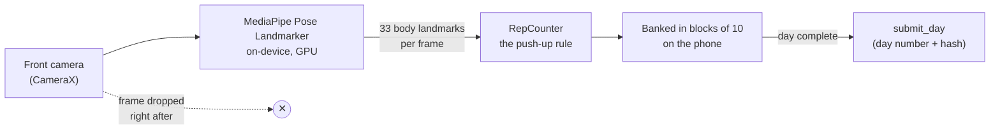

# How push-ups are counted

[← README](../README.md) · [Privacy](privacy.md) · [How it works](how-it-works.md)

Every rep is judged on the phone, live, by a pose model and a rule written down in code. Nobody
reviews video. No video exists to review.

## The pipeline

- **Model.** [MediaPipe Pose Landmarker](https://ai.google.dev/edge/mediapipe/solutions/vision/pose_landmarker),
  `pose_landmarker_full.task` (float16). It is downloaded at build time and its SHA-256 is pinned in
  [`kotlin/app/build.gradle.kts`](../kotlin/app/build.gradle.kts). It runs in live-stream mode on
  the GPU ([`VisionAnalyzer.kt`](../kotlin/app/src/main/kotlin/holdout/app/vision/VisionAnalyzer.kt)).
- **Counter.** [`kotlin/repcounter`](../kotlin/repcounter/src/main/kotlin/holdout/repcounter/) is a
  plain JVM module with no Android dependency. The same code runs on the phone and in the tests
  that replay recorded sessions.

## The rule

From [`RepCounter.kt`](../kotlin/repcounter/src/main/kotlin/holdout/repcounter/RepCounter.kt):

| Step | Condition |
|---|---|
| 1. Top | Elbow above 160°, shoulder–hip–ankle line within ±10° of straight |
| 2. Bottom | Elbow below 90°, body line held |
| 3. Top again | Elbow above 160°, body line held |
| 4. Tempo | One full cycle takes 0.8 to 6 seconds |
| 5. Legs | Straight, on the toes (Habit only) |

Angles are smoothed with a one-euro filter. The machine triggers on slightly wider values than the
rule (165° and 85°), so ~2° of model jitter can't count one descent twice. A rep that breaks the rule
is dropped quietly, with a coaching cue: *Go lower · Keep your body straight · Slow down*. It is
never an error.

## Why 45°

The phone stands on the floor, at 45° ahead of the shoulder. From there the camera sees the arm,
the body line **and** the legs. From the front, a push-up from the knees and one from the toes look
the same to the model: knee angle, knee and ankle height, hip height, torso angle and body line all
match. That's why every sitting, the free Daily 25 included, is counted at 45° only.

At 45° a locked-out arm reads 150–158° in the picture, not 180°. So the top of the rep is set **per
sitting**, from the arm you hold through the countdown, with a floor of 148° and a 10° margin.

## Spark vs Habit

[`Stakes.kt`](../kotlin/repcounter/src/main/kotlin/holdout/repcounter/Stakes.kt) holds the
difference:

- **Habit · 21-day** adds the knees-off-the-floor check. On the push back up, the knee and ankle
  must stand high enough above the hands, compared with your own plank held through the countdown.
  The knee angle is a second signal.
- **Spark · 7-day** and **the Daily 25** let push-ups from the knees count (a body line straight to
  the ankle *or* to the knee). The phone still has to be at 45°: a phone closer to head-on (beyond
  about 40°) is refused.
- All three refuse the **cobra**: hips left on the floor and only the chest pressed up. The check
  is how far the hips rise against the shoulders half-way up the push.

## Before the first rep

1. **Pre-flight checks** ([`Preflight.kt`](../kotlin/repcounter/src/main/kotlin/holdout/repcounter/Preflight.kt)):
   enough light, whole body in view, knees visible, phone at the right angle and spot. Each
   check is a pill that ticks green. A still background is advised but not required.
2. **Ready gate** ([`ReadyGate.kt`](../kotlin/repcounter/src/main/kotlin/holdout/repcounter/ReadyGate.kt)):
   hold the top of a push-up for about a second.
3. **Countdown:** 3 · 2 · 1, spoken. Then every rep counts.

## Blocks of 10

The day doesn't have to be one sitting. Each verified block of 10 is written to the phone's storage
the moment its tenth rep counts. Banked reps survive closing the app or a crash. The day completes
when banked plus current reps reach 25, so the last block can be smaller (10 + 10 + 5). When a
sitting ends, reps short of the next block are not kept, and the app says so.

## How it is tested

- **Recorded traces.** [`fixtures/rep-traces/`](../fixtures/rep-traces/) holds landmark recordings
  of real sittings: honest sets, half reps, knees, cobras, out-of-frame. They are numbers only,
  never pixels. 27 labelled sets hold 278 labelled reps.
- **Regression ratchet.** `RepRatchetTest` replays every labelled rep and holds it to
  `baseline.csv`. CI fails if any rep does worse, and also if any does better until the baseline
  is updated on purpose.
- **150 unit tests** in `:repcounter` assert the rule (never the trigger values), the pre-flight
  checks, the stakes rules and the placement logic.

## Known limits

The thresholds were measured on a small number of people and phones. Some cheats still pass at
45°: a rep let down until the hips rest on the floor, and a few cases where the head hides the near
hand. Loose trousers can hide the knees, so a Habit sitting won't start in them. Each limit, with
its real fix, is in the README's [Known weaknesses](../README.md#known-weaknesses) table.
